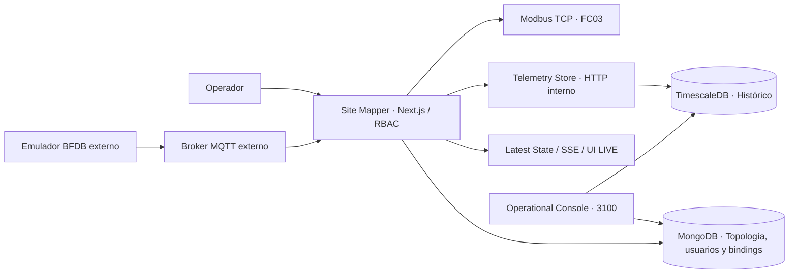
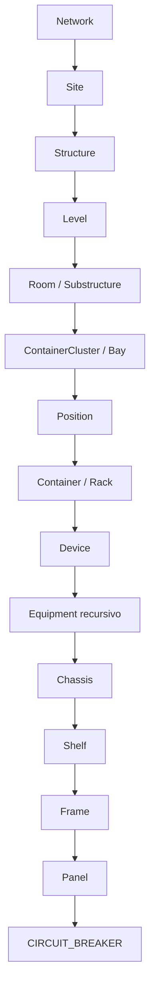
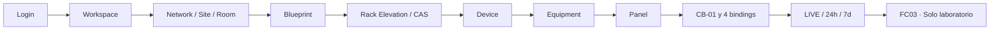

# AppM Site Mapper MK1

**Candidato a MVP presentable · Octubre 2026.**

## ¿Qué es?

Una plataforma para modelar infraestructura física (Network → Site → Room → Rack → Device → Equipment), administrar posiciones y conexiones eléctricas y consultar telemetría confirmada. El resultado del laboratorio **no equivale a certificación de producción**.

### Arquitectura



El broker/emulador/gateway exterior es independiente del repositorio. Modbus lee su Latest State, no consulta TimescaleDB durante cada FC03.

### Jerarquía



Los nombres con `/` representan alternativas del **mismo nivel**. No implican un nivel adicional. La correspondencia física nunca se infiere automáticamente de un número de slot. Consulta [topología](docs/domain/topology-hierarchy.md).

## Inicio rápido · Demo visual sin Docker

Requisitos: Node.js 22.13+ (menor a 23), npm y navegador.

```bash
git clone https://github.com/em3rc0dTh/AppM-Site-Mapper.git
cd AppM-Site-Mapper
npm ci
npm run local:dev
```

Abre **http://127.0.0.1:3000/login** y utiliza las credenciales temporales impresas en tu terminal. Este modo usa datos **en memoria**; al detenerse se pierden. No requiere broker, MongoDB ni dispositivos industriales. Para desactivar la apertura automática del navegador: `npm run local:dev -- --no-open`.

**¿Quieres persistencia?** Sigue el [quickstart de Docker](docs/operations/quickstart.md); requiere configuración privada de tokens, broker y mapa Modbus. No ejecutes `docker compose down -v` sobre datos existentes.

## Recorrido de una presentación



**[Manual del operador: aprender a crear, ubicar, conectar y verificar](docs/user-guide/README.md)** · [Guion para presentar el MVP en español](docs/product/MVP-DEMO-ES.md).

El manual está orientado a personas sin experiencia con Site Mapper. Incluye ocho lecciones, procedimientos paso a paso, diagramas de decisiones, ejercicios seguros y un guion para instructores; no requiere conocer comandos, UUID ni MongoDB.

## Evidencia real y límites

El 15 de octubre de 2026, el laboratorio comprobó **un** breaker: `BDFB-01-PANEL-01-CB-01`, `EMU-BFDB-01 / 0_1_1`, métricas V/A/W/kWh, cuatro bindings explícitos, LIVE, histórico consultable, persistencia en la TimescaleDB de Site Mapper y `MODBUS_CERT_PASS` (Unit ID 1, FC03, registros 0–7, coincidencia con una muestra histórica reciente).

La consulta **7D** volvió a presentar datos tras recuperar la conectividad del servicio histórico; esto no demuestra recuperación de muestras perdidas durante la interrupción. No está certificado el resto de los 23 breakers, 96 circuitos por BFDB, tres BFDB completos, cableado físico ni conexión a Metasys. Un cero Modbus puede significar dato expirado o valor real: no usar en control de seguridad.

[Estado, evidencia y puertas de salida del MVP](docs/release/MVP-READINESS.md).

## Código organizado

| Directorio                   | Propósito                                       |
| ---------------------------- | ----------------------------------------------- |
| `src/app` y `src/components` | Páginas, APIs y UI                              |
| `src/modules`                | Dominio, aplicación, persistencia por módulo    |
| `infra/telemetry-store`      | Histórico propio TimescaleDB                    |
| `infra/modbus-tcp`           | Salida Modbus TCP privada                       |
| `infra/operational-console`  | Consola de operación independiente              |
| `scripts` y `tests`          | Herramientas locales, migración y certificación |
| `docs`                       | Producto, arquitectura, operación y release     |

## Validación del código

```bash
npm ci
npm run typecheck
npm run lint
npm run format:check
npm run test:unit
npm run test:integration
npm run test:certification
npm run build
```

GitHub CI verifica también Modbus, SQL histórico y auditoría de dependencias. Un build exitoso no implica aceptación en el entorno del cliente.

## Seguridad

Sesiones y RBAC server-side; credenciales MQTT privadas; MongoDB con seriales activos únicos; bindings **exactos** entre publisher, raw point, métrica y Equipment. `APP_ENV=production` requiere transporte MQTT seguro. Modbus TCP no tiene autenticación propia y solo debe exponerse dentro de una red OT autorizada. Nunca subir `.env`, secretos, dumps ni topologías sensibles.

## Documentación

**Inicio recomendado para una persona nueva:** [Manual maestro de operación de Login a PowerPath y MQTT](docs/user-guide/manual-maestro.md), con [modelo de datos explicado](docs/user-guide/modelo-de-datos.md) y [catálogo de capturas reales](docs/user-guide/evidencia-visual.md). La estructura de persistencia actual permanece inalterada.

**[Índice de documentación](docs/README.md)** · [Arquitectura](docs/architecture/system-map.md) · [Guía de demostración](docs/product/MVP-DEMO-ES.md) · [Operación y diagnóstico](docs/operations/quickstart.md) · [Release](docs/release/MVP-READINESS.md) · [Limitaciones](docs/release/known-limitations.md).

[CONTRACT.md](CONTRACT.md) es el plan histórico de reconstrucción; las decisiones aceptadas en contratos de dominio, ADR y código implementado gobiernan el estado actual. Las PR divergentes no entran en este baseline sin aceptación independiente.

_English summary:_ Site Mapper is a modular, security-conscious physical infrastructure application with canonical inventory, floorplans, rack/equipment modeling and explicitly commissioned MQTT telemetry. A single synthetic BFDB breaker passed local end-to-end LIVE/history/Modbus verification; production and full-panel certification remain open.

## Integración industrial: Metasys (Modbus TCP)

La salida industrial es **solo lectura** y expone exclusivamente **voltaje (V), corriente (A), potencia (W) y energía (kWh)** mediante FC03 (Holding Registers), IEEE-754 FLOAT32 y dos registros de 16 bits por variable. El contrato compartido por el servidor y el generador permite documentar **96 circuitos por BFDB**, con mapas independientes para cada Unit ID.

- [Formato y tabla de registros para el integrador Metasys](docs/telemetry/metasys-register-map.md) · [CSV completo de laboratorio](docs/telemetry/metasys-register-map.csv).
- [Comportamiento del servicio y puesta en marcha](docs/telemetry/modbus-tcp-output.md).

El mapa CSV incluido usa identidades **sintéticas**, no topología ni seriales reales del cliente. Un registro asignado **no** certifica una medición comisionada. Por compatibilidad, la política predeterminada de dato ausente/vencido sigue devolviendo cero; existe `MODBUS_MISSING_POLICY=exception` para evaluación con el integrador. La conectividad y las reglas de lectura con el **Metasys físico** siguen pendientes de aceptación en la red OT autorizada.

### Extensión industrial MQTT/SNMP

Captura original, catálogo de señales desconocidas, alarmas Eltek rev54 y registros Modbus
adicionales con calidad explícita: [configuración, contratos y laboratorio](docs/telemetry/industrial-integration.md).
La extensión conserva las vistas y direcciones actuales; requiere comisionamiento de fuentes,
asociaciones y puntos antes de conectarse al hardware y a Metasys.

Estado del cierre industrial: [cambios y validaciones pendientes](docs/telemetry/industrial-closure-static.md).
La revisión posterior a PR #103/#10 se realizó sin ejecutar ni agregar pruebas.
