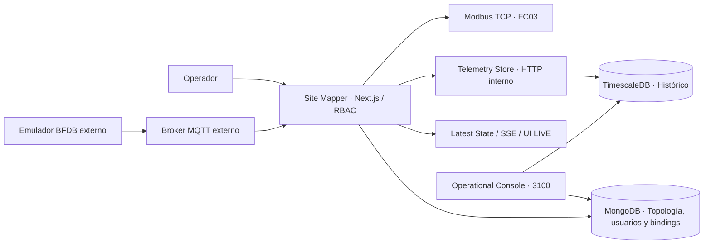
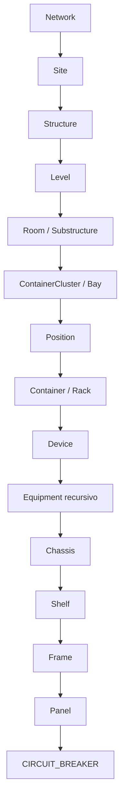
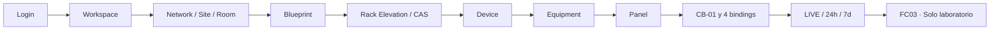

# AppM Site Mapper MK1

**Candidato a MVP presentable · Octubre 2026.**

## Empieza aquí · Sin conocimientos de sistemas

**[Manual paso a paso: Login → Workspace → BDFB → MQTT → SNMP → Timescale → Modbus](docs/user-guide/recorrido-completo-login-mqtt-snmp-modbus.md)**

**[Guía para encender el laboratorio existente en WSL/Docker, comprobarlo y ampliar SNMP](docs/operations/laboratorio-industrial-para-principiantes.md)**

Si recibiste una computadora con la instalación ya preparada, el primer comando de diagnóstico es **solo lectura**:

```bash
python3 scripts/telemetry/estado-laboratorio.py
```

No reinstales ni reconstruyas el proyecto para volver a entrar. Las cuentas, bases de datos y configuraciones de laboratorio no se regeneran al hacer `git pull`; el entorno persistente necesita sus propios archivos privados y volúmenes originales.


## ¿Qué es?

Una plataforma para modelar infraestructura física (Network → Site → Room → Rack → Device → Equipment), administrar posiciones y conexiones eléctricas y consultar telemetría confirmada. El resultado del laboratorio **no equivale a certificación de producción**.

### Arquitectura



El broker/emulador/gateway exterior es independiente del repositorio. Modbus lee su Latest State, no consulta TimescaleDB durante cada FC03.

### Jerarquía



Los nombres con `/` representan alternativas del **mismo nivel**. No implican un nivel adicional. La correspondencia física nunca se infiere automáticamente de un número de slot. Consulta [topología](docs/domain/topology-hierarchy.md).

## Inicio rápido · Demo visual sin Docker

Requisitos: Node.js 22.13+ (menor a 23), npm y navegador.

```bash
git clone https://github.com/em3rc0dTh/AppM-Site-Mapper.git
cd AppM-Site-Mapper
npm ci
npm run local:dev
```

Abre **http://127.0.0.1:3000/login** y utiliza las credenciales temporales impresas en tu terminal. Este modo usa datos **en memoria**; al detenerse se pierden. No requiere broker, MongoDB ni dispositivos industriales. Para desactivar la apertura automática del navegador: `npm run local:dev -- --no-open`.

**¿Quieres persistencia?** Sigue el [quickstart de Docker](docs/operations/quickstart.md); requiere configuración privada de tokens, broker y mapa Modbus. No ejecutes `docker compose down -v` sobre datos existentes.

## Recorrido de una presentación



**[Manual del operador: aprender a crear, ubicar, conectar y verificar](docs/user-guide/README.md)** · [Guion para presentar el MVP en español](docs/product/MVP-DEMO-ES.md).

El manual está orientado a personas sin experiencia con Site Mapper. Incluye ocho lecciones, procedimientos paso a paso, diagramas de decisiones, ejercicios seguros y un guion para instructores; no requiere conocer comandos, UUID ni MongoDB.

## Evidencia real y límites (actualizada el 24 de octubre de 2026)

El cierre histórico del **15 de octubre** certificó un solo breaker MQTT original y Modbus Unit 1; sigue disponible en los receipts originales. **Los trabajos posteriores del laboratorio no deben confundirse con ese estado anterior.**

En la rama de trabajo del **24 de octubre** se observó:

- Dos BDFB LAB, **96 breakers MQTT por equipo** (cuatro paneles de 24), con inventario, bindings, LIVE, histórico persistido en TimescaleDB y un panel con 24/24 MQTT LIVE mostrado por el operador.
- Gateway Modbus con **Units 1–3 originales preservadas** y Units **4–5** añadidas para los LAB, **FC03 8/8** en ocho bloques representativos (no en los 192 breakers completos ni en un Metasys físico).
- **BDFB-01 SNMPv3 sintético Config2 A/B**: dos shunts simulados, cuatro OIDs, nueve publicaciones aceptadas por el colector y gráficas independientes A/B en TimescaleDB visibles en la aplicación.
- **BDFB-02/03 SNMPv3 Config2 A/B**: código y proceso aditivo preparados, **aún sin ejecución ni aceptación local**. Su activación exige revisión del plan, copia de seguridad y confirmación de que los shunts son exclusivamente sintéticos.

Estas evidencias son de **laboratorio**, no de autenticación SNMP de campo, shunts instalados, redes OT, integridad eléctrica o interoperabilidad física Metasys. [Registro técnico detallado](docs/telemetry/industrial-unified-lab.md) y [evidencia visual BDFB-01 SNMP](docs/telemetry/bdfb01-snmp-ui-acceptance-2026-10-24.md).

## Código organizado

| Directorio                   | Propósito                                       |
| ---------------------------- | ----------------------------------------------- |
| `src/app` y `src/components` | Páginas, APIs y UI                              |
| `src/modules`                | Dominio, aplicación, persistencia por módulo    |
| `infra/telemetry-store`      | Histórico propio TimescaleDB                    |
| `infra/modbus-tcp`           | Salida Modbus TCP privada                       |
| `infra/operational-console`  | Consola de operación independiente              |
| `scripts` y `tests`          | Herramientas locales, migración y certificación |
| `docs`                       | Producto, arquitectura, operación y release     |

## Validación del código

```bash
npm ci
npm run typecheck
npm run lint
npm run format:check
npm run test:unit
npm run test:integration
npm run test:certification
npm run build
```

GitHub CI verifica también Modbus, SQL histórico y auditoría de dependencias. Un build exitoso no implica aceptación en el entorno del cliente.

## Seguridad

Sesiones y RBAC server-side; credenciales MQTT privadas; MongoDB con seriales activos únicos; bindings **exactos** entre publisher, raw point, métrica y Equipment. `APP_ENV=production` requiere transporte MQTT seguro. Modbus TCP no tiene autenticación propia y solo debe exponerse dentro de una red OT autorizada. Nunca subir `.env`, secretos, dumps ni topologías sensibles.

## Documentación

**Inicio recomendado para una persona nueva:** [Manual maestro de operación de Login a PowerPath y MQTT](docs/user-guide/manual-maestro.md), con [modelo de datos explicado](docs/user-guide/modelo-de-datos.md) y [catálogo de capturas reales](docs/user-guide/evidencia-visual.md). La estructura de persistencia actual permanece inalterada.

**[Índice de documentación](docs/README.md)** · [Arquitectura](docs/architecture/system-map.md) · [Guía de demostración](docs/product/MVP-DEMO-ES.md) · [Operación y diagnóstico](docs/operations/quickstart.md) · [Release](docs/release/MVP-READINESS.md) · [Limitaciones](docs/release/known-limitations.md).

[CONTRACT.md](CONTRACT.md) es el plan histórico de reconstrucción; las decisiones aceptadas en contratos de dominio, ADR y código implementado gobiernan el estado actual. Las PR divergentes no entran en este baseline sin aceptación independiente.

_English summary:_ Site Mapper is a modular, security-conscious physical infrastructure application with canonical inventory, floorplans, rack/equipment modeling and explicitly commissioned MQTT telemetry. The Oct 2026 synthetic lab includes two 96-breaker MQTT BDFBs, representative Modbus FC03 Units 4/5 verification, and SNMPv3 Config2 A/B end-to-end visual evidence for BDFB-01. BDFB-02/03 SNMP is prepared but not yet deployed; physical field certification remains open.

## Integración industrial: Metasys (Modbus TCP)

La salida industrial es **solo lectura** y expone exclusivamente **voltaje (V), corriente (A), potencia (W) y energía (kWh)** mediante FC03 (Holding Registers), IEEE-754 FLOAT32 y dos registros de 16 bits por variable. El contrato compartido por el servidor y el generador permite documentar **96 circuitos por BFDB**, con mapas independientes para cada Unit ID.

- [Formato y tabla de registros para el integrador Metasys](docs/telemetry/metasys-register-map.md) · [CSV completo de laboratorio](docs/telemetry/metasys-register-map.csv).
- [Comportamiento del servicio y puesta en marcha](docs/telemetry/modbus-tcp-output.md).

El mapa CSV incluido usa identidades **sintéticas**, no topología ni seriales reales del cliente. Un registro asignado **no** certifica una medición comisionada. Por compatibilidad, la política predeterminada de dato ausente/vencido sigue devolviendo cero; existe `MODBUS_MISSING_POLICY=exception` para evaluación con el integrador. La conectividad y las reglas de lectura con el **Metasys físico** siguen pendientes de aceptación en la red OT autorizada.

### Extensión industrial MQTT/SNMP

Captura original, catálogo de señales desconocidas, alarmas Eltek rev54 y registros Modbus
adicionales con calidad explícita: [configuración, contratos y laboratorio](docs/telemetry/industrial-integration.md).
La extensión conserva las vistas y direcciones actuales; requiere comisionamiento de fuentes,
asociaciones y puntos antes de conectarse al hardware y a Metasys.

Estado del cierre industrial: [cambios y validaciones pendientes](docs/telemetry/industrial-closure-static.md).
La revisión posterior a PR #103/#10 se realizó sin ejecutar ni agregar pruebas.

Laboratorio MQTT/SNMP unificado: [procedimiento para principiantes](docs/operations/laboratorio-industrial-para-principiantes.md) · [runbook industrial y evidencias](docs/telemetry/industrial-unified-lab.md).
