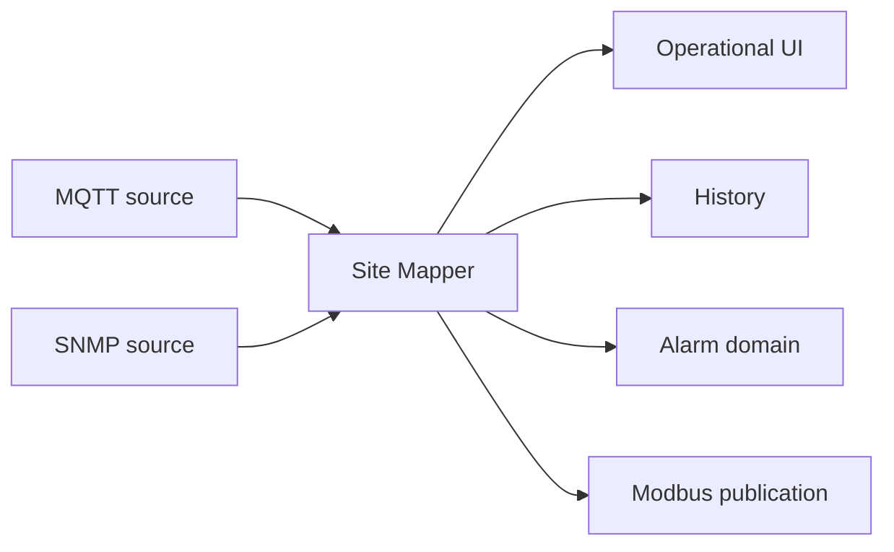
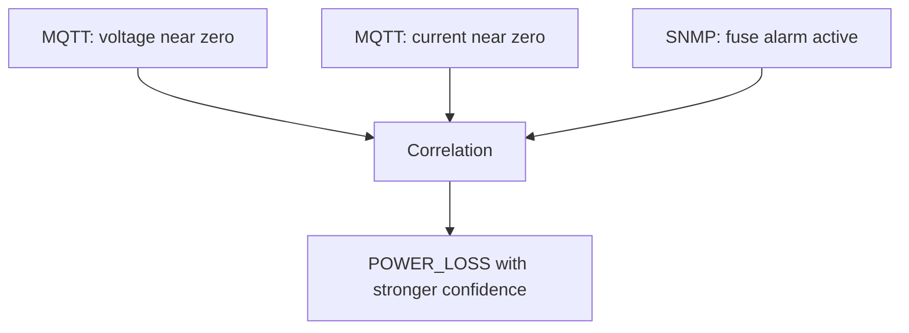
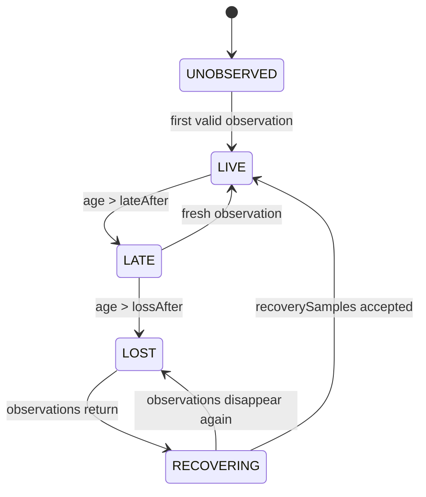
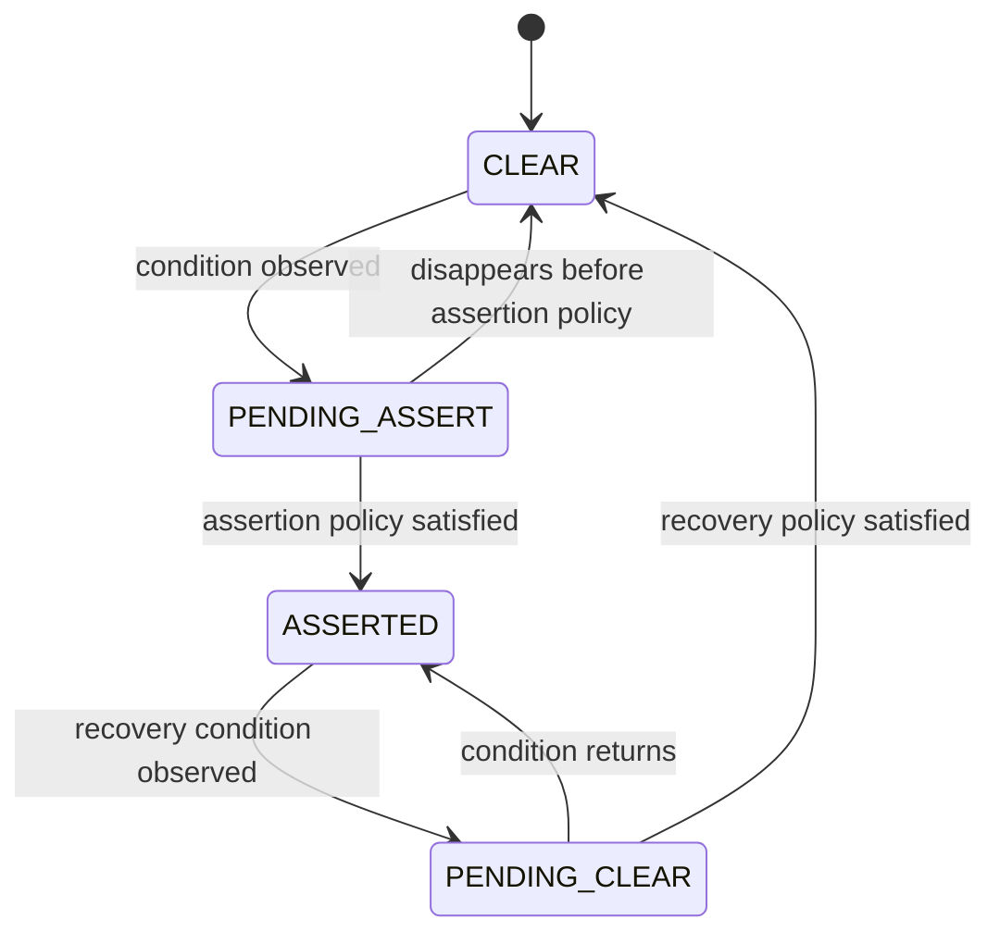
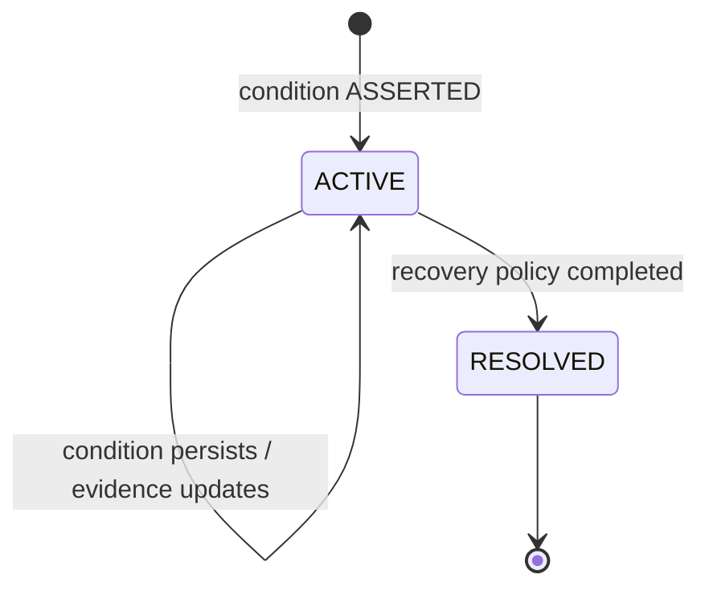
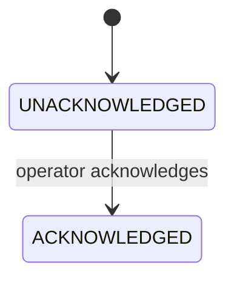
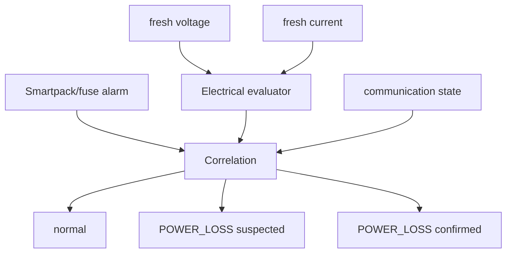
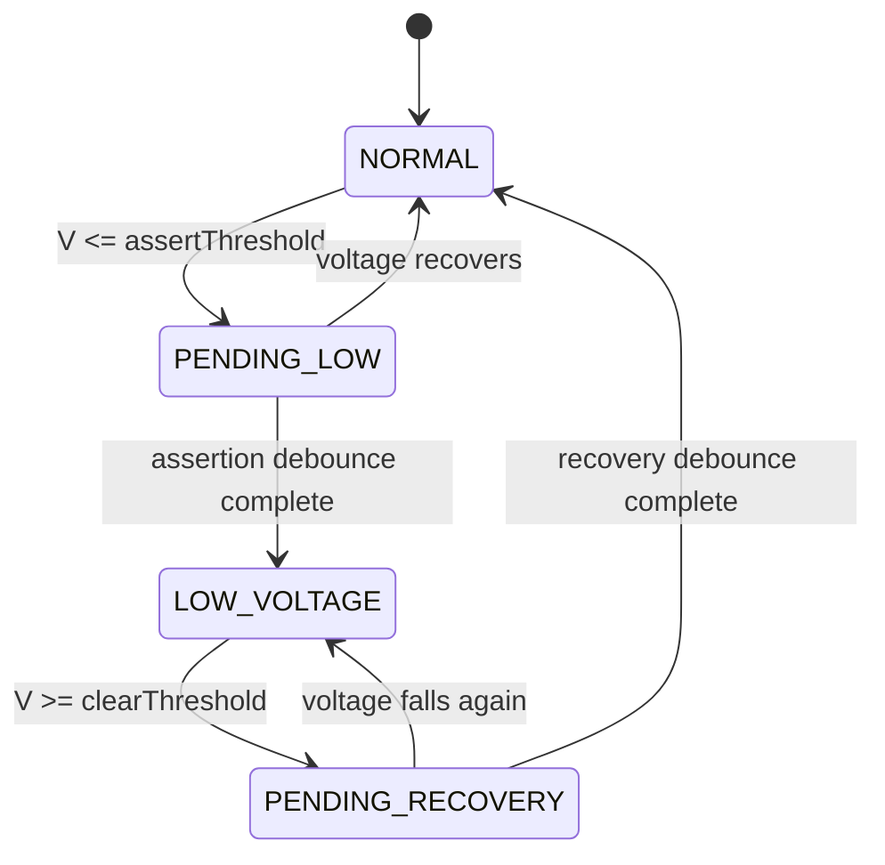
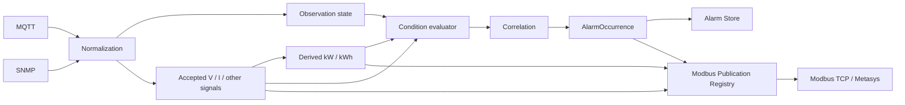

# Site Mapper MK1 — Alarm Domain, State Machines and Industrial Publication

**Status:** architecture/design baseline. This document defines the alarm-domain model and state-machine semantics approved for the current Site Mapper direction. It is not a claim that the complete Alarm Engine or Alarm Center UI is already implemented.

**Related boundaries:**
- MQTT provider/topic configuration: [Telemetry contract](../telemetry/contract.md)
- SNMP industrial ingestion: [Industrial integration](../telemetry/industrial-integration.md)
- Modbus/Metasys publication: [Modbus TCP output](../telemetry/modbus-tcp-output.md)

---

## 0. Architectural invariants

The alarm design must preserve the following invariants.

### 0.1 MQTT routing is runtime configuration, not a production constant

The current laboratory contract may use a filter such as `data/dev/#`, but production topic names are not assumed.

```text
LAB/current evidence
    MQTT topic/filter
          ↓
runtime configuration
          ↓
Site Mapper

FIELD
    provider-approved topic/filter
          ↓
same runtime contract
          ↓
Site Mapper
```

The application must continue to obtain the provider configuration from runtime variables such as `MQTT_TOPIC_FILTER` and `MQTT_TOPIC_PREFIX`. A production topic change must not require changing the alarm domain or the physical UI.

### 0.2 Missing telemetry is not electrical zero

```text
missing sample != zero
missing field  != zero
silence        != power loss
```

A communication gap is evidence about observability. It is not by itself proof of electrical failure.

### 0.3 Site Mapper remains the operational authority

MQTT and SNMP are sources. Site Mapper owns the accepted normalized state, historical interpretation, alarms, correlation and industrial projection.



### 0.4 Accepted operational data must be publishable through the governed Modbus contract

Signals approved for industrial publication must receive a stable, versioned publication reference. This includes normalized measurements, approved derived values and alarm states.

This does **not** mean arbitrary RAW values are coerced into FLOAT32. Unknown strings, binary values, unknown numeric OIDs and uncommissioned fields remain RAW until an explicit publication definition exists.

### 0.5 Existing Modbus references are immutable

The current legacy register block remains unchanged. New industrial points use the governed extension registry.

```text
legacy block:       0..767         NO REASSIGNMENT
industrial extension: >= 1024      stable / versioned / append-only
```

---

# Part 1 — Alarm domain model

## 1.1 Definition

An alarm is a first-class operational entity derived from observable evidence.

It is **not** equivalent to:

- a UI color;
- a stale telemetry badge;
- one MQTT message;
- one SNMP object;
- one missing packet;
- one numeric threshold crossing without policy.

Canonical relationship:

```text
observation
    ↓
operational state
    ↓
condition
    ↓
alarm policy
    ↓
alarm occurrence
```

## 1.2 Alarm families

The initial model recognizes four families.

| Family | Meaning | Typical examples |
| --- | --- | --- |
| `COMMUNICATION` | Observability or transport degradation | `TELEMETRY_LOSS` |
| `ELECTRICAL` | Electrical condition observed from accepted measurements | `LOW_VOLTAGE`, `OVERCURRENT` |
| `EQUIPMENT` | Condition explicitly reported by hardware/controller | `FUSE_ALARM`, `CONTROLLER_ALARM` |
| `CORRELATED` | Operational conclusion supported by more than one evidence stream | `POWER_LOSS` with confidence |

The families prevent a transport failure from being silently converted into an electrical diagnosis.

## 1.3 Domain entities

### AlarmDefinition

An `AlarmDefinition` describes the stable alarm type and its policy.

```text
AlarmDefinition
├── code
├── family
├── name
├── description
├── applicableTargetTypes
├── defaultSeverity
├── ruleVersion
├── assertionPolicy
├── recoveryPolicy
├── publicationDefinition?
└── enabled
```

Thresholds and timing are configuration/policy, not hard-coded UI behavior.

### AlarmOccurrence

An `AlarmOccurrence` is one real operational incident.

```text
AlarmOccurrence
├── id
├── alarmCode
├── targetType
├── targetId
├── sourceContext
├── openedAt
├── lastObservedAt
├── resolvedAt?
├── severity
├── confidence?
├── acknowledgement
├── correlationKey
├── ruleVersion
└── evidenceRefs[]
```

An alarm must identify **what is affected**. Examples include BDFB, panel, breaker, feed/access port, gateway or controller.

### AlarmEvidence

`AlarmEvidence` records why Site Mapper considers the condition real.

Possible evidence includes:

```text
MQTT
  sourceIdentity
  rawPointId
  metric
  value/unit
  observedAt

SNMP
  sourceIdentity
  OID
  rawValue
  interpreted state
  observedAt

WATCHDOG
  sourceIdentity
  lastObservedAt
  expected cadence
  elapsed time
```

The alarm domain references the underlying evidence rather than copying the entire telemetry history into the alarm record.

### AlarmTransition

State changes are historical events, not destructive updates.

```text
AlarmTransition
├── alarmOccurrenceId
├── fromState
├── toState
├── occurredAt
├── reason
├── evidenceRefs[]
├── actor?
└── metadata
```

This supports a trustworthy timeline:

```text
condition detected
alarm asserted
severity/confidence changed
operator acknowledged
condition recovered
alarm resolved
```

## 1.4 Identity and deduplication

Repeated evaluation of the same active condition must not create a new alarm every cycle.

A stable correlation key is derived from the affected target, alarm definition and relevant source context.

```text
correlationKey =
  targetId
  + alarmCode
  + source context
```

While the condition persists, the same `AlarmOccurrence` is updated with evidence and timestamps.

After resolution, a later recurrence creates a new occurrence.

## 1.5 Condition and alarm are separate concepts

```text
Condition
    ↓
Alarm policy
    ↓
AlarmOccurrence
```

The condition evaluator can observe a threshold crossing or stale source without immediately opening an alarm. Debounce, hysteresis, maintenance mode and recovery policy belong between observation and occurrence.

## 1.6 Watchdog model

A monitored telemetry point/source can define freshness policy.

```text
TelemetryWatch
├── targetId
├── sourceIdentity
├── sourcePointId?
├── expectedInterval
├── lateAfter
├── lossAfter
├── recoverySamples
└── lastObservedAt
```

The watchdog can establish that telemetry is missing. It cannot alone establish that power is missing.

## 1.7 Correlation

Correlation combines independent evidence without destroying the originals.

Example:



A different combination may support a communications conclusion instead:

```text
one MQTT point disappears
+ Smartpack remains normal
+ sibling feeds remain normal
→ likely metering/communication problem
```

Correlation is therefore evidence strengthening, not automatic causation.

## 1.8 Acknowledgement is not resolution

Acknowledgement records that an operator has seen the alarm.

It does not change the physical condition.

```text
condition = ACTIVE
ack        = ACKNOWLEDGED
```

is valid and means the fault is still present.

## 1.9 Persistence boundary

The planned authority is MongoDB because alarm definitions, occurrences, acknowledgements and transitions are operational entities tied to canonical topology.

Planned collections:

```text
alarm_definitions
alarm_occurrences
alarm_transitions
alarm_evidence_refs
```

Telemetry history remains in its existing stores. Alarm records reference the supporting evidence.

## 1.10 Initial alarm catalog

The initial V1 catalog should remain deliberately small.

| Code | Family | Primary evidence |
| --- | --- | --- |
| `TELEMETRY_LOSS` | COMMUNICATION | MQTT/SNMP watchdog |
| `LOW_VOLTAGE` | ELECTRICAL | voltage |
| `OVERCURRENT` | ELECTRICAL | current |
| `POWER_LOSS` | ELECTRICAL/CORRELATED | voltage/current plus optional corroboration |
| `FUSE_ALARM` | EQUIPMENT | SNMP/controller |
| `CONTROLLER_ALARM` | EQUIPMENT | SNMP/controller |
| `DATA_QUALITY_DEGRADED` | COMMUNICATION/DATA | invalid/stale/insufficient coverage |

Additional alarm types can be added when more of the observed SNMP space is understood and commissioned.

---

# Part 2 — Alarm state machines

The system uses separate state machines for observation, condition evaluation, alarm lifecycle and acknowledgement.

This separation is mandatory: a source becoming stale is not itself an electrical state transition.

## 2.1 Observation state

Canonical observation states:

```text
UNOBSERVED
LIVE
LATE
LOST
RECOVERING
```



The times are profile/configuration values. Production cadence is not assumed from the laboratory cadence.

## 2.2 Condition state

Canonical condition states:

```text
CLEAR
PENDING_ASSERT
ASSERTED
PENDING_CLEAR
```



This machine owns debounce and hysteresis.

## 2.3 Debounce

A threshold crossing may enter `PENDING_ASSERT` before becoming an alarm.

Example:

```text
voltage below configured threshold
        ↓
PENDING_ASSERT
        ↓ if it persists long enough
ASSERTED
```

Exact thresholds and durations belong to commissioning/profile configuration.

## 2.4 Hysteresis

Assertion and recovery thresholds may differ.

Conceptual example:

```text
ASSERT when V <= configured low threshold
CLEAR  when V >= configured recovery threshold
```

This avoids alarm chatter around one boundary.

## 2.5 AlarmOccurrence state

Once the condition reaches `ASSERTED`, an occurrence is created.

Canonical lifecycle:

```text
ACTIVE
RESOLVED
```



`RESOLVED` is terminal for that occurrence. A later failure creates a new occurrence.

A temporary recovery that returns to `ASSERTED` while still in `PENDING_CLEAR` continues the same occurrence.

## 2.6 Acknowledgement state

Acknowledgement is an independent dimension.

```text
UNACKNOWLEDGED
ACKNOWLEDGED
```



The first version does not define manual unacknowledgement.

## 2.7 Severity

Initial operational severities:

```text
INFO
WARNING
CRITICAL
```

Severity is independent of lifecycle and may escalate while one occurrence remains active.

## 2.8 Confidence

Correlated alarms may carry confidence:

```text
SUSPECTED
CONFIRMED
```

Confidence is not a lifecycle state.

Example:

```text
state      ACTIVE
severity   WARNING
confidence SUSPECTED
```

may evolve to:

```text
state      ACTIVE
severity   CRITICAL
confidence CONFIRMED
```

without creating a second occurrence.

## 2.9 Telemetry loss versus power loss

A missing publisher/point produces an observability condition.

```text
LIVE
  ↓
LATE
  ↓
LOST
  ↓
TELEMETRY_LOSS
```

It does **not** directly produce `POWER_LOSS`.

Electrical loss requires electrical evidence and/or correlation.



## 2.10 Hardware alarm silence does not clear hardware alarm state

If the last explicit Smartpack/controller evidence was `FUSE_ALARM ACTIVE` and SNMP subsequently disappears:

```text
FUSE_ALARM       remains ACTIVE
SNMP watchdog    may assert TELEMETRY_LOSS
```

Silence cannot be treated as an explicit hardware clear.

## 2.11 Low-voltage state example



## 2.12 Overcurrent state example

```text
I >= configured assert threshold
        ↓
PENDING_ASSERT
        ↓
OVERCURRENT ACTIVE

I <= configured clear threshold
        ↓
PENDING_CLEAR
        ↓
RESOLVED
```

Thresholds can use approved rated-current/overload commissioning data.

## 2.13 SNMP equipment alarm example

An explicit hardware signal such as `Fuse Alarm ON` may use a zero or short assertion debounce if the corresponding `AlarmDefinition` allows it.

```text
SNMP Fuse Alarm ON
        ↓
ASSERTED
        ↓
FUSE_ALARM ACTIVE
```

An explicit `OFF` then enters the configured recovery path and eventually resolves the occurrence.

## 2.14 Power and energy as derived operational signals

For a DC feed with temporally aligned, commissioned voltage and current:

```text
P(kW) = |V| × I / 1000
```

Energy is an integration over covered time, not a value inferred from one observation:

```text
E(kWh) = integral of P(kW) over time
```

Site Mapper must not interpolate large telemetry gaps as if continuous energy consumption were observed. Coverage/quality remains separate from the derived energy value.

This allows alarm policies to use power/energy only when their evidence quality is sufficient.

---

# Industrial / Modbus publication contract

Alarm semantics and derived signals must be compatible with the governed Modbus publication model.

## Stable logical publication identity

Modbus references a stable logical signal/alarm definition, not an occurrence UUID.

Example:

```text
QDF4.A3.POWER_LOSS
```

not:

```text
alarmOccurrence-<uuid>
```

## Suggested alarm publication semantics

The exact addresses are assigned only by the publication registry.

| Logical value | Suggested type | Semantic values |
| --- | --- | --- |
| `ALARM_STATE` | UINT16 | 0 = clear/resolved, 1 = active |
| `ALARM_ACK` | UINT16 | 0 = unacknowledged, 1 = acknowledged |
| `ALARM_SEVERITY` | UINT16 | 0 none, 1 info, 2 warning, 3 critical |
| `ALARM_CONFIDENCE` | UINT16 | 0 none, 1 suspected, 2 confirmed |
| `QUALITY` | UINT16 | governed quality enumeration |

Approved normalized/derived measurements may use engineering values such as:

```text
Voltage   FLOAT32 V
Current   FLOAT32 A
Power     FLOAT32 kW
Energy    FLOAT32 kWh
```

The existing legacy Modbus layout is not silently rewritten. New alarm/derived points belong to the industrial extension registry and must preserve address, datatype, unit, word order, quality reference and meaning once published.

---

# Combined semantic model



The alarm engine never owns register addresses directly. Publication remains an independent, stable contract.

---

# Current status and next design steps

This document freezes **Part 1 — alarm domain model** and **Part 2 — state machines** as the current architecture direction.

The following remain deliberately open:

## Part 3 — UI placement and presentation

To design next:

- alarm visibility at BDFB/QDF level;
- A3/B3 panel summaries;
- individual breaker rows;
- Inspector alarm summary;
- global navigation / Alarm Center;
- distinction between telemetry status and alarm state;
- use of V / A / kW / kWh in the physical view;
- alarm counters, severity and acknowledgement affordances.

## Part 4 — operational wireframe

Still to define:

- exact screen composition;
- table columns;
- badges and compact indicators;
- alarm drawer/detail;
- evidence timeline;
- acknowledgement interaction;
- historical navigation;
- mobile/responsive behavior if required.

Neither Part 3 nor Part 4 is frozen by this document.
