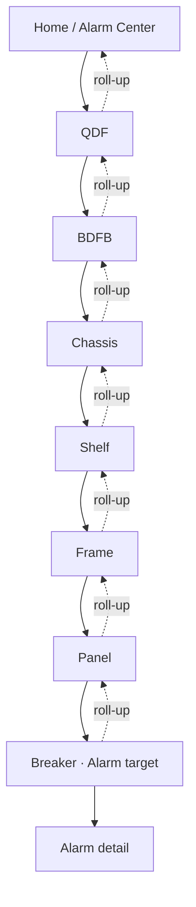
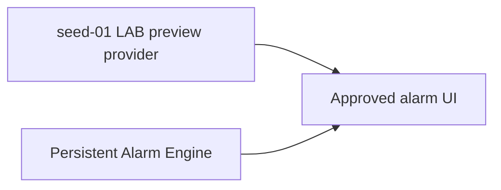

# Site Mapper MK1 — Part 4: Operational Alarm Wireframe and Interaction

**Status:** approved visual/interaction baseline, 2026-10-30.

**Implementation status:** the branch **feat/alarm-operational-ui-2026-10-30** implements the approved presentation vertical slice for the **seed-01** laboratory. The persistent production Alarm Engine, Mongo alarm collections and durable acknowledgement history remain separate follow-up work.

**Depends on:**

- [Alarm Domain and State Machines](alarm-domain-and-state-machine.md)
- [Alarm UI Placement and Presentation](alarm-ui-placement.md)

---

## 1. Purpose

Part 4 freezes how an operator discovers, follows, inspects and acknowledges an alarm without breaking the physical-navigation model already used by Site Mapper.

```text
operator navigation:   TOP → DOWN
alarm visibility:      BOTTOM → UP
alarm ownership:       REAL TARGET
```

For a breaker-targeted occurrence:



There is still only one **AlarmOccurrence**. Ancestor badges are projections.

---

## 2. Laboratory truth boundary

The approved visual behavior needs real Site Mapper screens for validation before the production alarm engine exists. The implementation branch therefore contains an explicitly bounded **seed-01 LAB preview**.

Preview activation requires both:

```text
APP_ENV != production
SITE_MAPPER_SEED_PROFILE == seed-01
```

The preview projects two deterministic visual fixtures onto canonical existing Equipment:

```text
A3-04
  POWER_LOSS
  CRITICAL
  CONFIRMED

A3-03
  TELEMETRY_LOSS
  WARNING
```

These fixtures exercise the UI and hierarchy. They are **not field-certified Telxius alarm evidence** and do not claim that those physical breakers are currently failing.

The preview uses the real topology IDs and canonical parent ancestry. It creates no synthetic Shelf/Frame/Panel telemetry.

### 2.1 Preview acceptance scope

The preview allows visual validation of:

- Home alarm summary;
- global alarm navigation;
- topology-tree roll-up;
- QDF scope;
- BDFB physical view;
- Chassis → Shelf → Frame → Panel drill-down;
- breaker target;
- Alarm Center;
- Alarm Detail;
- acknowledgement interaction;
- responsive presentation.

It does **not** certify production alarm evaluation, durable Mongo alarm persistence, field causation, Modbus alarm publication or Metasys interoperability.

---

## 3. Global navigation

The top bar exposes one operational alarm entry:

```text
[ Search ] [ ⚠ ALARMS 2 ] [ EXPLORE ] [ WAREHOUSE ] [ ADMIN ]
```

The global count is occurrence-based. Roll-up visibility at ancestors never multiplies the count.

---

## 4. Home / Infrastructure overview

Home exposes active alarms before the operator enters a QDF.

```text
INFRASTRUCTURE OVERVIEW

[ Equipment ] [ Reporting ] [ No recent data ]

┌──────────────── ACTIVE ALARMS ────────────────┐
│ 1 Critical · 1 Warning · 0 Info              │
│                                               │
│ POWER LOSS       ... / A3 / A3-04           │
│ CRITICAL         [ Go to target → ]          │
│                                               │
│ TELEMETRY LOSS   ... / A3 / A3-03           │
│ WARNING          [ Go to target → ]          │
│                              [ View all → ]   │
└───────────────────────────────────────────────┘
```

Home is a navigation surface, not a new alarm owner.

---

## 5. Hierarchical tree

Every canonical ancestor of an active target receives a compact roll-up badge.

```text
QDF4                          🔴 2
└─ BDFB QDF-4                 🔴 2
   └─ QDF-4 Chassis           🔴 2
      └─ QDF-4-SHELF-01       🔴 2
         └─ FRAME-01          🔴 2
            └─ A3             🔴 2
               ├─ A3-03       🟠 1
               └─ A3-04       🔴 1
```

The highest severity drives the compact visual tone while the count remains occurrence-based.

---

## 6. QDF / Rack Elevation

The QDF elevation keeps its existing physical meaning and gains:

- descendant alarm banner;
- tree badges;
- Inspector alarm summary;
- direct navigation to affected equipment.

QDF itself does not acquire breaker telemetry because a descendant is alarmed.

---

## 7. BDFB Physical View

The existing BDFB physical diagram remains authoritative. Panels containing alarmed descendants are marked without taking alarm ownership.

```text
FRAME-01                         FRAME-02
┌──────────────────────┐         ┌──────────────────────┐
│ A3       🔴 2        │         │ B3       NORMAL     │
│ 6 installed          │         │ 6 installed         │
│ 1 critical           │         │                     │
│ 1 warning            │         │                     │
└──────────────────────┘         └──────────────────────┘

P01 ●  P02 ●  P03 🟠  P04 🔴  P05 ●  P06 ●
```

Installed-circuit presentation separates observability and alarms:

```text
POS   BREAKER   V     I     P     E      STATE    ALARM
03    A3-03     ...   ...   ...   ...    STALE    WARNING
04    A3-04     ...   ...   ...   ...    LIVE     CRITICAL
```

**LIVE does not mean healthy.**

---

## 8. Structural hierarchy

Chassis, Shelf and Frame show descendant alarm summaries and identify the affected immediate child.

```text
Chassis
  2 descendant alarms
  affected child → Shelf-01

Shelf-01
  2 descendant alarms
  affected child → Frame-01

Frame-01
  2 descendant alarms
  affected child → A3
```

Structural roll-up never invents V/A/kW/kWh for those nodes.

---

## 9. Panel

Panel is the transition from structural navigation to circuit-level evidence.

```text
A3

2 ACTIVE ALARMS
1 Critical · POWER LOSS
1 Warning  · TELEMETRY LOSS

POS   BREAKER   V     I     P      E      STATUS   ALARM
01    A3-01     ...   ...   ...    ...    LIVE     —
03    A3-03     ...   ...   ...    ...    STALE    WARNING
04    A3-04     ...   ...   ...    ...    LIVE     CRITICAL
```

Alarm state never rewrites a missing or stale measurement as zero.

---

## 10. Breaker target

When selected Equipment is the real alarm target, a direct alarm hero appears before normal Equipment Composition.

```text
CRITICAL ALARM · LAB PREVIEW
POWER LOSS

ACTIVE · CONFIRMED · UNACKNOWLEDGED

[ ACKNOWLEDGE ] [ VIEW ALARM DETAIL → ]
```

The normal breaker identity, telemetry and PowerPath functions remain available underneath.

---

## 11. Alarm Center

Alarm Center answers: **What requires attention now?**

Canonical columns:

| Field      | Meaning                               |
| ---------- | ------------------------------------- |
| Severity   | INFO / WARNING / CRITICAL             |
| Alarm      | stable alarm code/name                |
| Target     | real alarm owner                      |
| Path       | canonical physical ancestry           |
| Since      | occurrence opening time               |
| ACK        | acknowledgement state                 |
| Confidence | SUSPECTED / CONFIRMED when applicable |
| Actions    | Open Detail / Go to Target            |

One occurrence appears once regardless of how many ancestor scopes display it.

---

## 12. Alarm Detail

The full alarm view contains:

1. lifecycle and severity;
2. canonical target/path;
3. latest accepted measurements when available;
4. evidence separated by source;
5. event timeline;
6. acknowledgement;
7. direct navigation to target.

Evidence remains source-aware:

```text
Telemetry / MQTT
Controller / SNMP
Watchdog / observability
Correlation
```

The timeline preserves the lifecycle:

```text
condition detected
       ↓
alarm asserted
       ↓
confidence / severity change
       ↓
operator ACK
       ↓
recovery detected
       ↓
alarm resolved
```

Automatic alarms have no manual Resolve button.

---

## 13. Acknowledgement

ACK means **seen**, not **fixed**.

```text
ACTIVE + ACKNOWLEDGED
```

is valid.

In the seed-01 preview, ACK is process-memory only and resets when the application process/container restarts. Durable ACK belongs to the persistent Alarm Engine phase.

---

## 14. Navigation modes

Both routes are mandatory.

### Investigative

```text
Home
→ QDF
→ BDFB
→ Chassis
→ Shelf
→ Frame
→ Panel
→ Breaker
→ Alarm Detail
```

### Direct

```text
Home alarm → target
Alarm Center → target
Alarm Center → Alarm Detail → target
```

Deep links preserve enough ancestry for breadcrumbs and tree context.

---

## 15. Empty and unavailable states

These are different:

```text
NO ACTIVE ALARMS
```

means evaluation completed and no active occurrence exists.

```text
ALARM STATUS UNAVAILABLE
```

means alarm state could not be obtained.

Unavailable must never be rendered as healthy.

---

## 16. Responsive behavior

Desktop preserves the established Site Mapper structure:

```text
Topology | Stage | Inspector
```

At smaller widths:

- alarm tables scroll horizontally;
- hero actions wrap below the alarm identity;
- Alarm Center stats collapse to fewer columns;
- tree badges stay compact;
- text/icon semantics remain available without relying on color alone.

---

## 17. Replacement boundary

The approved UI consumes occurrences and roll-ups. The seed preview can later be replaced by the persistent engine without redesigning the hierarchy.



Production follow-up still requires:

- alarm definitions;
- Mongo alarm occurrences and transitions;
- evidence references;
- durable acknowledgements;
- condition policy evaluation;
- correlation/recovery;
- governed Modbus alarm publication;
- production acceptance.

Part 4 freezes the **operator experience**, not a false claim that the persistent production Alarm Engine is already complete.
