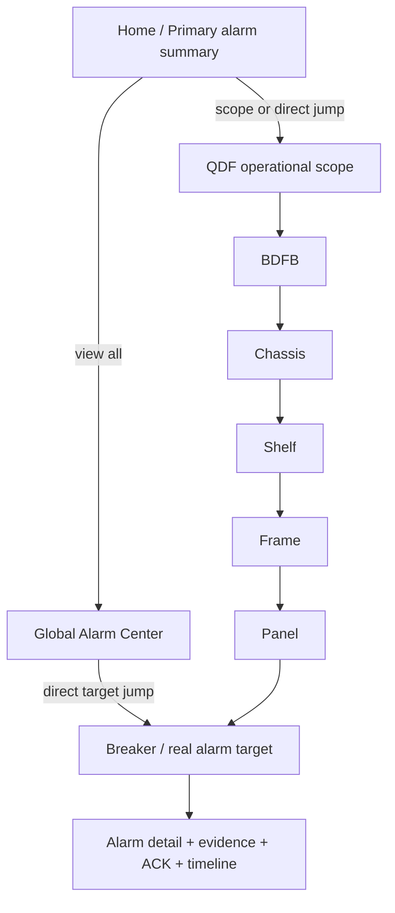

# Site Mapper MK1 — Alarm UI Placement and Presentation

**Status:** approved Part 3 design baseline, 2026-10-29.

**Visual basis:** the approved BDFB QDF-4 alarm mock derived from the current physical view. The mock is a visual design reference; this document is the canonical semantic description so implementation does not depend on pixels or a generated image.

**Depends on:** [Alarm Domain and State Machines](alarm-domain-and-state-machine.md).

---

## 1. Purpose

Alarm presentation must augment the existing physical/operational hierarchy without replacing it.

The same `AlarmOccurrence` may be summarized at several ancestor scopes, but it must not be duplicated merely because it is visible at breaker, panel, BDFB and global levels.

```text
Breaker alarm
    ↓ roll-up only
Panel summary
    ↓ roll-up only
BDFB summary
    ↓ roll-up only
Global Alarm Center
```

One incident remains one incident.

### 1.1 Navigation invariant — top-down navigation, bottom-up alarm visibility

The operator navigates **down** the physical hierarchy while alarm visibility rolls **up** from the real affected target.

For an alarm whose target is a breaker, the operational experience is:

```text
QDF scope
  ↓ operator drills down
BDFB
  ↓
Chassis
  ↓
Shelf
  ↓
Frame
  ↓
Panel
  ↓
Breaker target
```

The alarm itself is visible in the opposite direction as a descendant summary:

```text
Breaker target            ← owns the AlarmOccurrence
  ↑ descendant roll-up
Panel
  ↑
Frame
  ↑
Shelf
  ↑
Chassis
  ↑
BDFB
  ↑
QDF operational scope
  ↑
Global Alarm Center
```

For every ACTIVE `AlarmOccurrence`:

```text
visible scopes =
  target
  + every canonical ancestor(target)
  + global operational scope
```

The implementation must follow the canonical `parentId` / `parentEquipmentId` ancestry. It must **not** hard-code a mandatory list of labels such as Shelf → Frame → Panel, because supported physical compositions may vary.

Ancestor visibility means **contains an alarmed descendant**. It does not transfer ownership of the alarm to the ancestor.

### 1.2 Telemetry ownership invariant

Structural hierarchy and telemetry ownership are separate concerns.

In the current BDFB/QDF model:

- Shelf, Frame and Panel are structural Equipment and do not become telemetry producers merely because alarm state is displayed on them.
- Metering devices / commissioned telemetry bindings provide measurements associated with the monitored circuit breaker or another explicitly commissioned target.
- The breaker (or other explicitly bound target) may own the detailed telemetry/evidence used by the Alarm Engine.
- Shelf, Frame, Panel, Chassis, BDFB and QDF may display alarm roll-ups from descendants without displaying invented telemetry values.
- A structural node may show direct telemetry only when an independent, explicit measurement binding exists for that exact node/feed. No telemetry is inferred from hierarchy alone.

Therefore:

```text
alarm visibility can propagate upward
telemetry ownership does not propagate upward
```

and:

```text
descendant alarm roll-up != node telemetry
```

### 1.3 Direct alarm navigation invariant

Every alarm summary must preserve a path to the real affected target.

From the home screen, QDF overview, Alarm Center, ancestor badge or Inspector, the operator must be able to reach:

```text
alarm summary
  ↓
affected branch
  ↓
affected child at the next hierarchy level
  ↓
...
  ↓
target breaker / target equipment
  ↓
alarm detail
```

At intermediate scopes, the UI highlights which child contains the active descendant alarm. This allows the operator to answer successively:

```text
Which QDF?
Which BDFB?
Which chassis?
Which shelf?
Which frame?
Which panel?
Which breaker?
```

A global Alarm Center entry may additionally deep-link directly to the target breaker/equipment while preserving enough context to reconstruct its ancestor trail.

---

## 2. Global navigation

The primary application header gains a visible alarm entry next to the operational navigation.

Conceptual placement:

```text
[ Search ] [ ALARMS 3 · critical/warning/info counters ] [ EXPLORE ] [ WAREHOUSE ] [ ADMINISTRATION ]
```

The alarm entry is operational, not administrative.

It must expose at least:

- active alarm count;
- severity summary;
- navigation to the Alarm Center.

Search remains an independent control. Alarm counters must not replace or obscure global search.

### 2.1 Home / primary-screen alarm summary

The primary workspace must expose an operational alarm summary even before the operator enters a specific QDF/BDFB.

Minimum behavior:

- active alarm count and highest severity;
- compact list of the highest-priority active alarms;
- canonical target path;
- direct navigation to the affected target;
- optional scoped navigation to the containing QDF/BDFB;
- no duplication when the same occurrence is visible in more than one ancestor summary.

Conceptually:

```text
ACTIVE ALARMS · 3
CRITICAL 1 · WARNING 2

POWER LOSS
QDF-4 / BDFB-01 / CHASSIS / SHELF-2 / FRAME-1 / A3 / P04
[GO TO TARGET]

TELEMETRY LOSS
QDF-4 / ... / A3 / P03
[GO TO TARGET]

[VIEW ALL ALARMS]
```

The home summary is a navigation surface, not a new alarm source.

---

## 3. Alarm Center

The global Alarm Center answers one question first:

> What is failing now?

Default view:

```text
ACTIVE
ordered by severity, then age
```

Minimum list fields:

| Field | Meaning |
| --- | --- |
| Severity | INFO / WARNING / CRITICAL |
| Alarm | Stable AlarmDefinition name/code |
| Asset | Canonical target path |
| Since | Opened timestamp / duration |
| Ack | Acknowledgement state |
| Confidence | When applicable, SUSPECTED / CONFIRMED |

Planned filters:

- active / resolved;
- severity;
- site;
- BDFB/QDF;
- family;
- acknowledgement;
- source.

Acknowledgement actions belong in the Alarm Center or alarm detail, not on every physical breaker tile.

---

## 4. BDFB physical view

The existing BDFB physical view remains the main context.

The BDFB/QDF view must make alarm location obvious at every visible structural level. A node with no direct alarm may still show that one of its descendants is alarmed.

Panel cards are therefore **physical/alarm summaries first**.

For the current model, where metering devices are bound to circuit breakers rather than to structural panels, a panel card should default to:

```text
A3                                  CRITICAL DESCENDANT

6 installed · 18 available
1 critical · 1 warning

Affected: P04
```

For a healthy panel:

```text
B3                                  NORMAL

6 installed · 18 available
No active descendant alarms
```

A panel may show V / A / kW only if those measurements are explicitly commissioned to that exact panel/feed. Breaker telemetry must never be silently re-labelled as panel telemetry.

### 4.1 Measurement source rule

Shelf, Frame and Panel are structural nodes in the current QDF/BDFB composition. They do not produce telemetry by hierarchy.

Do not fabricate panel values by averaging, summing or copying breaker children merely to fill a structural card.

If a future or explicitly commissioned panel/feed meter exists, its measurements may be shown only with a binding that proves the measurement belongs to that exact scope.

For a commissioned DC feed:

```text
P(kW) = |V| × I / 1000
```

only when V and I are commissioned to the same feed and sufficiently aligned in time.

Breaker-level measurements remain attached to the breaker/metering-device relationship and are presented at breaker detail/rows.

### 4.2 Panel roll-up

A panel card may display the highest active descendant severity and counts.

Example:

```text
A3
1 CRITICAL
1 WARNING
```

This is a visual roll-up, not a new panel-level AlarmOccurrence unless an independent panel alarm actually exists.

---

## 5. Breaker position strip

The P01..P24 strip retains its physical-capacity purpose and adds a compact alarm indicator.

Conceptual states:

```text
P01  normal
P03  warning
P04  critical
P07  empty/uninstalled
```

The design must not rely on color alone. Hover/focus/click must expose the textual severity/alarm state.

An empty slot is not an alarm and is not treated as telemetry-capable inventory.

---

## 6. Installed-circuits table

The approved mock separates measurements, observation state and alarm state.

Canonical columns:

| Column | Purpose |
| --- | --- |
| Position | Physical slot P01..P24 |
| Circuit | Canonical breaker/feed label |
| V | Latest/last-known voltage |
| A | Latest/last-known current |
| kW | Derived/accepted power |
| State | Observation state |
| Alarm | Alarm severity/state summary |
| Remarks | Human-readable operational explanation |
| Last reading | Source/measurement timestamp |

Example:

| Pos | Circuit | V | A | kW | State | Alarm | Remarks |
| --- | --- | ---: | ---: | ---: | --- | --- | --- |
| P01 | A3-01 | 53.7 | 12.4 | 0.67 | LIVE | — | Linked by MQTT |
| P03 | A3-03 | 53.6 | 9.2 | 0.49 | LATE | WARNING | Telemetry delayed |
| P04 | A3-04 | 0.4 | 0.0 | 0.00 | LIVE | CRITICAL | Power loss confirmed |

The key semantic rule is:

```text
LIVE != healthy
```

A breaker can be `LIVE` and `CRITICAL` because fresh telemetry may be the evidence proving an electrical failure.

---

## 7. Last-known values during telemetry degradation

Stale/lost telemetry must not be rewritten as electrical zero.

When the last accepted values remain useful, present them as last-known data with degraded visual treatment and timestamp.

Example:

```text
53.71 V
10.84 A
0.58 kW
LOST · last reading 35 s ago
```

This means:

- values are historical/last-known;
- observation is not LIVE;
- the values are not evidence of current electrical state.

Do not replace them with `0` merely because the source stopped reporting.

---

## 8. Inspector

The Inspector keeps its existing context and adds alarm visibility.

Recommended tab structure:

```text
Summary
Alarms
Inputs
Charts
Configuration
```

The exact tab order may follow the established UI convention, but alarms must be first-class and directly reachable.

### 8.1 Summary alarm card

The Summary tab contains a compact current-alarm card even when the Alarms tab is not selected.

Example:

```text
ALARMS

1 CRITICAL
1 WARNING

POWER LOSS · A3 / P04
TELEMETRY LOSS · A3 / P03

VIEW ALL
```

### 8.2 Scoped Alarms tab

The Alarms tab is scoped to the selected topology context.

Selecting BDFB QDF-4:

```text
direct BDFB alarms
+
descendant alarms
```

Selecting A3:

```text
A3 direct alarms
+
A3 breaker descendants
```

Selecting breaker A3-04:

```text
only alarms targeting that breaker
```

---

## 9. Inspector operational measurements

For a commissioned DC input/feed, the Inspector may show:

```text
Voltage       53.7 V
Current       138.2 A
Power          7.42 kW
Energy       xxx.xx kWh

Reporting       6 / 6
Utilization      xx %
Active alarms  1 critical · 1 warning
```

Power is displayed in **kW** in the main operational UI.

Energy remains **kWh**.

---

## 10. Alarm detail

Opening an alarm must explain the conclusion, not merely repeat its color.

Minimum structure:

```text
POWER LOSS
CRITICAL · ACTIVE · CONFIRMED

Target
QDF-4 / A3 / P04

Opened
Acknowledged
Duration

EVIDENCE
MQTT voltage
MQTT current
derived power
SNMP controller/fuse evidence
watchdog state

OBSERVABILITY
MQTT state
SNMP state

TIMELINE
condition detected
alarm asserted
confidence/severity changes
acknowledgement
recovery
resolution
```

This is the operational realization of `AlarmEvidence` and `AlarmTransition`.

---

## 11. Acknowledgement placement

Do not place a large ACK control on every breaker tile.

Acknowledgement belongs in:

- Alarm Center;
- Alarm detail.

The physical view may show acknowledgement state compactly, but acknowledging an alarm must require an intentional operator action and permission.

ACK does not change `ACTIVE` to `RESOLVED`.

---

## 12. Visual language

Observation quality and alarm severity must not share identical semantics.

### Observation state

```text
UNOBSERVED
LIVE
LATE
LOST
RECOVERING
```

This answers:

> Are we observing the signal correctly?

### Alarm severity

```text
INFO
WARNING
CRITICAL
```

This answers:

> How important is the active operational condition?

A communication loss should therefore not visually imply an electrical critical condition unless the Alarm Engine has produced such a conclusion.

---

## 13. Charts

The existing V / A / kW / kWh charts should support alarm/event overlays.

Concept:

```text
measurement trend
       │
       ├── ALARM ASSERTED marker
       ├── CONFIDENCE changed marker
       ├── ACK marker
       └── ALARM RESOLVED marker
```

This allows the operator to correlate a voltage/current/power transition with the alarm lifecycle.

---

## 14. Modbus visibility

The UI does not allocate Modbus addresses.

The advanced alarm/detail view may expose publication metadata for diagnostics:

```text
Logical point
Unit ID
Register/address
Datatype
Quality reference
Publication stage
```

This provides traceability between Site Mapper and Metasys without making register allocation a frontend responsibility.

---

## 15. Approved visual scenario represented by the mock

The approved mock depicts the following semantic example:

```text
BDFB QDF-4

A3
  Voltage  53.7 V
  Current  138.2 A
  Power      7.42 kW
  Alarm summary:
    1 CRITICAL
    1 WARNING

B3
  Voltage  53.8 V
  Current  130.0 A
  Power      6.99 kW
  NORMAL

P03 / A3-03
  State     LATE
  Alarm     WARNING
  Remarks   Telemetry delayed

P04 / A3-04
  State      LIVE
  Voltage     0.4 V
  Current     0.0 A
  Power       0.00 kW
  Alarm      CRITICAL
  Remarks    Power loss confirmed
```

The example values are **UI design fixtures**, not field-certified measurements.

The semantic point of P04 is deliberate: a source can be LIVE while its fresh values prove a critical electrical condition.

---

## 16. Hierarchical presentation contract

The canonical interaction is **top-down drill-down with bottom-up alarm roll-up**.



At each ancestor, the UI must identify the affected child branch. Example:

```text
QDF-4       🔴 1
└─ BDFB-01  🔴 1
   └─ CH-01 🔴 1
      └─ S2 🔴 1
         └─ F1 🔴 1
            └─ A3 🔴 1
               └─ P04 🔴 POWER LOSS
```

The same `AlarmOccurrence` is being projected at each level. The badges do not create seven alarms.

Each scope should expose at least:

```text
directAlarmCount
descendantAlarmCount
highestSeverity
unacknowledgedCount
affectedChildren
```

where `affectedChildren` identifies the immediate child nodes that contain active alarm descendants and therefore provides the next drill-down step.

The hierarchy always keeps these concepts separate:

```text
MEASUREMENT
owned by the explicitly commissioned telemetry target/binding

OBSERVATION
UNOBSERVED / LIVE / LATE / LOST / RECOVERING

ALARM
INFO / WARNING / CRITICAL
ACTIVE / RESOLVED
SUSPECTED / CONFIRMED when applicable

ROLL-UP
ancestor summary of descendant AlarmOccurrence identities
```

The key invariants are:

```text
one occurrence, many visible scopes
target owns the alarm
ancestors summarize the alarm
structural roll-up does not invent telemetry
navigation always preserves a route to the real target
```

---

## 17. Status of the four-part alarm design

- **Part 1 — Alarm domain model:** frozen design baseline.
- **Part 2 — Alarm state machines:** frozen design baseline.
- **Part 3 — UI placement and presentation:** frozen design baseline by this document and the approved mock.
- **Part 4 — Operational wireframe/detail interaction:** approved; see [Operational Alarm Wireframe and Interaction](alarm-operational-wireframe.md).

Parts 1–4 are frozen design/operator baselines. The seed-01 implementation remains explicitly LAB preview until the persistent Alarm Engine is delivered.
