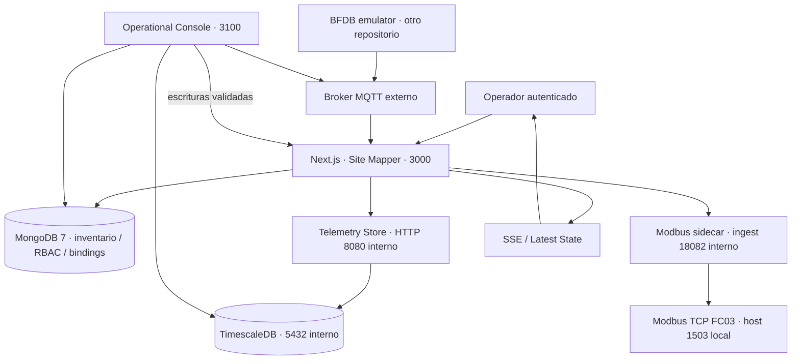
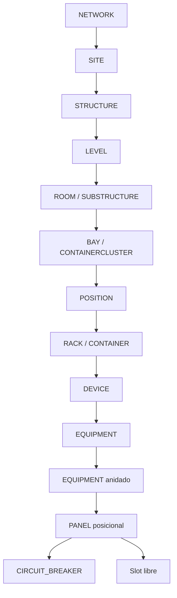
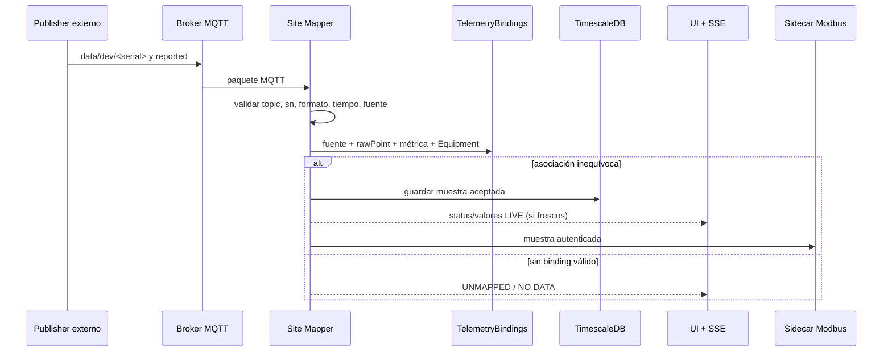

# Mapa del sistema · MK1

**Objetivo:** que una persona nueva entienda la arquitectura sin conocer los detalles del repositorio. Refleja el baseline actual; no es un diseño futuro G16.

## 1. Contexto y límites

**No mezclar:** el broker y emulador son externos a Site Mapper; el gateway externo también puede tener su **propia** TimescaleDB y Modbus, distintos de los que entrega este repositorio. La consola consulta datos directamente, pero realiza las mutaciones mediante la API autenticada de Site Mapper.

## 2. Orden físico e identidad

Los Equipment están persistidos con identidad propia; el Device organiza el inventario montado. El Rack/CAS pertenece a la estructura, no a una lectura MQTT. El Parent Equipment puede contener _slots_; un slot libre no equivale a un breaker instalado ni a una lectura válida. Modelo normativo: [topology hierarchy](../domain/topology-hierarchy.md).

## 3. MQTT a datos útiles: la frontera de confianza

**Criterio central:** `EMU-BFDB-01`, `0_1_1` y posición física `01` son cosas distintas. Solo una asociación explícita entre publisher, punto, métrica y Equipment autoriza los cuatro valores. El prefijo del panel sirve para proponer puntos, nunca para certificar el cableado.

## 4. Persistencia y duración

| Dato                                             | Autoridad                                          | Rehidratación / implicación            |
| ------------------------------------------------ | -------------------------------------------------- | -------------------------------------- |
| Red física, Rack, Equipment, acceso y posiciones | MongoDB `topology_nodes`                           | Persistente; requiere backup           |
| Power Paths                                      | MongoDB `power_paths`                              | Conexiones explícitas a AccessPorts    |
| Bindings MQTT                                    | MongoDB `telemetry_bindings`                       | Identidad exacta por métrica           |
| Usuarios y sesiones                              | MongoDB                                            | Control de acceso en servidor          |
| Latest State + SSE                               | Proceso de Site Mapper                             | Efímero; espera paquetes tras reinicio |
| Historial genérico por Equipment                 | Site Mapper TimescaleDB `telemetry_entity_samples` | Filtrado por target y ventana          |
| Historial eléctrico por breaker                  | Site Mapper TimescaleDB `telemetry_samples`        | Source+raw point+breaker, tiempos      |
| Registros Modbus FC03                            | Memoria de sidecar                                 | Efímero; sin rehidratación al reinicio |

La escritura histórica **no** exige que un cliente Modbus esté disponible. El sidecar no consulta TimescaleDB ni Mongo para responder FC03. Sus ceros por ausencia/stale no distinguen una medición genuina de un dato inválido.

## 5. Servicios del Compose local

| Servicio                 | Función                            | Publicación host en el laboratorio  |
| ------------------------ | ---------------------------------- | ----------------------------------- |
| `site-mapper`            | UI + API Next.js                   | `127.0.0.1:3000`                    |
| `mongodb` y `mongo-init` | DB + replica set rs0               | `127.0.0.1:27017`                   |
| `timescaledb`            | Persistencia histórica             | `127.0.0.1:55432`                   |
| `telemetry-store`        | API interna del histórico          | `127.0.0.1:18081`                   |
| `modbus-tcp`             | FC03 y bridge privado              | `127.0.0.1:1503`, `127.0.0.1:18082` |
| `operational-console`    | Inventario/operación independiente | `127.0.0.1:3100`                    |

Los puertos del host están fijados a loopback para este laboratorio. El acceso dentro de Docker usa nombres de servicio (`telemetry-store:8080`, `timescaledb:5432`, `modbus-tcp:18082`). No se deben transportar estos bindings tal cual a una red OT o a Internet.

## 6. Arquitectura modular

- `src/modules/identity`: autenticación, sesiones, roles y permisos.
- `topology` / `spatial` / `rack`: jerarquía canónica, plano geométrico, CAS.
- `power` / `inventory`: PowerPath, AccessPorts y proyecciones BDFB.
- `telemetry`: MQTT normalizado, asociación, Latest State e historial.
- `warehouse`: plantillas e instanciación gobernada.
- `workspace` / `settings`: vistas y administración.

Los flujos de negocio residen en servicios de aplicación y reglas de dominio. Next.js atiende HTTP y presenta UI; Mongo, MQTT y TimescaleDB son adaptadores de infraestructura.

## 7. Navegación por evidencia

- [Demo de un circuito real del laboratorio](../operations/mqtt-modbus-lab.md).
- [Fuente de verdad, serial y prefix](../telemetry/contract.md).
- [Salida Modbus y layout 4×24](../telemetry/modbus-tcp-output.md).
- [Guía de incidente histórico](../operations/history-connectivity.md).
- [Alcance y pendientes del MVP](../release/MVP-READINESS.md).
