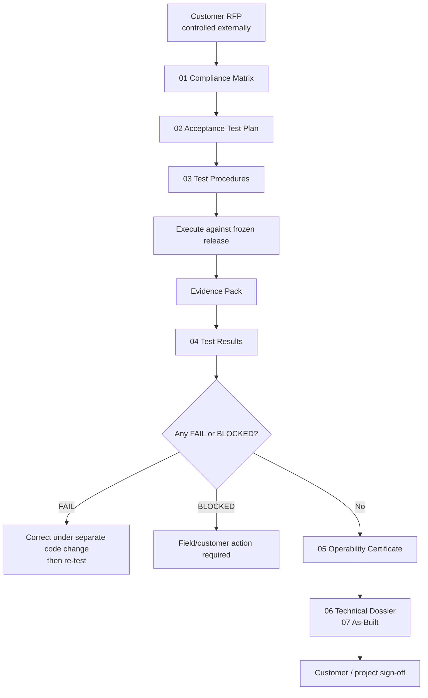

# RFP Acceptance & Operability Pack

## 1. Purpose

This directory defines the acceptance, evidence, operability and handoff package for the Site Mapper
portion of the QDF solution.

It exists to answer one question in a reproducible way:

> Can the delivered Site Mapper release be shown, requirement by requirement, to satisfy the
> software and telemetry obligations that apply to it, and can the remaining field-only obligations
> be identified without overstating what laboratory evidence proves?

This pack is **documentation only**. Creating or maintaining it must not modify application code,
runtime configuration, schemas, APIs, CI workflows, deployment manifests, MQTT topics, SNMP
profiles, Modbus addresses or production infrastructure.

## 2. Source authority and confidentiality

The governing customer source is the externally controlled RFP for the supply and installation of
QDFs, version 1.34. The source document is marked for internal/customer use and is **not committed
to this public repository**.

This pack therefore:

- references the RFP by section and page;
- paraphrases obligations instead of reproducing customer text;
- stores only Site Mapper-owned procedures, interpretations and evidence;
- forbids customer-confidential screenshots, IPs, serial numbers, credentials, network diagrams or
  private mappings from being committed here.

If a customer-controlled copy of the RFP changes, the compliance matrix must be reviewed before a
new acceptance run.

## 3. RFP obligations relevant to Site Mapper

The RFP establishes, among other project obligations, that the QDF solution must support:

- local and remote measurement associated with the new QDFs;
- current consumption by installed breaker and total rack/QDF consumption in real time;
- measurement over time, total and by breaker, for Voltage, Current, Power and Energy;
- Power in kW and Energy in kWh at the contractual/presentation boundary;
- local web access to measurement parameters and load-report generation;
- a networked integration path compatible with the customer BMS/Metasys environment;
- validation tests, configuration/change control and reporting as quality activities;
- commissioning, As-Built and technical dossier as part of handoff;
- an operability certificate among the final deliverables.

Some RFP obligations are physical or supplier-wide rather than Site Mapper software obligations,
for example 1200 A QDF capacity, physical wiring, grounding, door display, civil work, training,
warranty and final installation acceptance. They remain visible in the matrix so they cannot be
mistaken for software-complete items.

## 4. Pack structure

```text
docs/certification/rfp-acceptance/
│
├── 00-README.md
├── 01-RFP-COMPLIANCE-MATRIX.md
├── 02-ACCEPTANCE-TEST-PLAN.md
├── 03-TEST-PROCEDURES.md
├── 04-TEST-RESULTS.md
├── 05-OPERABILITY-CERTIFICATE.md
├── 06-TECHNICAL-DOSSIER.md
├── 07-AS-BUILT.md
├── 08-KNOWN-LIMITATIONS.md
├── 09-RELEASE-IDENTIFICATION.md
└── evidence/
    └── README.md
```

## 5. Acceptance model



The documents do not turn an implemented feature into a contractual PASS. A PASS only exists after
the corresponding procedure has been executed against a frozen release and the required evidence
has been recorded.

## 6. Status vocabulary

### Engineering readiness

Used before formal execution:

| State | Meaning |
| --- | --- |
| `IMPLEMENTED` | The required capability exists in the product. |
| `EVIDENCE_AVAILABLE` | Existing technical/lab evidence can support formal acceptance. |
| `PENDING_EXECUTION` | The formal acceptance procedure has not yet been executed. |
| `FIELD_REQUIRED` | The obligation cannot be closed without physical/customer environment evidence. |
| `OUTSIDE_SOFTWARE` | The requirement belongs to QDF hardware, installation or another supplier scope. |

### Acceptance result

Used only after execution:

| Result | Meaning |
| --- | --- |
| `PASS` | Expected result was observed and required evidence was captured. |
| `FAIL` | Expected result was not met. A separate correction and re-test are required. |
| `BLOCKED` | Test could not be completed because a required field/customer dependency was unavailable. |
| `N/A` | Requirement was formally determined not to apply to the accepted scope. |
| `NOT_RUN` | Procedure has not been executed. |

`IMPLEMENTED` is **not** equivalent to `PASS`.

## 7. Software acceptance versus field acceptance

Site Mapper can prove software behavior in a controlled environment. It cannot, from CI alone,
certify a physical QDF, customer switch, production Metasys instance, actual shunt calibration,
door display or final wiring.

```text
SOFTWARE / LAB                           FIELD / CUSTOMER
-----------------------------------      -----------------------------------
Canonical V/A/kW/kWh                     Physical QDF installation
Historical persistence                   Real source/controller mapping
Load Report                              Door display
MQTT/SNMP ingestion                      Customer OT route/firewall
Modbus server/register contract          Native Metasys point commissioning
RBAC / web access behavior               Final addressing/word-order confirmation
Restart/recovery behavior                As-Built physical verification
```

The operability certificate must preserve this boundary.

## 8. Existing Site Mapper authorities

The acceptance pack does not redefine telemetry semantics. It points to existing authorities:

- [Unified QDF V/A/P/E contract](../../telemetry/qdf-unified-vipe-contract.md)
- [QDF Load Report / Detached Workbench](../../telemetry/detached-workbench-load-report.md)
- [Modbus TCP output for Metasys](../../telemetry/modbus-tcp-output.md)
- [Metasys register-map handoff](../../telemetry/metasys-register-map.md)
- [Industrial integration](../../telemetry/industrial-integration.md)

The principal rule is:

> Acceptance may observe, summarize and compare canonical values. It may not invent another
> calculation for Voltage, Current, Power or Energy.

## 9. Execution order

1. Freeze the exact release in [09-RELEASE-IDENTIFICATION.md](09-RELEASE-IDENTIFICATION.md).
2. Review every row in [01-RFP-COMPLIANCE-MATRIX.md](01-RFP-COMPLIANCE-MATRIX.md).
3. Confirm environment and participants using [02-ACCEPTANCE-TEST-PLAN.md](02-ACCEPTANCE-TEST-PLAN.md).
4. Execute [03-TEST-PROCEDURES.md](03-TEST-PROCEDURES.md) in order.
5. Save sanitized evidence using [evidence/README.md](evidence/README.md).
6. Record results in [04-TEST-RESULTS.md](04-TEST-RESULTS.md).
7. Resolve every FAIL; explicitly retain every BLOCKED item.
8. Complete [07-AS-BUILT.md](07-AS-BUILT.md) with field-controlled data.
9. Issue [05-OPERABILITY-CERTIFICATE.md](05-OPERABILITY-CERTIFICATE.md) only when its stated
   acceptance boundary is true.
10. Package the dossier and obtain project/customer sign-off.

## 10. Definition of closure

The Site Mapper acceptance package is closed only when:

- every in-scope RFP row has a final `PASS`, `BLOCKED` or formally approved `N/A`;
- no `FAIL` remains open;
- every PASS has traceable evidence;
- the release SHA and environment are frozen;
- field-only gaps are visible rather than silently treated as passed;
- the technical dossier and As-Built are consistent with the accepted installation;
- the operability certificate states exactly what was and was not certified.
