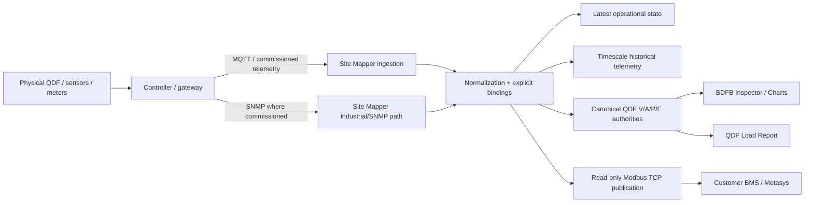

# Technical Dossier — Site Mapper QDF Telemetry

## 1. Purpose

This dossier explains the delivered Site Mapper telemetry architecture sufficiently for acceptance,
operation, troubleshooting and handoff. It is intentionally self-contained while linking to deeper
implementation contracts.

It does not contain customer-confidential IP addresses, credentials, production source identities or
the customer RFP.

## 2. System context



The customer field installation determines which physical protocols/sources are actually
commissioned. The architecture does not infer physical identity from topology alone.

## 3. Domain boundary

### Device and Equipment

Site Mapper treats Device and Equipment as domain peers with explicit topology/composition
relationships. A BDFB/QDF Device may contain chassis/shelves/frames/panels and installed breaker
Equipment.

Telemetry ownership is explicit through bindings. A physical position does not automatically grant
telemetry authority.

## 4. Breaker telemetry

Commissioned Equipment bindings associate a breaker with a source identity/point/metric.

Accepted historical breaker measurements may include:

- Voltage V;
- Current A;
- internal Power W with kW presentation where required;
- Energy kWh where the commissioned source provides/derives it under the accepted contract.

Unbound or invalid data must not be silently assigned to a breaker.

## 5. Canonical QDF V/A/P/E

The unified contractual facade is `qdf-vipe-v1`.

```text
Existing authoritative engines
   ├── QDF Voltage
   ├── QDF Current
   ├── QDF Power
   └── QDF Energy E1
          │
          ▼
      qdf-vipe-v1
          │
          ├── API/history
          ├── Charts
          └── Load Report
```

### Voltage

QDF Voltage is not a sum. Bus voltages are accepted from complete FIELD evidence and must satisfy
the configured coherence tolerance. TOTAL voltage exists only when the required buses are valid and
coherent.

### Current

QDF total Current is valid only from the complete independently verified incoming-feed inventory.
Missing, stale, duplicate, unverified or mixed LAB/FIELD inputs cannot become a valid partial total.

### Power

Canonical internal telemetry uses watts where defined. The QDF contractual/presentation unit is kW.

The accepted total authority is the existing QDF Power projector; downstream surfaces must consume
it rather than invent a second total.

### Energy

QDF Energy E1 is a historical-window measurement derived from accepted paired V/I coverage. It is
not represented as a lifetime hardware counter.

Incomplete buckets are omitted rather than zero-filled.

See:

- [Unified QDF V/A/P/E contract](../../telemetry/qdf-unified-vipe-contract.md)
- [QDF Energy E1](../../telemetry/qdf-total-energy-e1.md)
- [Power unit contract](../../telemetry/bfdb-power-unit-contract.md)

## 6. Historical telemetry

TimescaleDB stores telemetry history independently of the ephemeral Modbus Latest State.

Historical acceptance must preserve:

- source observation timestamp;
- target identity;
- metric value/unit;
- quality/provenance constraints;
- requested time window.

The acceptance test must never use a restart/replay timestamp to make old data appear fresh.

## 7. Web operational surfaces

### Main Site Mapper view

The BDFB Physical View remains the operator’s primary contextual view.

The Inspector provides compact operational views such as Overview, Alarms, Inputs, Charts and
Settings as implemented by the accepted release.

### Detached Workbench

Large analysis opens through same-origin Workbench routes requested with `window.open()` from a
direct user action.

The Workbench is intentionally detached so the operator can keep the main Site Mapper view active
while using a large telemetry/report window.

See [Detached Workbench and Load Report](../../telemetry/detached-workbench-load-report.md).

## 8. Load Report

The explicit QDF Load Report provides a report surface rather than treating charts as the report.

Its QDF summary consumes canonical historical `qdf-vipe-v1` points and may summarize them through
descriptive statistics such as average/peak/min/max. It may not redefine the underlying V/A/P/E
authority.

Breaker distribution is separately derived from explicitly bound Equipment history.

Current export mechanisms include:

- CSV from the loaded accepted report data;
- browser Print/PDF.

The report must identify its target QDF and selected time window.

## 9. Modbus TCP / Metasys handoff

The Site Mapper-owned Modbus service is read-only in the baseline contract.

Key baseline properties:

- Modbus TCP/MBAP;
- FC03 Read Holding Registers;
- four electrical quantities: V, A, kW, kWh;
- IEEE-754 FLOAT32;
- two 16-bit registers per value;
- high word first / network big-endian bytes;
- explicit source-to-Unit-ID mapping;
- 96 circuits per Unit ID in the baseline register block;
- no automatic guessing of source IDs or field wiring;
- internal W converted to kW at the publication boundary.

The Modbus service answers from ephemeral Latest State and does not query TimescaleDB for each BMS
read.

The register allocation is generated from the same runtime source used by the server.

See:

- [Modbus TCP output](../../telemetry/modbus-tcp-output.md)
- [Metasys register map](../../telemetry/metasys-register-map.md)

## 10. Missing and stale data

Application-level canonical QDF totals are fail-closed according to their metric contracts.

The legacy Modbus block has a deployment-configured missing-data policy. The backward-compatible
policy may represent stale/missing data as zero; an optional exception policy is also documented.
Because those behaviors have different implications for a BMS, the final policy must be agreed and
field-tested with the Metasys integrator.

Do not interpret a Modbus zero as proof of canonical data availability unless the accepted missing
policy and quality semantics make that distinction possible.

## 11. Security and access

Acceptance must verify:

- authenticated/authorized access to protected telemetry surfaces;
- machine credentials are distinct from user credentials where applicable;
- customer secrets are not stored in public documentation;
- production MQTT/SNMP/OT security follows the commissioned deployment profile;
- Modbus is exposed only on the approved OT path because baseline Modbus TCP has no built-in
  authentication/encryption.

## 12. Recovery and persistence

Operational acceptance should demonstrate:

- historical data remains after Site Mapper restart;
- telemetry source timestamps are preserved;
- no cross-QDF leakage occurs;
- Latest State/Modbus behavior after restart is understood;
- customer-required reconnect/failover behavior is separately field-accepted where applicable.

## 13. Configuration authority

The following are deployment authorities and must be revision-controlled:

- topology/inventory;
- telemetry binding set;
- source/controller profiles;
- QDF voltage tolerance;
- Modbus source-to-Unit-ID map;
- Modbus raw-point layout;
- missing-data policy;
- customer BMS addressing convention.

Production values may be confidential and should be stored in the controlled deployment repository,
not this public documentation tree.

## 14. Operational troubleshooting sequence

```text
No value in UI?
   |
   +-- Is target/binding commissioned?
   |
   +-- Is source telemetry arriving?
   |
   +-- Is sample fresh and valid?
   |
   +-- Is canonical QDF inventory complete?
   |
   +-- Is history persisted?
   |
   +-- Is Load Report querying same window?
   |
   +-- If Metasys only: is Modbus Latest State fresh?
                         |
                         +-- Unit ID / address offset / word order / OT route
```

## 15. Acceptance boundary

Repository CI and synthetic laboratories provide strong engineering evidence. They do not alone
certify:

- actual customer QDF hardware;
- real sensor/shunt calibration;
- physical breaker mapping;
- door display;
- customer switch/firewall;
- production Metasys configuration;
- final As-Built.

Those items remain explicit field acceptance gates.
