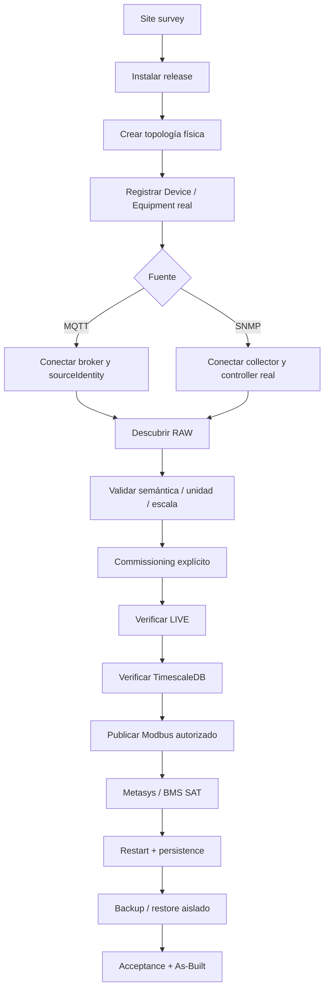

# Field Commissioning · Site Mapper MK1

Este directorio define el camino canónico para llevar una instalación de Site Mapper desde un entorno limpio hasta infraestructura física real. No sustituye los contratos de dominio, seguridad, telemetría o Modbus; los organiza como un procedimiento de puesta en servicio.

## Estado y terminología

Site Mapper distingue cuatro contextos:

1. **DEV** — aplicación efímera o datos sintéticos para desarrollo.
2. **INTEGRATION / PRE-PRODUCTION** — stack persistente con MongoDB, TimescaleDB, MQTT/SNMP, commissioning y Modbus; puede usar fuentes controladas o reales.
3. **FIELD** — hardware físico, red OT, fuentes reales, identities y mappings aprobados, y pruebas con el integrador.
4. **PRODUCTION** — FIELD aceptado, con seguridad, backup/restore, observabilidad, As-Built y criterios contractuales cerrados.

El entorno persistente actual de ingeniería corresponde a **INTEGRATION / PRE-PRODUCTION**. No debe describirse simplemente como un demo efímero. Lo que permanece pendiente para declarar producción es la aceptación sobre el hardware, red OT, mappings y sistemas externos reales del sitio.

## Regla de oro

La identidad física y la semántica de una señal nunca se infieren por nombre, slot, tópico, OID o dirección.

```text
Physical Equipment
      !=
Protocol Endpoint
      !=
Raw Signal
      !=
Canonical Metric
```

Una señal llega a un Equipment únicamente mediante commissioning explícito y evidencia verificable.

## Camino completo



## Documentos de ejecución

- [Site Survey](site-survey.md) — información que debe obtenerse antes de tocar la red o el equipo.
- [Commissioning de equipos reales](real-equipment-commissioning.md) — procedimiento MQTT/SNMP, RAW, binding, histórico y salida industrial.
- [Telxius Lurín · Conexión de equipos físicos y cierre de Power Feeds](telxius-physical-equipment-connection-runbook.md) — runbook operativo para sustituir el laboratorio por BDFB/Acrel real, preservar Feed A/B y materializar equipos remotos solo con evidencia de ubicación.
- [Metasys SAT](metasys-sat.md) — prueba de aceptación Modbus TCP con el BMS/integrador.
- [Commissioning Record](commissioning-record.template.md) — plantilla de evidencia por equipo/fuente.
- [Portability Hardening](../release/portability-hardening.md) — condiciones para instalar y recuperar Site Mapper desde una máquina limpia.

## Evidencia mínima por equipo

Cada equipo real debe terminar con un registro controlado que identifique:

- fabricante, modelo, firmware y serial físico;
- Site / Room / Rack / Device / Equipment canónicos;
- sourceIdentity y protocolo;
- dirección de gestión o broker mediante referencia controlada, no secretos en Git;
- OID/raw point/topic aprobado;
- métrica, unidad y escala validadas;
- TelemetryBinding o asociación industrial correspondiente;
- timestamps y valores observados en RAW, LIVE e histórico;
- Unit ID / register address solo cuando exista publicación Modbus aprobada;
- resultado de SAT y referencia de As-Built.

## Criterio de aceptación

No se acepta un equipo porque “aparece en pantalla”. Debe existir una cadena trazable:

```text
REAL SOURCE
 -> authenticated/authorized transport
 -> RAW value
 -> approved interpretation
 -> commissioned Equipment
 -> LIVE
 -> durable history
 -> optional Modbus projection
 -> external consumer
```

Cada salto debe conservar identidad, tiempo, valor y condición de disponibilidad de forma coherente.

## Acceso y continuidad S06

Para implementar el acceso HTTPS interno con Caddy y el acceso externo opcional mediante Cloudflare Tunnel, consulta [S06 FIELD LAN y LAB REMOTE](../operations/lan-https/README.md), [contrato de seguridad](../operations/lan-https/security-and-access.md), [runbook de despliegue](../operations/lan-https/deployment-runbook.md) y [gate de aceptación](../operations/lan-https/acceptance.md).

**Estado:** configuraciones propuestas en GitHub, no aplicadas al host ni certificadas en campo. La instalación FIELD LAN debe funcionar sin WAN; LAB REMOTE requiere Internet, políticas Cloudflare Access y aprobación independiente.
