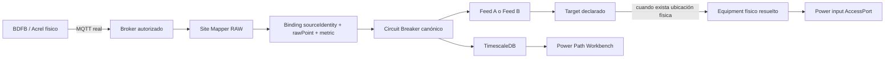

# Telxius Lurín · Conexión de equipos físicos y cierre de Power Feeds

**Estado:** Runbook operativo para el siguiente trabajo de campo.  
**Repositorio:** AppM Site Mapper MK1  
**Rama canónica:** `main`  
**Ámbito:** QDF-2 / QDF-4 / QDF-5, MQTT/Acrel, Feed A/B, equipos destino aún no ubicados físicamente.

---

## 1. Propósito

Este documento define cómo sustituir la fuente sintética de laboratorio por los equipos físicos reales sin modificar la topología canónica ya construida en Site Mapper y sin inventar ubicación física para los equipos remotos alimentados por los breakers.

La regla de trabajo es:

> **El BDFB real aporta telemetría. El Excel ya aporta la relación declarada Feed A / Feed B. La ubicación física del equipo destino se materializa únicamente cuando exista evidencia de Room / Rack / Bay / U.**

Actualmente Site Mapper ya conoce para QDF-4 y QDF-5:

- el BDFB;
- chassis / shelf / frame / panel;
- breakers actuales después de la migración;
- target declarado por breaker;
- Feed A o Feed B;
- breaker compañero del otro feed;
- target compañero;
- posición anterior a la migración;
- remarks de la hoja cuando existen;
- bindings MQTT del laboratorio;
- Power Path Workbench por breaker.

No se deben crear racks, bays, U positions ni Equipment remotos para los destinos declarados hasta que esa información exista en campo.

---

## 2. Modelo operacional



La fuente MQTT y el target físico son conceptos independientes.

Un breaker puede estar completamente comisionado para telemetría aunque el equipo remoto todavía permanezca:

```text
DECLARED
UNPLACED
```

---

## 3. Verdad actual del seed

### 3.1 Gateways QDF

| QDF   | Gateway serial registrado | Breakers actuales materializados |
| ----- | ------------------------- | -------------------------------: |
| QDF-2 | `26092403950003`          |                                0 |
| QDF-4 | `26092403950004`          |                               12 |
| QDF-5 | `26092403950002`          |                               36 |

**Importante:** el serial del gateway registrado no debe asumirse automáticamente como `sourceIdentity` MQTT del hardware real. En campo se debe observar el mensaje real y confirmar qué identidad publica efectivamente.

### 3.2 QDF-2

QDF-2 conserva evidencia histórica de breaker feeds, pero el Excel actualmente aceptado no establece las posiciones finales **Después** de la migración.

Por tanto:

- puede observarse RAW del equipo físico;
- puede identificarse su gateway;
- no deben materializarse breakers actuales a partir de posiciones antiguas;
- no debe cerrarse Feed A/B hacia breakers finales hasta contar con la migración física aceptada.

### 3.3 QDF-4 y QDF-5

Los pares A/B están cerrados por la misma fila del documento fuente.

La fila, no el parecido del nombre, es la autoridad del pairing.

Ejemplo:

```text
QDF-5 · source row 13

Feed A
A3-17
010208.14 PDU1-A

        ⇅ SAME DECLARED POWER PAIR

Feed B
B3-17
010208.14 PDU1-B
```

Site Mapper debe mantener cada Power Path como una ruta independiente y permitir abrir el companion feed en otro Detached Workbench.

---

## 4. Antes de conectar el BDFB real

### 4.1 Código

Usar solamente `main`:

```bash
git switch main
git pull --ff-only origin main
```

Registrar el SHA usado para el commissioning:

```bash
git rev-parse HEAD
```

### 4.2 No usar el publisher MQTT sintético

Para la prueba física **no** levantar el stack con:

```text
docker-compose.integration.yml
```

Ese overlay contiene fuentes sintéticas de laboratorio y puede contaminar la observación del equipo real.

Usar el perfil OFFICE / FIELD documentado en:

```text
docs/operations/office-field-mqtt-snmp.md
```

### 4.3 Runtime local

Si todavía no existe:

```bash
chmod +x infra/field/init-office-env.sh infra/field/office-up.sh
sh infra/field/init-office-env.sh
```

Esto genera:

```text
.runtime/office-test.env
```

Ese archivo contiene secretos locales y **no debe subirse a Git**.

---

## 5. Dos formas válidas de conectar MQTT

### Caso A · El BDFB/Acrel publica a nuestro broker

Arquitectura:

```text
BDFB / Acrel
     |
     | MQTT
     v
Site Mapper Mosquitto
     |
     v
Site Mapper
```

En el equipo físico configurar con los valores reales del entorno:

```text
Broker host : <IP_DEL_HOST_SITE_MAPPER>
Port        : 1883
TLS         : según entorno aprobado
Username    : site-mapper-office
Password    : valor runtime local
Topic       : topic acordado bajo MQTT_TOPIC_PREFIX
```

No copiar IPs de ejemplos históricos.

Obtener la IP real del host:

```bash
hostname -I
```

Si UFW está activo, autorizar únicamente la red OT/LAN correspondiente:

```bash
sudo ufw status
```

La regla exacta debe usar la subred real del sitio.

### Caso B · El BDFB ya publica a un broker existente

No insertar Mosquitto local en medio por obligación.

Obtener:

- hostname/IP del broker;
- port;
- TLS sí/no;
- usuario;
- password por canal seguro;
- topic exacto;
- frecuencia de publicación;
- payload real;
- source identity real.

Luego configurar el runtime OFFICE/FIELD para que Site Mapper se suscriba directamente al broker aprobado.

---

## 6. Arranque de campo

Si mañana solo se valida MQTT físico y todavía no se trabajará SNMP:

```bash
sh infra/field/office-up.sh none
```

Si también se conectará SNMP real:

```bash
sh infra/field/office-up.sh real
```

No usar `down -v`.

Para detener sin borrar datos:

```bash
sh infra/field/office-up.sh stop
```

o el procedimiento de stop equivalente definido por el script vigente.

---

## 7. Orden de validación del BDFB real

No empezar por las gráficas ni por Modbus.

Validar en este orden:

```text
1. Reachability de red
2. Conexión MQTT
3. Topic real
4. Payload real
5. sourceIdentity real
6. rawPointId real
7. Semántica V / I / P / E
8. Binding al breaker exacto
9. LIVE
10. TimescaleDB
11. Power Path Workbench
12. Modbus / BMS, si aplica
```

### 7.1 Captura mínima por mensaje

Registrar:

```text
observedAt
topic
sourceIdentity
payload
rawPointId
value
metric candidate
unit candidate
```

No asumir:

```text
raw point 17 == breaker 17
```

aunque aparentemente coincida.

La correspondencia física debe ser verificada.

---

## 8. Commissioning Acrel

Site Mapper ya dispone del flujo de commissioning Acrel.

Abrir:

```text
/industrial/commissioning
```

El proceso correcto es:

```text
AWT100 / gateway físico
        ↓
sourceIdentity observado
        ↓
AMC16Z meter
        ↓
canal físico
        ↓
rawPointId observado
        ↓
breaker existente
        ↓
V / I / P / E
```

Para cada mapping confirmar:

- gateway Equipment correcto;
- meter Equipment correcto;
- RS485 slave correcto;
- canal físico;
- raw MQTT point;
- breaker exacto;
- métricas permitidas;
- documento/evidencia;
- confirmación física del operador.

El binding debe terminar apuntando al `CIRCUIT_BREAKER` ya existente. No crear un breaker nuevo porque aparece un raw point nuevo.

---

## 9. Cierre Feed A / Feed B

El seed ya conserva los pares A/B para QDF-4 y QDF-5.

Por ejemplo:

```text
A3-17 → 010208.14 PDU1-A
B3-17 → 010208.14 PDU1-B
```

La UI debe tratarlo como:

```text
Power Path · Feed A
QDF-5 / A3 / A3-17 → 010208.14 PDU1-A

Companion:
Feed B available
OPEN FEED B ↗
```

y desde B:

```text
Power Path · Feed B
QDF-5 / B3 / B3-17 → 010208.14 PDU1-B

Companion:
Feed A available
OPEN FEED A ↗
```

### Regla

**Un Detached Power Path Workbench representa un feed.**

Un equipo puede tener varios feeds, pero cada ruta se observa de forma independiente para no mezclar telemetría ni diagnóstico.

---

## 10. Equipos destino que todavía no conocemos físicamente

Ejemplos:

- `DTX-LUR-FP2-1 SH8 PA1-1 / PB1-1`;
- `GXLUR01 SH2 PEM1 / PEM3`;
- `WS-LUR-01 PSU1 / PSU2`;
- `010208.14 PDU1-A / PDU1-B`.

Actualmente conocemos su relación eléctrica declarada, pero no necesariamente:

- Room exacto;
- Bay;
- Rack;
- U inicial;
- cantidad de U;
- fabricante;
- modelo;
- serial físico.

Por tanto **no se materializan todavía como Equipment físico ubicado**.

Su estado conceptual sigue siendo:

```text
targetLabel: known
feed relationship: known
physical placement: unknown
target Equipment: not created
```

---

## 11. Cómo materializar un equipo remoto cuando tengamos la ubicación

Cuando el levantamiento de campo confirme la ubicación física, obtener como mínimo:

| Campo                 | Requerido               |
| --------------------- | ----------------------- |
| Site / Room           | Sí                      |
| Bay / cluster         | Cuando aplique          |
| Rack                  | Sí para equipo rackeado |
| U inicial             | Sí para equipo rackeado |
| Tamaño U              | Sí                      |
| Manufacturer          | Cuando esté disponible  |
| Model                 | Cuando esté disponible  |
| Serial / Asset tag    | Cuando exista           |
| Nombre/label de campo | Sí                      |
| Power input A         | Si existe               |
| Power input B         | Si existe               |
| Fotografía/nameplate  | Recomendado             |

Entonces:

1. crear o identificar el Device/Equipment real;
2. ubicarlo en el rack correcto;
3. crear los AccessPorts de entrada de potencia reales;
4. resolver el target declarado contra ese Equipment;
5. vincular Feed A al input A correspondiente;
6. vincular Feed B al input B correspondiente;
7. preservar el raw label original del Excel como evidencia/alias;
8. cambiar el estado conceptual de `DECLARED/UNPLACED` a resuelto;
9. verificar ambos Power Path Workbenches;
10. registrar evidencia de commissioning.

No volver a escribir el seed para mover Equipment ya comisionado por el operador.

---

## 12. Remarks / SUB-EQUIPO

La columna `SUB-EQUIPO` del Excel se interpreta como **remark**, no como jerarquía física.

Ejemplo:

```text
010208.14 PDU1-A

Remarks
- Pos-1: MTC-9 SH10 PEM A
- Pos-2: XTM-LUR01 PEM A
```

No crear automáticamente:

```text
PDU
├── MTC-9
└── XTM-LUR01
```

solo por esa columna.

Cuando el levantamiento físico demuestre una jerarquía real, esa topología se modelará por evidencia independiente.

---

## 13. LIVE e histórico

Una vez conectado el BDFB físico, la telemetría esperada debe provenir del dispositivo real.

Para cada breaker comisionado:

```text
Voltage
Current
Power
Energy counter
```

deben verse en:

1. Equipment Composition;
2. Detached Power Path Workbench;
3. History / TimescaleDB.

No modificar el emulador para fabricar variación visual cuando el objetivo es validar hardware real.

### Energy

`Energy` es un contador acumulativo.

Su velocidad de incremento cambia con la potencia, pero normalmente el valor acumulado no disminuye salvo reset, rollover, sustitución o comportamiento explícito del equipo.

---

## 14. Criterio de aceptación de mañana

La conexión del BDFB queda aceptada para una ruta solamente cuando puede demostrarse:

```text
BDFB físico
  ↓
mensaje MQTT real
  ↓
sourceIdentity real
  ↓
raw point real
  ↓
binding explícito
  ↓
breaker correcto
  ↓
V / I / P / E LIVE
  ↓
TimescaleDB
  ↓
Power Path Workbench
  ↓
Feed companion disponible cuando corresponda
```

No es necesario que el Equipment remoto esté físicamente ubicado para cerrar la telemetría del breaker y su relación declarada A/B.

Sí es necesario conocer su ubicación antes de crear su representación física definitiva dentro de racks/containers.

---

## 15. Checklist de salida a campo

Antes de salir:

- [ ] `main` actualizado y SHA anotado.
- [ ] backup de MongoDB/TimescaleDB según runbook.
- [ ] runtime OFFICE/FIELD preparado.
- [ ] sin publisher MQTT sintético activo.
- [ ] IP del host Site Mapper conocida.
- [ ] acceso de red autorizado.
- [ ] credenciales MQTT disponibles por canal seguro.
- [ ] laptop con MQTT Explorer o herramienta equivalente.
- [ ] acceso a `/industrial/commissioning`.
- [ ] documentación del gateway/meter disponible.
- [ ] identificación de QDF físico a trabajar.
- [ ] formulario de commissioning disponible.

En campo:

- [ ] confirmar serial/nameplate del gateway;
- [ ] confirmar broker/topic;
- [ ] capturar payload real;
- [ ] confirmar sourceIdentity;
- [ ] confirmar raw points;
- [ ] mapear un breaker controlado primero;
- [ ] verificar LIVE;
- [ ] verificar histórico;
- [ ] abrir Power Path;
- [ ] comprobar Feed A/B companion;
- [ ] repetir por circuitos aprobados.

Después:

- [ ] registrar evidence;
- [ ] guardar As-Built;
- [ ] no borrar volúmenes;
- [ ] detener servicios únicamente si corresponde;
- [ ] dejar documentados blockers de ubicación física.

---

## 16. Documentos relacionados

- `docs/field/real-equipment-commissioning.md`
- `docs/field/commissioning-record.template.md`
- `docs/operations/office-field-mqtt-snmp.md`
- `docs/telemetry/acrel-commissioning.md`
- `docs/operations/seed-01-telxius-lab.md`
- `docs/telemetry/modbus-tcp-output.md`
- `docs/field/metasys-sat.md`

---

## 17. Invariante final

```text
NO LOCATION EVIDENCE
        ↓
DO NOT INVENT RACK / BAY / U

BUT

DECLARED FEED A/B EVIDENCE
        ↓
KEEP AND USE THE POWER RELATIONSHIP
```

La próxima sesión debe partir de esta frontera: **telemetría física primero; ubicación y materialización de los equipos remotos cuando exista evidencia física suficiente.**
