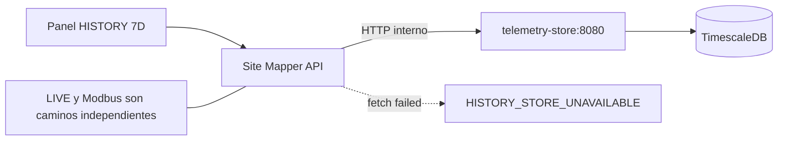

# Incidente: `HISTORY_STORE_UNAVAILABLE` en Site Mapper

**Alcance:** LIVE o commissioning puede funcionar mientras falla el histórico. El ejemplo siguiente corresponde al laboratorio Docker; la solución no consiste en borrar MongoDB o TimescaleDB.

## Síntomas y evidencia del 15 de octubre de 2026

- La tarjeta `HISTORY` al seleccionar `7D` mostraba `HISTORY_STORE_UNAVAILABLE` y `Last matching packet: —`.
- Las consultas internas de `site-mapper` a `telemetry-store` devolvieron `fetch failed` para **PANEL-01** y **CB-01** en las ventanas `24h` y `7d`.
- El writer informó repetidamente `telemetry.history.write_failed`, `reason: fetch failed`.
- `telemetry-store` había registrado `SITE_MAPPER_TELEMETRY_STORE_READY host=0.0.0.0 port=8080`; esto **solo demuestra que arrancó**, no que otro contenedor pueda resolverlo o conectarse.
- La persona operadora reportó que la ventana `7D` **volvió a mostrar histórico** después del procedimiento de recuperación. No hay evidencia suficiente para asegurar qué paquetes, si alguno, se perdieron durante la desconexión ni que el writer reanudó la escritura inmediatamente después.

## Mapa del fallo



El error se produce en la frontera **Site Mapper → Telemetry Store** o más adentro de su ruta HTTP; no identifica por sí solo DNS, conexión rechazada, timeout, SQL ni credenciales. La vista pone el historial visible vacío ante un error; `Last matching packet: —` **no demuestra pérdida o borrado de datos**.

## Diagnóstico de solo lectura

Desde el directorio del repositorio:

```bash
docker compose -f docker-compose.telemetry.yml ps \
  site-mapper telemetry-store timescaledb

docker compose -f docker-compose.telemetry.yml \
  logs --tail=70 site-mapper telemetry-store
```

Prueba DNS y HTTP desde el **contenedor consumidor**, no desde el navegador/WSL:

```bash
docker compose -f docker-compose.telemetry.yml \
  exec -T site-mapper node <<'JS'
const dns = require('node:dns').promises;
(async () => {
  const base = process.env.TELEMETRY_STORE_URL;
  console.log('STORE_URL:', base);
  try { console.log('DNS:', await dns.lookup('telemetry-store')); }
  catch (e) { console.log('DNS_ERROR:', e.code); }
  try {
    const response = await fetch(new URL('/health', base), {
      signal: AbortSignal.timeout(5000)
    });
    console.log('HTTP:', response.status, await response.text());
  } catch (e) {
    console.log('FETCH_ERROR:', e.message);
    console.log('CAUSE_CODE:', e.cause?.code);
    console.log('CAUSE:', e.cause?.message);
  }
})();
JS
```

Interpretar `HTTP 200` + `{"status":"ok"}` como **alcanzable ahora**, no como aprobación de todas las consultas históricas. `ENOTFOUND`/`EAI_AGAIN` apunta a DNS, `ECONNREFUSED` a socket/servicio, `ETIMEDOUT` a red/timeout. Un **HTTP 503** con JSON también requiere revisar la base y la consulta; no se soluciona cambiando el serial MQTT.

## Recuperación sin destruir estado

Solo si se verificó un problema de conectividad en este stack local, y aceptando una interrupción temporal:

```bash
docker compose -f docker-compose.telemetry.yml \
  up -d --no-deps --force-recreate telemetry-store site-mapper
```

Ese comando recrea los procesos/adjunciones de red pero conserva los **volúmenes**. No garantiza la reparación de todos los escenarios; si falla, inspeccionar `docker network`, DNS, servicio y logs antes de otras acciones. **Prohibido** `docker compose down -v`, `dropDatabase()` o reasignar seriales como parche.

## Cierre real de la incidencia

1. `/health` responde desde `site-mapper` hacia `telemetry-store`.
2. Con sesión autorizada, `GET /api/telemetry/entity?targetId=<breaker-id>&window=24h` devuelve JSON de histórico y `7d` carga en UI.
3. `GET /api/telemetry/diagnostics` muestra `history.failures` y `history.lastError` sin **nuevas** fallas, además de un `history.lastWriteAt` reciente **si se esperan nuevos paquetes**.
4. Confirmar que `MAX(received_at)` crece para el Equipment y breaker explícitamente mapeados:

```bash
docker compose -f docker-compose.telemetry.yml \
  exec -T timescaledb \
  psql -U site_mapper -d site_mapper_telemetry <<'SQL'
SELECT count(*) AS entity_rows, max(received_at) AS newest
FROM telemetry_entity_samples
WHERE target_id = '4d394db4-b263-4ca3-9fa2-fb10661d89ff';
SELECT count(*) AS breaker_rows, max(received_at) AS newest
FROM telemetry_samples
WHERE breaker_id = '4d394db4-b263-4ca3-9fa2-fb10661d89ff';
SQL
```

Las consultas SQL son **del entorno CB-01 de ejemplo**, no universales. Comparar dos observaciones separadas por algunos paquetes MQTT para concluir que se reanudaron escrituras. Si la fuente está parada, el contador puede permanecer constante legítimamente.

## Prevención y alcance

- Mantener las dependencias del Compose saludables y la URL interna `http://telemetry-store:8080` (sin `localhost` dentro de `site-mapper`).
- No usar el endpoint público `127.0.0.1:18081` dentro de contenedores.
- Supervisar errores de escritura y edad del último `received_at`, no solo el estado `subscribed` de MQTT.
- Un reinicio no recrea las muestras **que nunca fueron persistidas**. La recuperación y reconciliación de pérdidas requiere política adicional de durabilidad/replay, aún fuera del alcance certificado.

**Resultado observable del incidente anterior:** consulta visual 7D recuperada. **Pendiente de cerrar con evidencia:** avance de escrituras posteriores al fallo, si hubo pérdida de muestras y su tratamiento.
