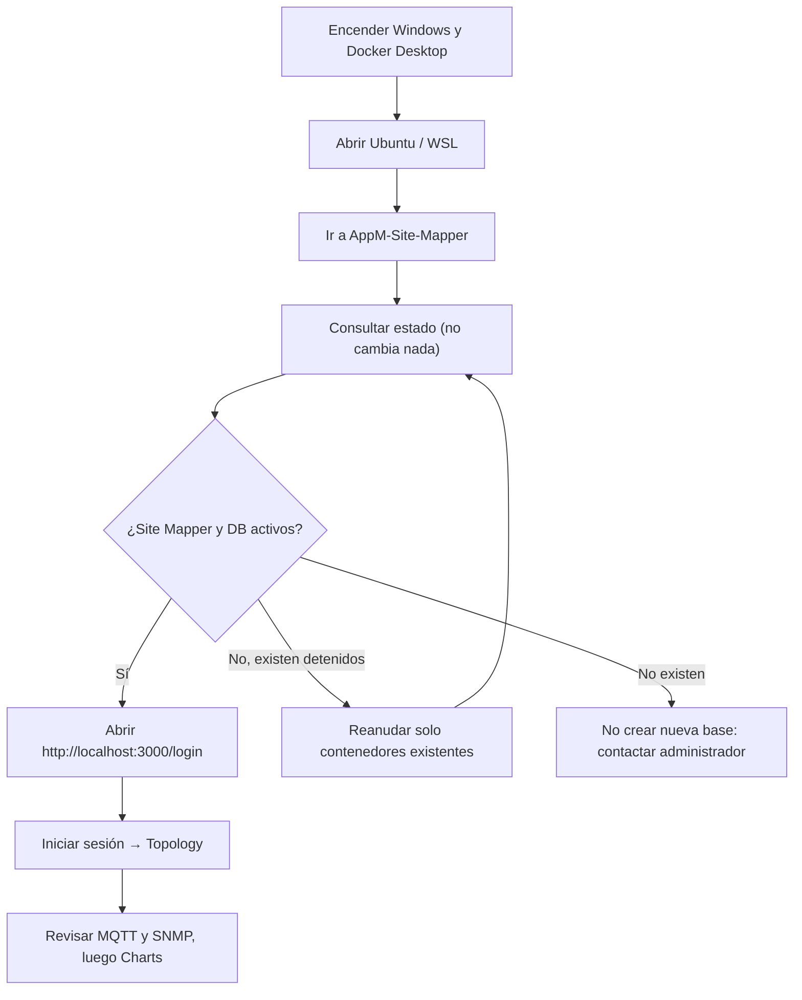
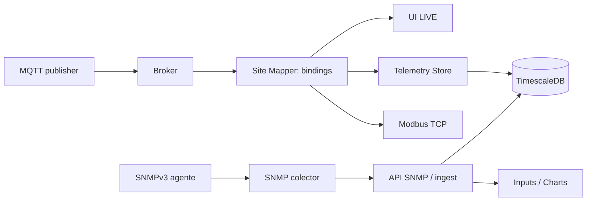

# Encender Site Mapper y su laboratorio industrial — guía para principiantes

**¿Para quién?** Para quien recibe una laptop Windows con WSL2 + Docker Desktop y el laboratorio de Site Mapper **ya instalado**, o para un administrador que va a dar de alta dos nuevos BDFB sintéticos.

Este procedimiento **no presupone que una máquina recién clonada contenga usuarios, una base o un inventario**. En una instalación nueva se requiere aprovisionar secretos, cuentas y datos de prueba por separado.

## Ruta rápida (si ya funcionó ayer)



### 1. Abre el entorno correcto

1. Inicia **Docker Desktop** en Windows y verifica que su motor responda.
2. Abre **Ubuntu (WSL)**.
3. Entra a la carpeta local de **AppM-Site-Mapper**. Si ya estás dentro, no repitas el comando `cd`.

Ejemplo de carpeta WSL (ajústala al equipo):

```bash
cd /mnt/c/Users/USUARIO/Desktop/Thradex/AppM-Site-Mapper
git branch --show-current
```

La rama de las nuevas funciones de laboratorio es `feat/site-mapper-work-2026-10-23`. Si tu directorio está configurado para usar esa rama y no tienes cambios locales incompatibles:

```bash
git pull --ff-only origin feat/site-mapper-work-2026-10-23
```

### 2. Revisa el estado sin cambiar nada

```bash
python3 scripts/telemetry/estado-laboratorio.py
python3 scripts/telemetry/reanudar-laboratorio-existente.py
```

El primero muestra **ACTIVO / DETENIDO / NO CREADO** para cada servicio. El segundo solo anuncia qué contenedores existentes podrían reanudarse. No lee tokens ni crea otra base de datos.

Si Docker Desktop estaba apagado y ves contenedores originales **DETENIDOS**, se pueden reanudar **sin reconstruir**:

```bash
python3 scripts/telemetry/reanudar-laboratorio-existente.py \
  --start-stopped --ack-resume-existing
python3 scripts/telemetry/estado-laboratorio.py
```

Este comando **solo ejecuta `docker start` en contenedores con las etiquetas del proyecto original**. Comprueba los volúmenes permanentes de MongoDB y TimescaleDB. No crea instalaciones nuevas ni carga datos de ejemplo. Los servicios SNMP de BDFB-02/03 son opcionales: si aparecen **NO CREADO**, significa que aún no se comisionaron.

**Si MongoDB/TimescaleDB no existen, o cambió su volumen, detente.** No crees una base vacía para hacer desaparecer un error.

### 3. Abre la interfaz y verifica la sesión

Accede a **http://localhost:3000/login**. Usa una cuenta entregada por el administrador. La base persistente no trae contraseñas públicas. Si una cuenta nueva debe crearse, el administrador debe usar el procedimiento autorizado de [primer usuario y permisos](../user-guide/primer-acceso-y-usuarios.md).

Completa el [recorrido del operador desde Login hasta SNMP/MQTT](../user-guide/recorrido-completo-login-mqtt-snmp-modbus.md).

### 4. Genera señales MQTT en LAB, si hace falta

**No abras dos publicadores simultáneos.** Si el panel muestra lecturas `MQTT LIVE`, ya puedes revisar sin publicar de nuevo.

Si los BDFB-02/03 no tienen lecturas recientes y el broker LAB existe, **en una terminal separada**:

```bash
python3 scripts/telemetry/publish-bdfb-lab-pair.py --publish
```

Mantén esa terminal abierta durante la verificación. Solo produce datos sintéticos de los LAB-BDFB-02/03 existentes; no cambies los seriales de MQTT para igualar etiquetas del panel. Para detener el publicador usa **Ctrl+C** en esa terminal (no `docker compose down`).

### 5. Revisa la integración de los tres protocolos

| Protocolo   | Qué alimenta                                   | Dónde se observa                           | Comprobación                          |
| ----------- | ---------------------------------------------- | ------------------------------------------ | ------------------------------------- |
| MQTT        | Breakers de salida                             | Panel → Open Panel Composition → Telemetry | `24/24 MQTT LIVE` y V/A/W/kWh         |
| SNMPv3      | Shunts independientes de entrada A/B           | Device BDFB → Inputs                       | `LAB LIVE · SIMULATED`                |
| TimescaleDB | Histórico independiente de MQTT y SNMP         | Device BDFB → Charts                       | Curvas o puntos en la ventana elegida |
| Modbus TCP  | Registros de circuitos para lectura industrial | Herramienta técnica FC03                   | `FC03 PASS` en comparaciones reales   |

La ruta de transporte:



**Lo que ya se observó en el laboratorio de 24 octubre 2026:** BDFB-02/03 tienen 96 breakers MQTT vinculados por unidad; Modbus 4/5 pasó 8/8 lecturas representativas; BDFB-01 tiene SNMPv3 sintético A/B con 9 polls aceptados y gráficas SNMP de TimescaleDB visibles. **No atribuir esos resultados a un campo real.**

### 6. Comprobar Modbus sin cambiar sus asignaciones

Con el publicador MQTT LAB activo:

```bash
python3 scripts/telemetry/verify-bdfb-lab-modbus-fc03.py
```

El resultado requerido en este laboratorio es `FC03 PASS: 8/8`, mostrando Units 4 y 5. Los Units 1, 2 y 3 deben mantenerse ligados a `EMU-BFDB-01/02/03`. **No ejecutar `--stage` ni recrear el gateway cuando ya está certificado.**

### 7. Diagnóstico si una pantalla no funciona

- **No abre /login:** Docker puede estar apagado, o `site-mapper` detenido; ejecuta el estado seguro del paso 2.
- **Vuelve de Workspace a Login:** problema de sesión/cookie/RBAC, no de MongoDB ni de Modbus.
- **MQTT STALE:** verificar que el publicador siga activo, la conexión al broker, y el binding de cada breaker.
- **SNMP PENDING:** consultar los puertos de entradas SNMP en Device → Inputs y los logs del colector.
- **No samples stored** bajo SNMP: consulta la historia de shunts, distinta de MQTT. La fuente puede estar LIVE y no tener aún puntos en esa ventana.
- **Valores de Modbus cero:** pueden significar dato ausente/vencido bajo la política `MODBUS_MISSING_POLICY=zero`; no demostrar apagado.

Para soporte técnico sin editar la instalación:

```bash
python3 scripts/telemetry/audit-bdfb-snmp-readiness.py
python3 scripts/telemetry/audit-bdfb-lab-downstream.py
```

Para logs de SNMP usa exactamente el sufijo **-1** de Docker Compose:

```bash
docker logs --tail 50 appm-site-mapper-snmp-lab-agent-01-1
docker logs --tail 80 appm-site-mapper-snmp-lab-collector-01-1
```

Busca `snmp.poll.accepted`. Un servicio `Up` no certifica ingestión; una muestra `LAB LIVE` no certifica sensor físico.

## Nuevo: ampliar SNMP sintético Config2 de BDFB-02/03 (administrador)

**Solo en este laboratorio:** Config2 A/B es una hipótesis para entrenar con shunts ficticios, sin suponer la instalación física. La acción añadirá cuatro puertos externos POWER INPUT en total (dos por equipo) y ocho bindings SNMP, sin alterar los breakers MQTT.

Antes de ejecutar, verifica que estén preparados: la **misma** base original, el repositorio hermano `bfdb-telemetry-gateway`, su archivo privado `.env.snmp` con credenciales SNMPv3 y dos agentes/colectores de BDFB-01 operativos.

### Fase A — Preflight sin cambios

```bash
python3 -m unittest discover -s tests/python -p 'test_bdfb23_snmp_setup.py' -v
python3 scripts/telemetry/setup-bdfb23-snmp-lab.py
```

La ejecución normal solo debe informar que los dos BDFB están `READY` o `ALREADY_READY` y terminar con `READ-ONLY PREFLIGHT PASS`. En caso de `BLOCKED`, no ejecutar la fase siguiente. No se utilizan ni publican passwords en la consola.

### Fase B — Inventario sintético y respaldo automático

```bash
python3 scripts/telemetry/setup-bdfb23-snmp-lab.py \
  --apply-inventory --ack-synthetic-only
```

**Sí escribe inventario de laboratorio**, pero primero crea una copia privada nueva de la base Mongo y guarda su SHA256. La transacción incorpora el perfil Config2 a los Devices BDFB-02/03, crea los puertos A/B en sus chasis y comisiona sus cuatro OIDs por equipo con `SYNTHETIC_LAB_ONLY`. Si detecta duplicados, estados parciales o identidades distintas, se bloquea. No marca shunts como físicamente verificados.

### Fase C — Arrancar solo los cuatro servicios SNMP nuevos

```bash
python3 scripts/telemetry/setup-bdfb23-snmp-lab.py \
  --start-collectors --ack-synthetic-only
```

Arranca **dos agentes SNMPv3 y dos colectores**, sin recrear Site Mapper, MongoDB, TimescaleDB, Modbus, broker MQTT ni SNMP BDFB-01. No usa SNMPv2c ni expone puertos UDP en Windows.

Para ver la recepción real:

```bash
docker logs --tail 60 appm-site-mapper-snmp-lab-collector-02-1
docker logs --tail 60 appm-site-mapper-snmp-lab-collector-03-1
```

En cada uno buscamos `snmp.poll.accepted` con `pointCount:4` y su propia identidad `EMU-DELTA-BFDB-02` o `EMU-DELTA-BFDB-03`. Si no existe esta evidencia, no afirmar aceptación.

### Fase D — Validación por la pantalla

1. Login → Explore → Bay-02 → Rack-01-Bay-02 → **BDFB-02 → Inputs**.
2. Comprueba `LAB SIMULATED`, dos entradas `LAB LIVE · SIMULATED`, A/B con corriente y voltaje.
3. Abre **Charts → 24H → Current**: verifica curvas A y B.
4. Repite en **Bay-03 → BDFB-03**.
5. Verifica que los paneles de ambos siguen mostrando **96 breakers** en total, MQTT LIVE cuando la fuente publique, y que **BDFB-01** sigue con sus shunts anteriores.
6. Comprueba de nuevo los Unit IDs Modbus 1–5 sin recrearlos.

**Estado al publicar esta guía:** código de BDFB-02/03 preparado en GitHub; el operador todavía no ha ejecutado fases B–D ni las ha certificado. BDFB-01 ya cuenta con evidencia visual real de laboratorio.

## ¿Y si la computadora es nueva y no tiene nada instalado?

No intentes las fases anteriores sin un inventario existente. Para **explorar la interfaz sin base de datos**:

```bash
npm ci
npm run local:dev
```

Este modo usa **memoria temporal** y no conecta SNMP/MQTT/Modbus: al cerrarse se pierde el ejercicio. Para una **instalación industrial persistente desde cero**, el administrador debe preparar configuración privada, cuentas, broker, base y enlaces autorizados siguiendo [Quickstart](quickstart.md), [autenticación](../security/authentication.md), [variables](environment-reference.md) y [backup](backup-restore.md). No hay secretos de ejemplo listos para producción.

**Jamás uses como solución rápida:** `docker compose down -v`, `docker volume rm`, `dropDatabase`, `mongorestore` sobre bases existentes, reasignar Unit IDs históricos o activar SNMP con una MIB inventada como si fuera lectura de campo.
