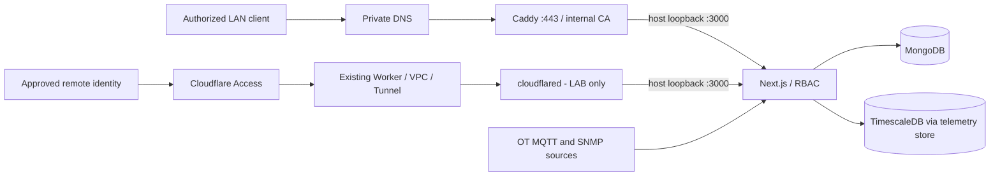

# Site Mapper MK1 · S06 FIELD LAN and optional LAB REMOTE

**Status: repository-only implementation candidate. NOT DEPLOYED, NOT CERTIFIED.**
No actions in this delivery touch TFARM04, customer routers, firewall, Cloudflare account, credentials, volumes, or running containers.

## Scope and source of truth

- **FIELD LAN:** `https://sitemapper.thradex.home.arpa` uses local DNS, Caddy internal CA, and private port 443. It must operate with WAN unavailable.
- **LAB REMOTE (opt-in only):** `https://site-mapper.thradex.workers.dev` uses Cloudflare Worker/VPC/Tunnel and Cloudflare Access. It needs Internet and is **not** air-gapped.
- Existing OFFICE/preproduction stack is not a certified client release. The base `docker-compose.telemetry.yml` binds Next.js to `127.0.0.1:3000`; the OFFICE overlay exposes MQTT on a configurable LAN interface. Verify effective bindings on the target before choosing deployment profiles.
- Client distribution is defined separately in `docs/release/docker-vps-distribution.md`: current Compose definitions can build from source and are **not** the finished prebuilt offline image package.

## Architecture

LAN works without any Cloudflare component. Cloudflare is optional for laboratory remote use only. The internal `.home.arpa` hostname must never be pointed at public DNS.

## Delivered repository artifacts

| Item | Responsibility |
| --- | --- |
| `docker-compose.field-lan.yml` | Additive Caddy service, host networking, persistence for CA and Caddy configuration |
| `infra/field/caddy/Caddyfile` | HTTPS for approved hostname with `tls internal`; reverse proxy to loopback Next.js |
| `docker-compose.lab-remote.yml` | Explicit opt-in cloudflared service, no public inbound host ports |
| `deployment-runbook.md` | Preconditions, controlled execution, rollback, CA distribution, backup |
| `security-and-access.md` | Security boundaries, separation of FIELD and LAB, ports, auth |
| `acceptance.md` | HU-039..048 acceptance gates and evidence |
| `operations.md` | Systemd templates, watchdog, backups, restore preflight and security considerations |

## Non-negotiables

1. Never run `docker compose down -v`, purge existing data volumes, or recreate identities to fix an HTTP problem.
2. No secret, cloudflared tunnel token, CA private key, customer topology, or data dump enters Git.
3. Any change to published ports, routing, SSH, firewall, or DNS needs a target-specific change window with rollback and independent administrative access.
4. Trust the **public root certificate** on each authorized client; never copy the root private key to a browser workstation.
5. Don't label the environment PRODUCTION or AIR-GAPPED until the corresponding acceptance record has been signed.
6. Existing SITE MAPPER auth/RBAC stays authoritative even when Cloudflare Access is enabled.
7. Certificates are only one layer: verify session cookies, origin rules, real-time transports, and redirect URLs for both hostnames.

## Sprint 06 scope

HU-039 local hostname; HU-040 Caddy/CA; HU-041 least-privilege networking; HU-042 boot; HU-043 watchdog; HU-044 recoverable backup; HU-045 separate profiles; HU-046 acceptance; HU-047 optional tunnel; HU-048 Access plus app authorization.

**Implementation status:** Caddy, optional connector, systemd templates, conservative watchdog, encrypted backup, isolated restore preflight, static checks and network-policy templates are versioned. DNS/firewall enforcement, runtime integration, independent boot recovery, actual encrypted backups, restoration and certification remain target-specific and **not executed**.
