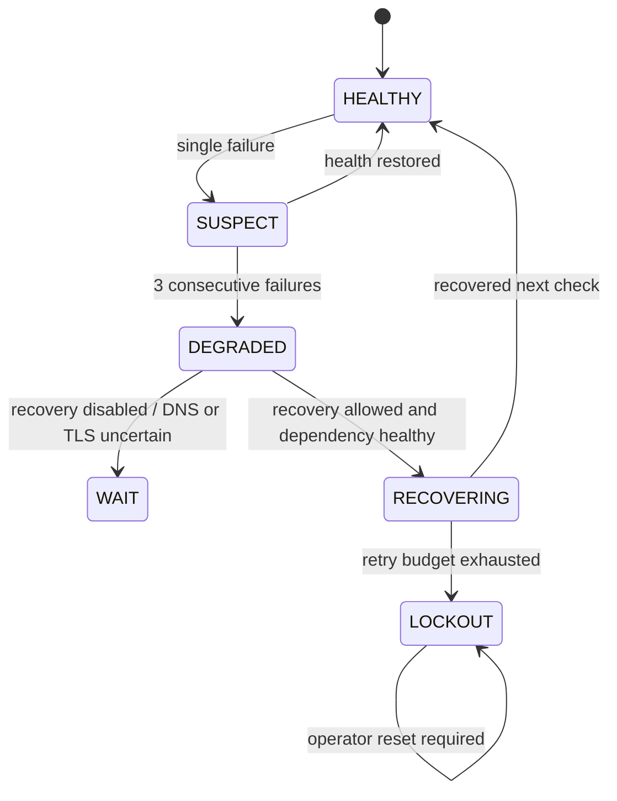

# S06 — Continuity, backups and network policy

**Status: repository implementation only. No TFARM04 deployment or validation.**

## New artifacts and responsibilities

| Artifact                                                | Responsibility                                                                                                 | Protection                                                    |
| ------------------------------------------------------- | -------------------------------------------------------------------------------------------------------------- | ------------------------------------------------------------- |
| `infra/field/ops/field-lan-service.sh`                  | Starts/stops **Caddy only** by Compose service name, with no build or volume removal                           | Requires original private Compose environment                 |
| `infra/field/ops/systemd/site-mapper-field-lan.service` | Linux boot hook for Caddy after Docker                                                                         | Requires approved `/opt/site-mapper` deployment location      |
| `infra/field/ops/dnsmasq.conf.template` + DNS unit      | Serves `thradex.home.arpa` only on the FIELD bridge and forwards non-private names to the host uplink resolver | No WAN dependency for the private zone                        |
| `infra/field/ops/watchdog.py` and systemd timer         | Checks DNS, HTTPS and Next.js health; selectively restarts DNS, Caddy or Next.js without restarting databases  | 3 failures, 3 recoveries / 15 min, persistent LOCKOUT         |
| `infra/field/ops/install-host-resilience.sh`            | Installs DNS/watchdog, persists route-only DNS, stages Kea DNS advertisement and enforces Site Mapper restart policy | Root-only; fails closed unless industrial ingest contract is healthy |
| `scripts/operations/certify-s06-host.sh`                | Read-only acceptance for boot services, DNS, Docker restart policy, trusted HTTPS and live certificate         | Run after apply and after reboot                              |
| `infra/field/ops/backup.py` and daily timer             | Runs `mongodump`, `pg_dump`, captures Caddy /data and private runtime configuration, encrypts using `age`      | Requires external backup destination and public age recipient |
| `infra/field/ops/restore-preflight.py`                  | Verifies SHA-256 checksums and decrypts into a **new isolated directory only**                                 | Never connects to running databases                           |
| `infra/field/ops/network-policy.example.json`           | Template for authorized LAN + admin CIDRs, no auto-applied firewall                                            | Site survey + administrative approval mandatory               |
| `infra/field/ops/check-network-policy.py`               | Validates network contract, rejects wildcard/public source CIDRs                                               | Read-only                                                     |
| `infra/field/ops/preflight.py`                          | Inspects DNS, tool presence and Docker port publication                                                        | Read-only                                                     |
| `scripts/ci/check-s06.py`                               | Checks Python syntax and static file invariants                                                                | Local/CI only, no services                                    |

## Systemd installation contract

The host-resilience installer copies the watchdog into `/usr/local/lib/site-mapper`, stores its non-secret environment in `/etc/site-mapper/watchdog.env`, and installs only the DNS/watchdog units. It does not replace databases, regenerate Caddy PKI, rebuild images or start an inactive Kea DHCP service.

1. Verify the exact Compose project, FIELD bridge, private hostname and bridge address. The installer fails closed if the bridge does not already own the expected address.
2. The installer creates a route-only resolver for `thradex.home.arpa` and renders the DNS service configuration. Kea integration is **stage-only by default**: it writes `/etc/site-mapper/kea-dhcp4.s06.candidate.json` and does not restart or reload DHCP. `S06_KEA_PUBLISH=1` is allowed only while Kea is inactive; an active Kea service causes a fail-closed result instead of an automatic restart.
3. The operating-system trust store is authoritative by default. `S06_CA_CERT` remains available only when a site intentionally uses a separate public-root path.
4. Docker and Caddy must be systemd-enabled. Before any host mutation, the live Site Mapper container must belong to the expected Compose project and contain valid, non-empty `INDUSTRIAL_INGEST_SOURCES_JSON` and `INDUSTRIAL_PROFILES_JSON` with consistent source identities. The installer also requires an invalid ingest probe to return HTTP 401; HTTP 503 `INVALID_SOURCE_CREDENTIALS` blocks the APPLY before DNS/watchdog installation.
5. The Site Mapper restart policy is enforced as `unless-stopped`, but the installer never executes Compose up/down/recreate. Recovery is enabled only after DNS, loopback application health and trusted HTTPS pass. Before any watchdog restart of Site Mapper, the industrial contract is inspected again. The watchdog never targets Mosquitto, SNMP trap/collector services, MongoDB, TimescaleDB or telemetry-store.
6. Run `scripts/operations/certify-s06-host.sh` after apply and again after a real reboot. Enable the backup timer separately only after off-host backup requirements are satisfied.

## Watchdog contract



- Probe 1: local Next.js `http://127.0.0.1:3000/api/health`.
- Probe 2: resolve the exact private hostname and require the configured FIELD address.
- Probe 3: `https://sitemapper.thradex.home.arpa/api/health` using normal certificate verification. No TLS bypass.
- DNS degradation targets only `site-mapper-dns.service`; an intentionally stopped DNS unit is not revived.
- If Next.js fails, validate the live industrial source/profile contract before any restart. Missing, malformed or inconsistent SNMP ingest configuration produces `industrial_contract_block` and requires operator intervention.
- If Next.js fails but a dependency is unhealthy, do not restart Next.js blindly; emit a degradation event.
- If app and DNS respond but HTTPS fails, recovery may target Caddy only.
- A deliberately stopped container is never revived by the watchdog.
- Lockout persists until an authorized operator reviews and resets state. Never reset it by deleting arbitrary volumes.

## Backup and restoration contract

The backup program relies on running MongoDB, Timescale and Caddy Compose containers. By default it refuses a destination that is not a separate mounted off-host volume (`S06_BACKUP_MOUNT_REQUIRED=1`); a target-specific remote mount must be approved. It fails closed if `age`, the approved recipient or the existing runtime configuration are missing.

Generated bundle: encrypted `mongo.archive.gz.age`, `timescale.dump.age`, `caddy-data.tar.gz.age` and `runtime-config.tar.gz.age`; the manifest stores checksums of ciphertext. Temporary plaintext is created only in a root-protected scratch directory and removed after completion; for stronger assurance against recoverable plaintext on persistent disks, the operator should use encrypted scratch storage (tmpfs or LUKS), as approved for the host. Never copy plaintext bundle contents to Git.

The restoration preflight **does not restore running databases**. It checks ciphertext hashes, requires a brand-new output directory outside the repo, and decrypts to that isolated location. A separate human-approved restoration procedure must establish a clean Mongo replica set and Timescale instance, apply `mongorestore`/`pg_restore`, recover Caddy CA identity, verify data integrity, and then conduct a client acceptance test. No script must overwrite the live installation automatically.

RPO/RTO and retention remain client-approved parameters; a daily candidate timer is not a promise of recovery point. Backup must be stored off-host and access-controlled; keep the age private identity separate.

## Firewall and Cloudflare controls

The JSON network policy is an **intended allowlist**, not a firewall installer. Completing it requires actual CIDRs, OT protocols, management exceptions, Docker publish inspection and WAN firewall constraints. Automatic application is expressly prohibited.

Cloudflare Access rules, Worker/VPC routing and `cloudflared` tokens remain outside this repository change. The LAB REMOTE overlay must never be enabled by a FIELD LAN startup sequence. When both access paths coexist, certify LAN operation with the cloudflared process stopped.

## Static checking (repository only)

```bash
python3 scripts/ci/check-s06.py
python3 infra/field/ops/check-network-policy.py infra/field/ops/network-policy.example.json
```

The second command **must fail** on the unchanged template: authorized CIDRs are intentionally missing. This is by design. Neither command performs a deployment.

## Remaining blockers to acceptance

- Actual Linux host installation and boot verification
- Internal DNS and client CA trust
- Firewall policy applied and verified against Docker networking
- Real Cloudflare Access policy and authorized remote flow
- Actual automated backup evidence, successful isolated restoration, RPO/RTO signoff
- Watchdog fault-injection/LOCKOUT behavior with evidence
- Offline end-to-end user journey
