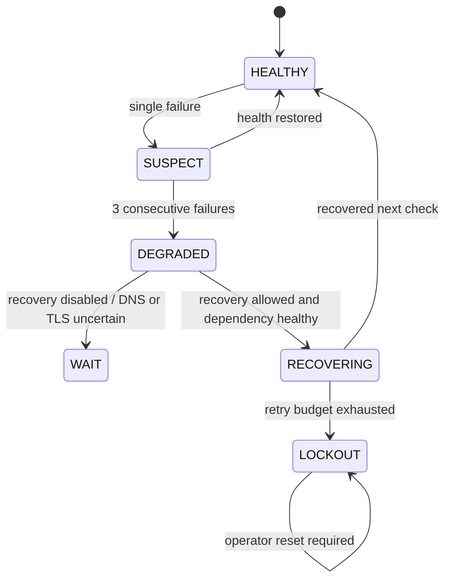

# S06 — Continuity, backups and network policy

**Status: repository implementation only. No TFARM04 deployment or validation.**

## New artifacts and responsibilities

| Artifact                                                | Responsibility                                                                                                    | Protection                                                    |
| ------------------------------------------------------- | ----------------------------------------------------------------------------------------------------------------- | ------------------------------------------------------------- |
| `infra/field/ops/field-lan-service.sh`                  | Starts/stops **Caddy only** by Compose service name, with no build or volume removal                              | Requires original private Compose environment                 |
| `infra/field/ops/systemd/site-mapper-field-lan.service` | Linux boot hook for Caddy after Docker                                                                            | Requires approved `/opt/site-mapper` deployment location      |
| `infra/field/ops/watchdog.py` and systemd timer         | Checks HTTPS through local CA and Next.js health, observes dependencies and selectively restarts Caddy or Next.js | **Recovery disabled by default**                              |
| `infra/field/ops/backup.py` and daily timer             | Runs `mongodump`, `pg_dump`, captures Caddy /data and private runtime configuration, encrypts using `age`         | Requires external backup destination and public age recipient |
| `infra/field/ops/restore-preflight.py`                  | Verifies SHA-256 checksums and decrypts into a **new isolated directory only**                                    | Never connects to running databases                           |
| `infra/field/ops/network-policy.example.json`           | Template for authorized LAN + admin CIDRs, no auto-applied firewall                                               | Site survey + administrative approval mandatory               |
| `infra/field/ops/check-network-policy.py`               | Validates network contract, rejects wildcard/public source CIDRs                                                  | Read-only                                                     |
| `infra/field/ops/preflight.py`                          | Inspects DNS, tool presence and Docker port publication                                                           | Read-only                                                     |
| `scripts/ci/check-s06.py`                               | Checks Python syntax and static file invariants                                                                   | Local/CI only, no services                                    |

## Systemd installation contract

The provided units deliberately reference `/opt/site-mapper` and `/etc/site-mapper/s06.env`; these are target-specific defaults, **not verified locations on TFARM04**. Do not enable these units before installation survey and backups.

1. Choose final immutable release/images and target directory. Verify exact Compose project name and runtime env. The systemd entrypoint uses the _existing_ Compose project identity; a wrong project name may create a separate Caddy instance.
2. Copy the example settings to `/etc/site-mapper/s06.env`, edit locally, set root-only permissions (0600). Do not check it into Git.
3. Place public CA root in `/etc/site-mapper/ca-root.crt` after approved Caddy enrollment; never copy its private key to this path.
4. Once the operator approves installation, install/copy units into systemd's administrator-managed directory, reload units and enable them individually.
5. Keep `S06_WATCHDOG_RECOVERY_ENABLED=0` throughout observation testing; authorize `1` only after controlled fault-injection acceptance.
6. Enable backup timer only after `age` is available offline, the public recipient has been verified, backups go to an appropriate off-host location, and a restore drill passed.

## Watchdog contract



- Probe 1: local Next.js `http://127.0.0.1:3000/api/health`.
- Probe 2: `https://sitemapper.thradex.home.arpa/api/health`, with exact hostname verification using the public local CA root. No TLS bypass.
- If DNS or TLS trust is invalid, report configuration failure; do **not** restart databases or Caddy repeatedly.
- If Next.js fails but a dependency is unhealthy, do not restart Next.js blindly; emit a degradation event.
- If app responds and HTTPS fails, recovery may target Caddy only.
- A deliberately stopped container is never revived by the watchdog.
- Lockout persists until an authorized operator reviews and resets state. Never reset it by deleting arbitrary volumes.

## Backup and restoration contract

The backup program relies on running MongoDB, Timescale and Caddy Compose containers. By default it refuses a destination that is not a separate mounted off-host volume (`S06_BACKUP_MOUNT_REQUIRED=1`); a target-specific remote mount must be approved. It fails closed if `age`, the approved recipient or the existing runtime configuration are missing.

Generated bundle: encrypted `mongo.archive.gz.age`, `timescale.dump.age`, `caddy-data.tar.gz.age` and `runtime-config.tar.gz.age`; the manifest stores checksums of ciphertext. Temporary plaintext is created only in a root-protected scratch directory and removed after completion; for stronger assurance against recoverable plaintext on persistent disks, the operator should use encrypted scratch storage (tmpfs or LUKS), as approved for the host. Never copy plaintext bundle contents to Git.

The restoration preflight **does not restore running databases**. It checks ciphertext hashes, requires a brand-new output directory outside the repo, and decrypts to that isolated location. A separate human-approved restoration procedure must establish a clean Mongo replica set and Timescale instance, apply `mongorestore`/`pg_restore`, recover Caddy CA identity, verify data integrity, and then conduct a client acceptance test. No script must overwrite the live installation automatically.

RPO/RTO and retention remain client-approved parameters; a daily candidate timer is not a promise of recovery point. Backup must be stored off-host and access-controlled; keep the age private identity separate.

## Firewall and Cloudflare controls

The JSON network policy is an **intended allowlist**, not a firewall installer. Completing it requires actual CIDRs, OT protocols, management exceptions, Docker publish inspection and WAN firewall constraints. Automatic application is expressly prohibited.

Cloudflare Access rules, Worker/VPC routing and `cloudflared` tokens remain outside this repository change. The LAB REMOTE overlay must never be enabled by a FIELD LAN startup sequence. When both access paths coexist, certify LAN operation with the cloudflared process stopped.

## Static checking (repository only)

```bash
python3 scripts/ci/check-s06.py
python3 infra/field/ops/check-network-policy.py infra/field/ops/network-policy.example.json
```

The second command **must fail** on the unchanged template: authorized CIDRs are intentionally missing. This is by design. Neither command performs a deployment.

## Remaining blockers to acceptance

- Actual Linux host installation and boot verification
- Internal DNS and client CA trust
- Firewall policy applied and verified against Docker networking
- Real Cloudflare Access policy and authorized remote flow
- Actual automated backup evidence, successful isolated restoration, RPO/RTO signoff
- Watchdog fault-injection/LOCKOUT behavior with evidence
- Offline end-to-end user journey
