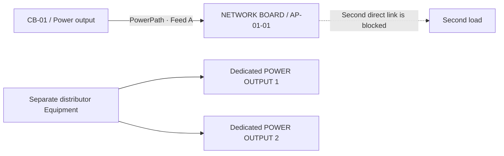

# One-to-one POWER Access Port commissioning

**Accepted physical rule (2026-10-19):** one origin Access Port feeds **one** destination Access Port. An output cannot be attached to a second load, and an input cannot have a second feed. Distribution to multiple loads must be modeled by a **separate Equipment distributor** with distinct physical output terminals.

## Example — what the operator should see



On the CB-01 Equipment page, the terminal shows **CONNECTED → NETWORK BOARD / AP-01-01** with a **VIEW POWERPATH** link. The CTA **CONNECT LOAD** is suppressed while that terminal has an active path. On NETWORK BOARD, the terminal reports **POWERED BY ← CB-01 / Power output**, not another invitation to connect it.

A recorded PowerPath documents an **asserted physical connection**, not proof that hardware is energized. MQTT LIVE and historical measurements remain separate evidence.

## Enforced limits

- The API returns `SOURCE_ALREADY_CONNECTED` when a physical source terminal is already assigned to a different PowerPath.
- The API returns `TARGET_ALREADY_CONNECTED` when a physical destination is already assigned.
- Reposting exactly the same pair is idempotent: the original path remains unchanged.
- `POWER` ports with `BIDIRECTIONAL` direction cannot be used as a pass-through in a second connection; create an explicit distribution Equipment with separate terminals.
- MongoDB's active-source and active-target unique indexes prevent duplicate assignment even when independent writers race **for the same port role**. The read-only audit also flags bidirectional cross-role reuse.

## Safe upgrade of existing databases

**Before deploying the new app build**, select your actual database and run the read-only Mongo integrity audit against it. The script reports `MULTIPLE_ACTIVE_POWER_PATHS_FOR_OUTPUT`, `MULTIPLE_ACTIVE_POWER_PATHS_FOR_INPUT` and `POWER_PORT_USED_IN_MULTIPLE_PATHS`. It **does not modify** any record.

```bash
# Set the existing environment/secret values locally; never print credentials.
npm run audit:mongo -- --expect-db=<YOUR_ACTUAL_DATABASE_NAME>
```

If violations are found, stop. Have an operator review and **explicitly** resolve incorrect historical physical assertions. Never delete a connection or switch source IDs automatically. The new unique indexes will reject pre-existing duplicate active source/target assignments; plan that remediation before deploying or restarting the app.

After passing the audit, rebuild **only Site Mapper** when you are ready to apply its index definitions. Do not remove any MongoDB or TimescaleDB volume and do not change the MQTT serials or approved bindings.

## Other checks

- Select an Equipment with an existing path and inspect **PHYSICAL TERMINALS** and **ACCESS PORTS**. Both must name the same peer Equipment/port and offer **VIEW POWERPATH**.
- The connect form must mark used sources and targets **ALREADY CONNECTED**, and disable its confirmation.
- A free POWER output may still offer **CONNECT LOAD**.
- The full power trace must show the same path and correct Feed A or B. Feed A recorded does not certify A+B redundancy.
- If the source was physically moved to another destination, retire the existing recorded PowerPath through the approved administrative workflow _after field verification_, then create the newly confirmed path.

### Physical modeling note

A terminal labeled `POWER · BIDIRECTIONAL` on a Network Board can receive a feed in the current schema, but a dedicated `POWER · INPUT` should be used when it physically **only** receives. An `RS-485` communications interface should not be represented as a power terminal unless its engineering specification explicitly supports that meaning.

This change adds no implicit port, breaker, telemetry binding or wiring assumption.
