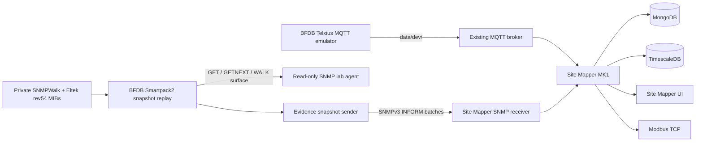

# Telxius seed-01 · consolidated MQTT + Smartpack2 evidence lab

**Status:** current-main laboratory runbook. This profile is additive, preserves Mongo/Timescale volumes, uses the existing MQTT broker, and keeps laboratory replay separate from field commissioning.

## What this launcher starts



The launcher **does not start or own an MQTT broker**.

The broker URL is supplied by the operator and is the same broker consumed by Site Mapper and published to by the BFDB MQTT emulator.

## Truth boundary

### MQTT / Acrel-AWT

The three laboratory publishers are:

```text
EMU-TELXIUS-QDF-2
EMU-TELXIUS-QDF-4
EMU-TELXIUS-QDF-5
```

Each source exposes the complete four-group raw address space:

```text
0_1_1..24
0_2_1..24
0_3_1..24
0_4_1..24
```

BFDB emits each 24-position group in the captured 10 + 10 + 4 message shape.

This is **96 raw addresses per QDF**. Only documented measured positions carry U1/I1/P1/EP1 values; the remaining raw addresses are state-only.

Site Mapper currently contains explicit Circuit Breaker inventory/bindings for:

- QDF-4: 12 physical feed positions;
- QDF-5: 36 physical feed positions.

QDF-2 remains **RAW-visible but breaker-uncommissioned** in Site Mapper because the final post-migration physical breaker positions are not established by the seed evidence currently accepted in the repository.

That means this lab may receive QDF-2 MQTT traffic without presenting those 26 historical feed references as commissioned Circuit Breakers.

### SNMP / Smartpack2

There is **one Smartpack2 evidence source** in this lab:

```text
EMU-SMARTPACK2-LURIN
```

It is not cloned into QDF-2/QDF-4/QDF-5.

The supplied evidence snapshot contains **5,407 observed SNMP objects/OIDs**. These are not 5,407 sensors or 5,407 commissioned engineering measurements.

The replay pipeline is:

```text
private SNMPWalk
+
private Eltek rev54 MIBs
        |
        v
BFDB snapshot compiler
        |
        +--> read-only GET / GETNEXT / WALK surface
        |
        +--> snapshot.json
                 |
                 v
          SNMPv3 INFORM batches
                 |
                 v
          Site Mapper RAW SNMP
```

The Site Mapper profile uses `mib: eltek-rev54` but intentionally assigns **no QDF target** to the Smartpack2 source because the current evidence does not prove which QDF controller owns the captured walk.

Known Eltek definitions/enumerations may be interpreted by the existing catalog. Everything else remains visible as RAW/UNKNOWN rather than receiving invented engineering meaning.

The INFORM sweep is a **laboratory delivery mechanism**. It does not claim that the physical Smartpack2 emits all 5,407 objects as traps/informs in the field.

## Private evidence

Do not commit customer SNMP evidence or vendor MIB files.

Prepare a private directory containing:

```text
Results SNMPWalk(4).txt
EltekEnexusPowersystem-rev54.mib
EltekEnexusPowersystem_branch10_rev54.mib
```

The launcher also accepts `walk.txt` for the walk filename and the non-suffixed rev54 MIB names used by some local workspaces.

Example:

```bash
export TELXIUS_SNMP_EVIDENCE_DIR=/absolute/private/path/telxius-smartpack2
```

## Existing MQTT broker

Provide the already validated broker:

```bash
export TELXIUS_MQTT_BROKER_URL='mqtt://<broker-host>:1883'
export TELXIUS_MQTT_USERNAME='<only-if-required>'
export TELXIUS_MQTT_PASSWORD='<only-if-required>'
```

The current BFDB field-emulator publisher supports `mqtt://`. The launcher refuses to silently downgrade an `mqtts://` URL.

When the broker is on `localhost` / `127.0.0.1`, the launcher translates the container-side connection to `host.docker.internal` and adds the Docker host gateway explicitly.

## Repositories

Both repositories must be on current `main`:

```text
AppM-Site-Mapper
bfdb-telemetry-gateway
```

Typical sibling layout:

```text
Thradex/
├── AppM-Site-Mapper/
└── bfdb-telemetry-gateway/
```

The launcher validates that BFDB contains the current Telxius field emulator, full Smartpack2 snapshot compiler and snapshot INFORM sender.

## Start everything

### Full self-contained seed-01 lab without private Smartpack2 evidence

When the private Smartpack2 walk/MIB evidence is unavailable, the supported full
laboratory mode uses the repository's synthetic Eltek SNMPv3 emulator instead of
inventing Smartpack2 evidence:

```bash
python3 scripts/telemetry/seed-01-telxius-lab.py \
  --action up \
  --ack-lab-only \
  --use-lab-broker \
  --synthetic-snmp
```

This mode rebuilds/starts the seed-01 private broker, QDF-2/QDF-4/QDF-5 MQTT
Telxius publisher, three synthetic Eltek SNMPv3 agents, SNMP receiver, Site Mapper,
MongoDB, TimescaleDB, telemetry-store, Modbus TCP and Operational Console.

Each synthetic SNMP source is bound to the canonical QDF controller Equipment and
publishes lab voltage/current/temperature plus a governed `CONTROLLER_ALARM`
open/clear cycle. These signals are explicitly synthetic and must never be presented
as Smartpack2 field evidence or physical commissioning.

### Without private Smartpack2 evidence

If the private SNMPWalk and Eltek rev54 MIB files are not available, do **not** invent,
download substitute evidence, or assign the Smartpack2 source to a QDF. Start the same
Telxius lab in explicit degraded mode:

```bash
python3 scripts/telemetry/seed-01-telxius-lab.py \
  --action up \
  --ack-lab-only \
  --skip-snmp-evidence
```

This mode still starts MongoDB, TimescaleDB, telemetry-store, Site Mapper, Modbus TCP,
Operational Console and the QDF-2/QDF-4/QDF-5 MQTT Telxius emulator. It stops the old
per-QDF synthetic SNMP agents/collectors, does not start the Smartpack2 replay services,
and publishes no Smartpack2 profile or ingest authorization. The launcher reports SNMP as
`SKIPPED`; that is an explicit evidence boundary, not a failed commissioning state.

From `AppM-Site-Mapper`:

```bash
git switch main
git pull --ff-only origin main

cd ../bfdb-telemetry-gateway
git switch main
git pull --ff-only origin main

cd ../AppM-Site-Mapper

python3 scripts/telemetry/seed-01-telxius-lab.py \
  --action up \
  --ack-lab-only
```

The launcher will:

1. prepare the existing Site Mapper industrial runtime if its private runtime files do not yet exist;
2. start MongoDB and the replica-set initializer without deleting volumes;
3. verify `seed-01` v4+ already exists;
4. read QDF target IDs from Mongo rather than hardcoding UUIDs;
5. generate the MQTT industrial profiles and the single Smartpack2 RAW profile;
6. apply reversible MQTT source/point bindings;
7. stop older synthetic publishers/agents if they exist;
8. start TimescaleDB;
9. start the telemetry store;
10. start Site Mapper;
11. start the Modbus bridge;
12. start the Site Mapper SNMP receiver;
13. start the operational console;
14. start BFDB QDF-2/QDF-4/QDF-5 MQTT emulation against the **existing broker**;
15. compile and serve the private Smartpack2 5,407-object snapshot;
16. deliver that snapshot to Site Mapper through authenticated SNMPv3 INFORM batches.

No `docker compose down -v` is issued.

## Expected services

After startup:

```text
mongodb
timescaledb
telemetry-store
site-mapper
modbus-tcp
snmp-traps
operational-console
lab-mqtt-telxius
seed01-smartpack2
seed01-smartpack2-to-site-mapper
```

The historical `lab-mosquitto`, generic `lab-mqtt` and old three-controller SNMP services are stopped if present. They are not deleted.

## Observe

```bash
python3 scripts/telemetry/seed-01-telxius-lab.py --action status
```

Logs:

```bash
python3 scripts/telemetry/seed-01-telxius-lab.py --action logs
```

Expected local surfaces:

```text
Site Mapper:          http://127.0.0.1:3000
Operational Console: http://127.0.0.1:3100
Modbus TCP lab:      127.0.0.1:1503
```

## What should appear in Site Mapper

### MQTT

```text
EMU-TELXIUS-QDF-2
EMU-TELXIUS-QDF-4
EMU-TELXIUS-QDF-5
```

For QDF-4/QDF-5, commissioned breaker bindings should update their existing Circuit Breaker Equipment.

QDF-2 raw traffic can be captured and inspected, but its historical feed positions must not be promoted to final Circuit Breaker bindings until the post-migration physical positions are accepted.

### SNMP

Filter the universal industrial/SNMP explorer by:

```text
EMU-SMARTPACK2-LURIN
```

The expected catalog is the complete replayed snapshot over repeated batches, not one giant 5,407-varbind PDU.

The number 5,407 means **observed OID/value objects in the supplied walk**.

## Stop without deleting data

```bash
python3 scripts/telemetry/seed-01-telxius-lab.py --action stop
```

This stops the selected services. It does not delete MongoDB, TimescaleDB, the Smartpack runtime volume or Site Mapper topology.

## Retire only the synthetic MQTT bindings

```bash
python3 scripts/telemetry/seed-01-telxius-lab.py \
  --action retire \
  --ack-lab-only
```

This archives only bindings tagged by the Telxius synthetic lab commissioning marker.

## Explicit non-claims

This lab does not claim that:

- MQTT raw group numbers are commissioned physical panel identities;
- RTU slave IDs equal MQTT raw group numbers;
- real AWT firmware refreshes all four raw groups every ten seconds;
- U2/I2/P2/EP2 represent a second breaker channel;
- QDF-2 historical feed references are final post-migration breaker positions;
- the captured Smartpack2 belongs to QDF-2, QDF-4 or QDF-5;
- all 5,407 OIDs are engineering measurements;
- all originally numeric walk OIDs have manufacturer-verified ASN.1 type metadata;
- the physical Smartpack2 broadcasts a 5,407-object INFORM sweep;
- the existing Modbus map is field-commissioned for Metasys;
- successful laboratory startup equals physical field certification.

## Alarm UI acceptance fixture — Docker only

The alarm implementation includes a **reversible synthetic UI fixture** for the existing isolated seed-01 Docker project. It exists only to validate the approved hierarchy and screens; it is not electrical field evidence and it does not commission production thresholds.

The fixture creates exactly two active occurrences under QDF-4 / panel A3:

```text
A3-03  TELEMETRY_LOSS  WARNING
A3-04  POWER_LOSS      CRITICAL · CONFIRMED
```

Apply it to the existing seed-01 Mongo container:

```bash
docker exec -i -e SITEMAPPER_ALARM_DEMO_ACK=LAB_ONLY \
  site-mapper-seed-01-mongodb-1 mongosh --quiet seed-01 \
  < scripts/telemetry/seed-01-alarm-ui-fixture.mongosh.js
```

Clear only these synthetic alarm records:

```bash
docker exec -i \
  -e SITEMAPPER_ALARM_DEMO_ACK=LAB_ONLY \
  -e SITEMAPPER_ALARM_DEMO_MODE=clear \
  site-mapper-seed-01-mongodb-1 mongosh --quiet seed-01 \
  < scripts/telemetry/seed-01-alarm-ui-fixture.mongosh.js
```

The script refuses any database except `seed-01` and requires the explicit `LAB_ONLY` acknowledgement. Records are tagged `LAB_UI_DESIGN_FIXTURE_2026_10_30`.

For the already-created isolated Docker project used during the 30 October visual review, Site Mapper was published as:

```text
127.0.0.1:3001 -> container 3000
```

The generated runtime port overlay is authoritative for an existing lab. Do not recreate the project merely to force the base Compose default port.
