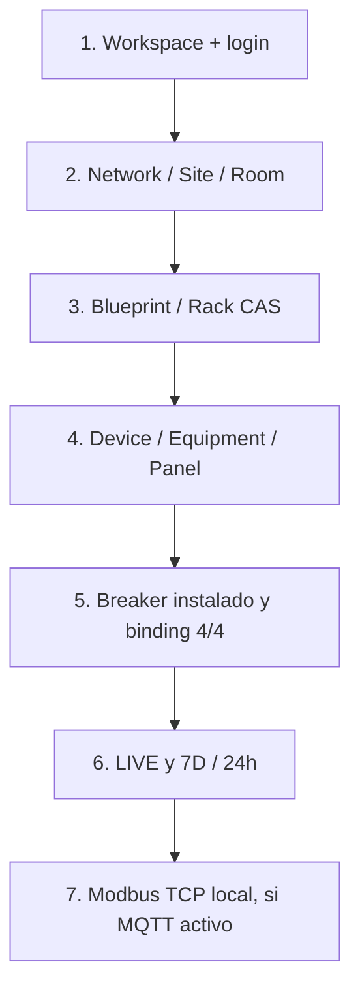

# Guía de presentación · Site Mapper MK1 (candidato MVP)

**Objetivo:** que alguien que no desarrolló la aplicación entienda qué es, cómo funciona y qué evidencia produce. Duración sugerida: 10–15 minutos. No demuestra seguridad de producción ni sensores físicamente conectados.

## Mensaje ejecutivo

> Site Mapper concentra la vista física de una instalación, organiza su infraestructura por ubicación y componentes y permite relacionar una señal externa con el equipo correcto. Una lectura no se considera de un circuito hasta que el operador valida la correspondencia; luego puede verse en tiempo real, persistirse como histórico y exponerse a sistemas industriales por Modbus TCP.

## Recorrido principal

| Momento                 | Qué mostrar                                                  | Qué decir / qué no decir                                          |
| ----------------------- | ------------------------------------------------------------ | ----------------------------------------------------------------- |
| 1. Login (1 min)        | Identidad y `Workspace`                                      | Sesión controlada por servidor; no mostrar secretos               |
| 2. Localización (2 min) | Network → Site → Structure → Level → Room                    | La navegación conserva la ubicación de cada equipo                |
| 3. Espacio (2 min)      | Blueprint, Rack y elevación CAS                              | Distinguir geometría registrada de levantamiento real del cliente |
| 4. Composición (2 min)  | Device con Equipment anidado, Panel de 24 posiciones y CB-01 | Un slot no genera un breaker ni una lectura automática            |
| 5. Comisión (2 min)     | `MQTT POINT COMMISSIONING`, `4/4 · VERIFIED MAPPING`         | El panel ofrece un prefijo; el operador confirmó el punto exacto  |
| 6. Evidencia (2 min)    | `LIVE`, luego `24H`/`7D` (la API usa `24h`/`7d`)             | LIVE exige frescura; histórico es TimescaleDB del producto        |
| 7. Integración (2 min)  | Registro de `MODBUS_CERT_PASS` y tabla de Unit ID/offset     | Certificación con emulador; **no** Metasys real                   |

## Escenario probado para la demostración técnica

**Solo cuando se esté usando el mismo inventario de laboratorio y el emulador activo:**

- Panel: `BDFB-01-SHELF-01-FRAME-01-PANEL-01`, serial `EMU-BFDB-01`, prefijo `0_1`.
- Posición 01: `BDFB-01-PANEL-01-CB-01` con las cuatro métricas `VOLTAGE`, `CURRENT`, `POWER`, `ENERGY`.
- Punto: `0_1_1`, source `EMU-BFDB-01`, 4/4 bindings explícitos.
- API de lectura autenticada: `/api/telemetry/entity?targetId=4d394db4-b263-4ca3-9fa2-fb10661d89ff&window=LIVE`.
- Histórico: mismo endpoint con `window=24h` o `window=7d`.
- Modbus: Unit ID 1, FC03, direcciones 0–7, 4 valores FLOAT32 en orden Voltage/Current/Power/Energy.

El 15 de octubre el verificador imprimió `MODBUS_CERT_PASS` con coincidencia exacta —dentro de la precisión FLOAT32— respecto a registros recientes del mismo breaker. No fijar esos números como si fueran valores actuales.

## Si la red o el emulador falla durante la presentación

1. Mostrar inventario, plano, rack, composiciones y PowerPath desde MongoDB: esa parte de la demo no depende del túnel MQTT.
2. No calificar lecturas históricas como LIVE. Es legítimo mostrar `NO DATA`, `STALE` o la última muestra histórica junto con su hora.
3. Si `7D` muestra `HISTORY_STORE_UNAVAILABLE`, seguir la [guía de conectividad](../operations/history-connectivity.md), no reinicializar Mongo.
4. No reconfigurar seriales, fabricar bindings o inyectar métricas sin declarar abiertamente que son un fixture de prueba.

## Preguntas esperables

**¿Se conecta a equipos reales?** El consumidor MQTT y la arquitectura están preparados para fuentes externas que cumplan contrato, pero solo se verificó el escenario local con emulador; integrar hardware requiere credenciales, ACL, identidad física y puesta en marcha independientes.

**¿Es SCADA o BMS?** No. Modela infraestructura y datos aceptados, y ofrece un sidecar Modbus TCP en laboratorio. No sustituye Metasys ni sus protocolos, alarmas o garantías de control.

**¿Si se desconecta MQTT se pierde todo?** La topología y lo ya persistido en Mongo/TimescaleDB permanecen; el LIVE se vuelve stale/offline. Las muestras no aceptadas durante una desconexión no se recuperan automáticamente por reiniciar contenedores.

**¿Qué falta para producción?** Calidad Modbus diferenciada de cero, certificación de 96 puntos por equipo, respaldo/restauración de Mongo y TSDB, TLS/ACL/secretos de producción, carga, auditoría OT, plan de recuperación y aceptación visual del cliente.

**¿Por qué un circuito debe confirmarse?** Porque la posición física 01 y la etiqueta `0_1_1` no prueban por sí mismas cableado ni propiedad de señal. Evitamos presentar la telemetría de un breaker equivocado.

## Checklist antes de mostrar

- [ ] Abrir sesión con un usuario autorizado y verificar navegación normal.
- [ ] Comprobar que se usa el inventario Mongo correcto (si no es demo en memoria).
- [ ] Verificar panel, slot 01, source y bindings 4/4.
- [ ] Si prometemos LIVE, confirmar `connection=subscribed`, muestras recientes y 0 rechazos relevantes.
- [ ] Si prometemos 7D, abrirlo realmente; comprobar histórico y escritura reciente en TimescaleDB.
- [ ] Si prometemos Modbus, ejecutar el script de certificación y mostrar un `PASS` reciente.
- [ ] Preparar recorrido alternativo sin telemetría para una caída del túnel.
- [ ] No exponer cookies, tokens, contraseñas, URIs ni capturas con datos sensibles.

## Cierre de la reunión

> El MVP representa infraestructura física jerárquica y demuestra un trayecto confiable desde una señal MQTT hasta un Equipment específico, con LIVE, histórico propio y lectura Modbus local. El trabajo siguiente es **escalar y certificar** esas capacidades, no dar por validada una instalación completa por haber probado un circuito.
