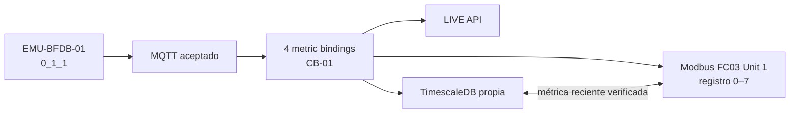

# MK1 · MVP Readiness y criterios de salida

**Evaluación a 16 oct. 2026:** **candidato a MVP presentable**. El repositorio cubre el recorrido físico y dispone de un primer circuito MQTT → Equipment → LIVE → TimescaleDB → Modbus TCP verificado en laboratorio. **No declarar `production ready`** hasta cerrar los puntos pendientes aquí.

## Diferenciar cuatro estados

| Etiqueta | Significado | Estado actual |
| --- | --- | --- |
| **Implementado** | Existe código y contratos para la capacidad | Amplia cobertura de MK1 |
| **Validado por CI** | Las pruebas del repositorio pasan en un commit concreto | Última consolidación previa a este documento aprobada; comprobar CI del nuevo HEAD |
| **Validado en laboratorio** | Operador observó la funcionalidad con emulador y base concreta | Un CB-01 y consultas LIVE/histórico/FC03 probadas |
| **Validado en cliente/producción** | Hardware, redes, seguridad, restore, SLA y aceptación real | **No** |

G0–G15 son las fases históricas de reconstrucción documentadas. No significan que cada despliegue ni los 288 puntos del emulador estén certificados.

## Capacidades para la presentación

| Capacidad | Evidencia / ubicación | Decisión |
| --- | --- | --- |
| Login, servidor y roles | Código `identity`, páginas y pruebas CI | Presentable como producto, probar sesión en escenario de demo |
| Topología navegable | `topology_nodes`, jerarquía accepted G2, Device/Equipment recursivo | Presentable, inventario del cliente pendiente |
| Blueprint / CAS / Rack Elevation | Módulos y Golden Path | Presentable como software, aceptación visual en resolución objetivo pendiente |
| PowerPath y AccessPorts | API + entidades de dominio, solo conexiones explícitas | Presentable cuando existan rutas registradas; no inferir redundancia |
| Warehouse / Workspace / Settings | Código y tests del baseline | Presentable con cuentas y permisos adecuados |
| MQTT BFDB | `EMU-BFDB-01`, subscription confirmada; emulador externo | Verificado para el laboratorio especificado |
| Commissioning | CB-01 4/4, `ready:true`, sin conflicto | Verificado en ese único circuito |
| LIVE y API | JSON del mismo CB-01 con cuatro variables y fuente exacta | Verificado en fecha de observación |
| Histórico SQL + 24h/7d | Registros en dos tablas, `window=24h` OK y UI 7D recuperada | **Consulta recuperada**; comprobar escrituras nuevas tras incidente |
| Modbus FC03 | `MODBUS_CERT_PASS`, Unit ID 1, registros 0–7, histórico equivalente | Verificado **solo** en circuito emulado |
| Operación | Operational Console y workflow CI previos aprobados | Validación local adicional aconsejada al demo |

## Evidencia del primer circuito (15 oct. 2026)

- Panel Equipment `5a31f9bd-220d-4f1b-b42a-f73a9aaf03f5`; breaker Equipment `4d394db4-b263-4ca3-9fa2-fb10661d89ff`.
- `EMU-BFDB-01 / 0_1_1`, cuatro bindings (`VOLTAGE`, `CURRENT`, `POWER`, `ENERGY`).
- En el corte de verificación SQL anterior: 44 filas en `telemetry_entity_samples` y 35 en `telemetry_samples`, ambos para CB-01. Son **snapshots**, no mínimos ni valores actuales.
- Modbus con `MODBUS_CERT_PASS`, comparación de IEEE-754 FLOAT32 con muestras recientes de **esa** TimescaleDB.
- Incidente posterior: `HISTORY_STORE_UNAVAILABLE` y `fetch failed` desde Site Mapper a `telemetry-store`; el operador confirmó que la vista 7D volvió a mostrar histórico. **No se ha adjuntado una nueva evidencia SQL de escritura exitosa después de esa recuperación.**

## Gates para una demostración interna repetible

- [ ] CI verde sobre el commit de documentación/release actual.
- [ ] Una persona distinta del desarrollador completa el guion [MVP-DEMO-ES](../product/MVP-DEMO-ES.md) sin asistencia sobre el flujo principal.
- [ ] Login, topología, Rack, Equipment, Power y navegación visual revisados en las resoluciones elegidas.
- [ ] MongoDB de la demo y base seleccionada documentados y respaldados si los datos deben persistir.
- [ ] Para demo LIVE: broker/túnel activos, aceptaciones recientes y fuente no ambigua.
- [ ] Para demo histórico: histórico 24h y 7d disponibles **y** `lastWriteAt`/`lastError`/filas SQL recientes tras recuperación.
- [ ] Para demo Modbus: repetir `MODBUS_CERT_PASS` en esa sesión; lectura cero no es pass.
- [ ] Demo degradada ensayada: visual sin broker, NO DATA/STALE explícitos.

**Una demo sin MQTT es válida como demostración de gestión física**, siempre que se anuncie ese alcance. No se debe presentar un histórico antiguo como LIVE.

## Gates para piloto controlado con cliente

- [ ] Aprobación escrita de geometría, Rack/CAS, identidades y fuente de señales.
- [ ] Verificación de los 24 puntos del panel antes de alta masiva; después 96 por fuente, y fuentes independientes sin colisiones.
- [ ] Aceptación funcional de roles, login/logout, edición y navegación en el entorno asignado.
- [ ] Infraestructura gestionada, DNS/HTTPS, broker `mqtts://`, ACL por topic y rotación de credenciales.
- [ ] Backups de **MongoDB y TimescaleDB**, prueba de restauración, políticas de retención y RTO/RPO.
- [ ] Observabilidad/alertas de ingestión, escritor histórico y sidecar; política de pérdida y reintento de paquetes.
- [ ] Calidad/frescura explícita Modbus, restart, endian, offset, Unit ID, firewall OT, aceptación Metasys cuando aplique.
- [ ] E2E con caídas de red, múltiples usuarios, concurrencia, volumen y límites medidos.
- [ ] Revisión de CSP, secrets, seguridad de acceso y auditoría de despliegue.

## Fuera del alcance demostrado

No afirmamos tres BFDB × 96 circuitos con señales certificadas, mantenimiento de datos durante desconexión, seguridad industrial de Modbus, alarmas reales, failover multiinstancia, control remoto BMS ni migración productiva de datos del cliente. Una implementación de API o un G14 PASS histórico no constituye esas evidencias.

Los PR abiertos [#29](https://github.com/em3rc0dTh/AppM-Site-Mapper/pull/29), [#30](https://github.com/em3rc0dTh/AppM-Site-Mapper/pull/30), [#36](https://github.com/em3rc0dTh/AppM-Site-Mapper/pull/36) divergen de la base certificada y **no** forman parte del baseline estable hasta revisión, integración y aceptación separadas.

## Decisión de producto

**Recomendado:** presentar MK1 como **MVP técnico funcional en laboratorio, candidato a piloto**, acompañado del guion y este registro de riesgos. Reservar “estable en producción” para el cierre de los gates operativos y la aceptación del cliente.

## Documentos que sustentan la decisión

- [README](../../README.md) y [diagrama](../architecture/system-map.md).
- [Laboratorio reproducible](../operations/mqtt-modbus-lab.md) y [quickstart](../operations/quickstart.md).
- [Límites de seguridad y disponibilidad](known-limitations.md).
- [Checklist general del proyecto](release-checklist.md) y [main stabilization](MK1-MAIN-STABILIZATION-2026-10-15.md).
