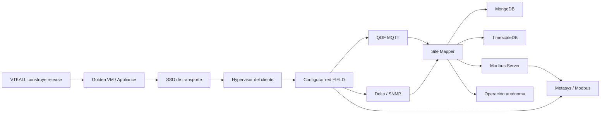
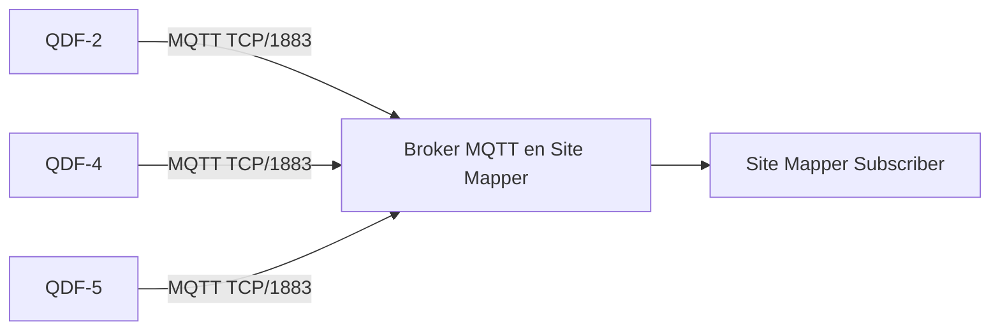
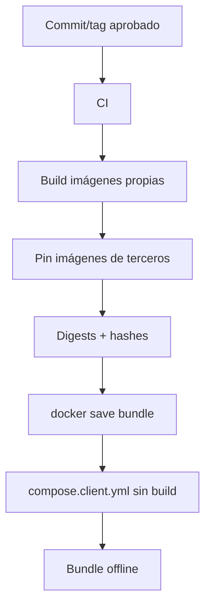
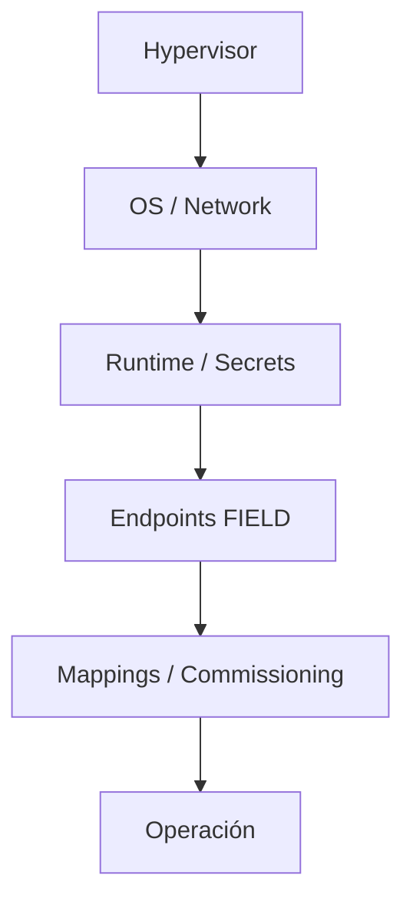
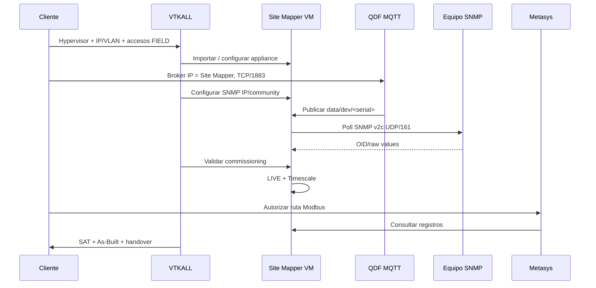
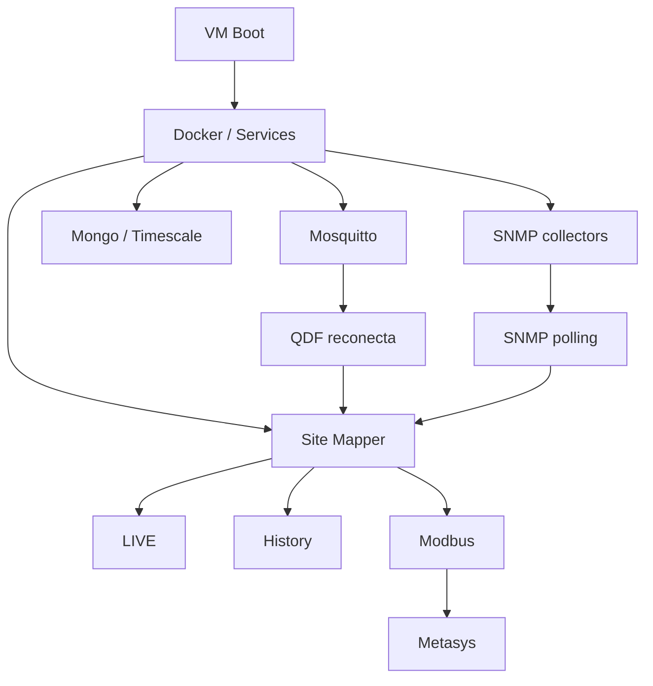
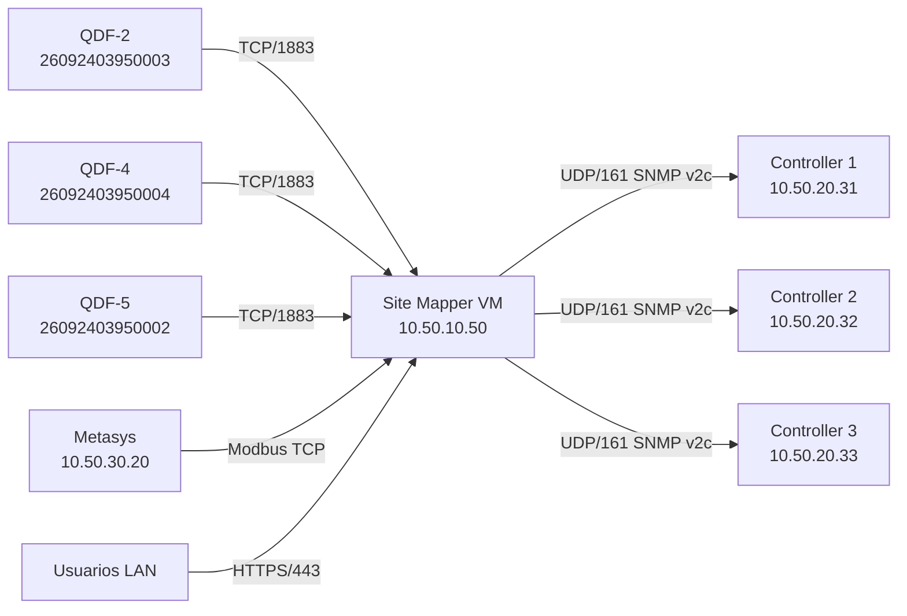

# Site Mapper MK1 — Entrega de VM, Configuración FIELD y Commissioning

**Versión:** 1.2  
**Propósito:** contrato operativo para preparar, transportar, instalar, configurar, comisionar y entregar Site Mapper en infraestructura del cliente.  
**Principio:** el cliente no recibe un proyecto para desarrollar; recibe una **appliance preparada**. La instalación FIELD debe requerir únicamente infraestructura, red, endpoints/credenciales y validación del commissioning.

---

## 1. Resultado esperado



Después del commissioning inicial, un reinicio de la VM debe recuperar automáticamente los servicios y las conexiones configuradas. El cliente **no debe compilar código, editar la aplicación, crear bases de datos ni reconstruir mappings manualmente**.

## 2. Qué pedimos al cliente

### 2.1 Infraestructura

| Requisito      | Baseline                                                        |
| -------------- | --------------------------------------------------------------- |
| Hypervisor     | VMware, Hyper-V o Proxmox/KVM                                   |
| Arquitectura   | x86_64 / amd64                                                  |
| CPU            | **4 vCPU**                                                      |
| RAM            | **16 GB**                                                       |
| Disco virtual  | **200 GB SSD expandible**, thin cuando el hypervisor lo soporte |
| IP Site Mapper | IP fija                                                         |
| Red            | máscara/VLAN/port-group                                         |
| Gateway        | según red FIELD                                                 |
| DNS            | servidor aprobado                                               |
| NTP            | servidor aprobado                                               |
| Acceso web     | HTTPS hacia Site Mapper                                         |

Escalamiento previsto de almacenamiento: **200 GB → 500 GB → 1 TB**.

### 2.2 MQTT — tres QDF

El baseline es **TCP/1883**. Si el cliente no permite 1883, se trata como una excepción de red y se acuerda otro puerto; no se rediseña Site Mapper.



Contrato actual:

```text
data/dev/<serial>
```

Seriales de referencia actualmente conocidos:

```text
26092403950003 -> QDF-2
26092403950004 -> QDF-4
26092403950002 -> QDF-5
```

Por tanto, **no pedimos al cliente inventar topics nuevos**. El serial/source identity determina el tópico previsto.

El cliente debe:

- permitir QDF → IP de Site Mapper por **TCP/1883**;
- configurar en cada QDF Broker IP = IP de Site Mapper;
- configurar Broker Port = 1883;
- usar la credencial MQTT acordada si el firmware/configuración usa autenticación.

No se requiere un usuario MQTT diferente por QDF. Si se habilita autenticación, el baseline puede utilizar una credencial compartida del broker para estos tres publishers, salvo que la política del cliente exija separación.

### 2.3 SNMP

**Baseline preferido para este deployment: SNMP v2c Read Only.** Site Mapper también soporta SNMPv3 si la política del cliente lo exige.

Para cada controlador/equipo SNMP necesitamos:

| Dato             | SNMP v2c                                          |
| ---------------- | ------------------------------------------------- |
| IP/hostname      | Obligatorio                                       |
| Puerto           | UDP/161 salvo acuerdo distinto                    |
| Versión          | v2c                                               |
| Community        | **Read Only**, entregada por canal seguro         |
| MIB/manual       | Requerido si el perfil/OIDs no están ya validados |
| OIDs             | Lista/documentación cuando corresponda            |
| Polling          | frecuencia acordada                               |
| Routing/firewall | Site Mapper → equipo UDP/161                      |

La **community no se inventa ni se lleva desde LAB**. La entrega real debe usar la community que el cliente ya tenga o la que su equipo de red/OT cree específicamente para la integración.

Si el cliente exige SNMPv3, además entrega username, auth protocol/key, privacy protocol/key y los datos de engine ID que correspondan.

### 2.4 Metasys / Modbus

El cliente o integrador Metasys debe entregar/confirmar:

- IP/rango origen de Metasys;
- conectividad hacia la IP de Site Mapper;
- puerto Modbus TCP acordado;
- Unit IDs;
- register map/revisión;
- address base;
- word order;
- poll interval;
- timeout/retries;
- política de dato stale/missing.

Normalmente Modbus TCP no usa username/password. La seguridad principal es segmentación/routing/firewall.

> **Gate obligatorio antes de entrega:** hoy existen documentos del repositorio que no son consistentes respecto del contrato final Modbus/Metasys (FC03 vs FC04 y W vs kW). Antes de congelar la Golden VM debe elegirse y versionarse un único contrato de register map y Function Code. El cliente recibe solo esa revisión congelada.

## 3. Matriz de responsabilidades

| Actividad                       | VTKALL                    | Cliente                 |
| ------------------------------- | ------------------------- | ----------------------- |
| Construir imágenes Site Mapper  | **Sí**                    | No                      |
| Construir Golden VM             | **Sí**                    | No                      |
| Proveer hypervisor              | No                        | **Sí**                  |
| Proveer 4 vCPU / 16 GB / 200 GB | No                        | **Sí**                  |
| Importar VM                     | Puede hacerlo             | Puede hacerlo           |
| Asignar VLAN/port-group         | Asiste                    | **Sí / autoriza**       |
| Asignar IP/gateway/DNS/NTP      | Configura si tiene acceso | **Provee / autoriza**   |
| Abrir MQTT TCP/1883             | No                        | **Sí**                  |
| Configurar Broker IP en QDF     | Puede asistir             | **Cliente/OT**          |
| Proveer SNMP IP/community       | No                        | **Sí**                  |
| Configurar collectors SNMP      | **Sí**                    | No                      |
| Validar OID/escala/unidad       | **Sí**, con evidencia     | Aporta documentación    |
| Configurar mappings             | **Sí**                    | Valida                  |
| Proveer datos Metasys           | No                        | **Sí / integrador**     |
| Configurar salida Modbus        | **Sí**                    | Valida                  |
| SAT Metasys                     | **Conjunta**              | **Conjunta**            |
| Backup/restore inicial          | **Sí**                    | Provee destino/política |
| As-Built                        | **Sí**                    | Aprueba                 |
| Operación normal                | Soporte                   | **Cliente**             |

Si el cliente dice **“háganlo ustedes”**, VTKALL necesita acceso temporal autorizado al hypervisor, red/VLAN, consola de la VM y los secretos FIELD. Los cambios de firewall/routing siguen requiriendo autorización del dueño de infraestructura.

## 4. Qué construimos nosotros

Hay dos niveles distintos: **imágenes Docker** y **Golden VM**.

### 4.1 Construcción de imágenes Docker



El release debe congelar Site Mapper/Next.js, Telemetry Store, Modbus sidecar, collectors SNMP, Operational Console si aplica, Mosquitto, MongoDB y TimescaleDB.

Las imágenes de terceros deben quedar **versionadas/pinneadas**, no con `latest`. El `compose.client.yml` final debe usar `image:` y **no `build:`**.

### 4.2 Bundle offline

```text
site-mapper-release/
├── images/
│   └── site-mapper-images.tar
├── compose.client.yml
├── config/
│   └── templates/
├── scripts/
│   ├── install.sh
│   ├── preflight.sh
│   ├── start.sh
│   ├── stop.sh
│   ├── status.sh
│   ├── backup.sh
│   ├── restore.sh
│   └── diagnostics.sh
├── manifest.json
├── SHA256SUMS
├── RELEASE-NOTES.md
└── OPERATIONS.md
```

No se incluyen contraseñas FIELD ni datos del cliente dentro de la imagen.

## 5. Construcción de la Golden VM

La Golden VM debe contener Ubuntu Server 24.04 LTS, Docker Engine, Docker Compose plugin, bundle offline de Site Mapper, imágenes ya cargadas o disponibles localmente, scripts operativos, configuración base sin secretos del cliente, autostart de los componentes aprobados, preflight y diagnósticos.

No debe contener community real del cliente, passwords MQTT, credenciales SNMPv3, secretos internos reutilizados desde LAB, topología privada de otro cliente ni dumps de otros entornos.

### 5.1 Sellado

Antes de exportarla:

1. limpiar logs/temporales innecesarios;
2. eliminar secretos de build y credenciales transitorias;
3. verificar que no existan datos de otro sitio;
4. preparar regeneración de identidad de host/SSH según el método de clonación;
5. registrar versión del release y hashes;
6. apagar limpiamente;
7. exportar en el formato del hypervisor objetivo.

## 6. Formato de VM según hypervisor

| Hypervisor  | Formato preferido         |
| ----------- | ------------------------- |
| VMware      | OVA/OVF + VMDK            |
| Hyper-V     | VHDX                      |
| Proxmox/KVM | QCOW2 o import compatible |

No necesitamos entregar los tres formatos a cada cliente. Se entrega **el formato de su hypervisor**.

## 7. Transporte en USB/SSD

- **Mínimo práctico:** USB 3.x de 64 GB.
- **Recomendado:** **SSD externo USB 3.2 de 256 GB**.
- **Kit completo/múltiples formatos/backups:** 512 GB.

La Golden Appliance tendrá un disco virtual de 200 GB, pero al ser thin/sparse el archivo exportado esperado será mucho menor. La estimación actual es ~15–25 GB hasta medir el release real. Evitar FAT32 por el límite de 4 GB por archivo.

Contenido recomendado:

```text
SITE-MAPPER-DELIVERY/
├── appliance/
│   └── site-mapper-vX.Y.<ova|vhdx|qcow2>
├── bundle/
│   └── site-mapper-images.tar
├── checksums/
│   └── SHA256SUMS
├── docs/
│   ├── INSTALL.md
│   ├── NETWORK.md
│   ├── COMMISSIONING.md
│   ├── BACKUP-RESTORE.md
│   └── AS-BUILT-TEMPLATE.md
└── manifest/
    └── release-manifest.json
```

Los secretos se entregan por un canal separado.

## 8. Qué hace el cliente en el hypervisor

### Caso A — el cliente importa la VM

1. conectar el SSD a una estación/host administrativo autorizado;
2. copiar/verificar el artefacto;
3. validar `SHA256SUMS`;
4. importar OVA/VHDX/QCOW2 en el hypervisor;
5. asignar 4 vCPU, 16 GB RAM y disco virtual de 200 GB;
6. conectar NIC virtual al port-group/VLAN FIELD;
7. encender VM;
8. asignar/confirmar IP, gateway, DNS y NTP;
9. autorizar las reglas de firewall;
10. entregar acceso temporal a VTKALL para commissioning, si nosotros lo ejecutamos.

### Caso B — VTKALL realiza la importación

El cliente entrega acceso administrativo temporal, ventana de cambio, datastore/cluster/host destino, port-group/VLAN, IP/gateway/DNS/NTP reservados y autorización para import/power-on.

VTKALL importa, configura, valida y entrega evidencias. El cliente conserva el control del hypervisor.

## 9. Capas de configuración

No todo debe vivir en un único `.env`.



### Capa 1 — Hypervisor

CPU, RAM, disco y NIC/port-group/VLAN.

### Capa 2 — OS / Network

IP, máscara, gateway, DNS, NTP y hostname. Esto pertenece al sistema operativo/red, no al código de Site Mapper.

### Capa 3 — Runtime y secretos

Tokens internos, password Timescale, credenciales de bootstrap, community SNMP, credenciales MQTT si aplican y claves internas de Site Mapper. No se almacenan en Git.

### Capa 4 — Endpoints FIELD

```dotenv
MQTT_BROKER_URL=mqtt://mosquitto:1883
MQTT_TOPIC_PREFIX=data/dev/
MQTT_TOPIC_FILTER=data/dev/#

SNMP_CONTROLLER_HOST=<IP_REAL>
SNMP_CONTROLLER_PORT=161
SNMP_VERSION=2c
SNMP_COMMUNITY=<SECRET>
```

Para varios controladores, el empaquetado genera/configura un collector por controlador con su IP y, si corresponde, su community.

### Capa 5 — Mappings

Los mappings que ya conocemos no deben reinventarse por cliente.

MQTT mantiene `data/dev/<serial>` y los seriales conocidos conservan su identidad.

SNMP conserva el profile/OID aprobado. Solo se sustituye el endpoint/secret FIELD cuando la semántica del equipo es la misma.

Modbus conserva el register map congelado que resulte del gate Metasys.

## 10. Secuencia de puesta en marcha FIELD



Orden operativo: preflight → red VM → health stack → MQTT → QDF-2/4/5 → seriales → SNMP v2c → RAW → OID/escala/unidad → LIVE → Timescale → Modbus → Metasys SAT → reboot → autorecovery → backup → handover.

## 11. Qué configura el cliente y qué configuramos nosotros

### Cliente configura normalmente

```text
Hypervisor resources
VLAN / port-group
IP Site Mapper
Gateway / DNS / NTP
Firewall
QDF Broker IP = Site Mapper
QDF Broker Port = 1883
SNMP community/IP disponibles para nosotros
Ruta Metasys -> Site Mapper
```

### VTKALL configura normalmente

```text
Site Mapper runtime
MongoDB / TimescaleDB
Mosquitto
MQTT subscriber
SNMP collectors
SNMP profiles/OIDs
bindings y commissioning
Modbus
register map aprobado
backups
monitoring
autostart
diagnostics
```

Si el cliente quiere configurar FIELD por sí mismo, se le entrega un runbook; no se le exige editar código.

## 12. Reglas de firewall mínimas

```text
QDF-2/4/5      -> Site Mapper VM : TCP/1883
Site Mapper VM -> Delta/SNMP     : UDP/161
Metasys        -> Site Mapper VM : TCP/<MODBUS_PORT>
Usuarios LAN   -> Site Mapper VM : TCP/443
```

No exponer MongoDB, TimescaleDB ni APIs internas a la red general.

Si TCP/1883 es rechazado por el cliente, se acuerda un puerto alternativo o TLS/8883 si el firmware lo soporta. El cambio debe quedar documentado en el As-Built.

## 13. Acceptance / SAT

No basta con “la pantalla abre”.

```text
QDF real
 -> MQTT
 -> Site Mapper RAW/LIVE
 -> Timescale
 -> Modbus
 -> Metasys
```

```text
Equipo real
 -> SNMP OID
 -> RAW
 -> significado/escala/unidad
 -> Equipment
 -> LIVE
 -> Timescale
 -> Modbus
 -> Metasys
```

Evidencia mínima: release SHA/version, hash appliance, IP Site Mapper, seriales QDF observados, referencia de secret/community sin exponerla, IPs SNMP, profile/OID revision, register-map revision/hash, reboot test, backup/restore o restore-preflight y SAT PASS/FAIL/BLOCKED.

## 14. Handover

Al cierre, el cliente debe recibir VM importada y operativa, release/version, documentación, diagrama de red, matriz de puertos, As-Built, register map Metasys, procedimientos start/stop/status, backup/restore, cambio de IP/community, expansión de disco y contactos/escalamiento de soporte.

El cliente **no necesita** el repositorio fuente para operar la appliance.

## 15. Operación posterior



No debe requerir intervención diaria.

Storage: <70% normal; 70–79% warning; 80–89% acción; 90–94% crítico; >=95% emergencia. Llegar al 80% **no autoriza borrar datos automáticamente**.

## 16. Pendientes antes de declarar “Golden Appliance lista”

1. `compose.client.yml` sin `build:`;
2. imágenes inmutables/pinneadas por versión/digest;
3. Mosquitto incluido como servicio FIELD del bundle;
4. scripts finales de install/start/stop/status/backup/restore/diagnostics;
5. configuración FIELD simple y documentada;
6. autostart/reboot validado;
7. instalación offline desde máquina limpia;
8. export real OVA/VHDX/QCOW2;
9. tamaño real del artefacto;
10. freeze del contrato **Modbus/Metasys** para resolver FC03/FC04 y W/kW;
11. SAT de extremo a extremo;
12. As-Built y handover.

## 17. Regla final de producto

```text
CLIENTE:
hypervisor + recursos + IP/VLAN + firewall
+ QDF -> IP Site Mapper:1883
+ SNMP IP/community
+ datos Metasys

                    ↓

VTKALL:
importa/configura appliance
+ sustituye endpoints/secrets FIELD
+ valida commissioning
+ ejecuta SAT
+ entrega As-Built

                    ↓

SITE MAPPER:
arranca solo
recibe MQTT
consulta SNMP
muestra LIVE
guarda Timescale
publica Modbus
se recupera tras reboot
```

**No se modifica código por cliente. Se sustituyen endpoints, red, secretos y commissioning aprobado.**

---

## 18. Ejemplos de cómo debería verse

> Todos los valores de IP, nombres y secretos de esta sección son **ilustrativos**. En FIELD se sustituyen por los datos aprobados del cliente. Los seriales QDF mostrados corresponden al baseline actualmente conocido.

### 18.1 Ejemplo — ficha mínima que entrega el cliente

```text
SITE MAPPER VM
Hypervisor: VMware vSphere
CPU:        4 vCPU
RAM:        16 GB
Disk:       200 GB SSD thin
VLAN:       OT-MONITORING
IP:         10.50.10.50/24
Gateway:    10.50.10.1
DNS:        10.50.1.10
NTP:        10.50.1.20

MQTT
Puerto requerido: TCP/1883
QDF-2 serial: 26092403950003
QDF-4 serial: 26092403950004
QDF-5 serial: 26092403950002

SNMP
Versión:    v2c
Puerto:     UDP/161
Community:  <entregada por canal seguro>
Controller 1 IP: 10.50.20.31
Controller 2 IP: 10.50.20.32
Controller 3 IP: 10.50.20.33
MIB/OID docs: entregadas / perfil ya validado

METASYS
Origen BMS:      10.50.30.20
Destino:         10.50.10.50
Modbus TCP Port: <puerto aprobado>
Register map:    <revisión aprobada>
```

### 18.2 Ejemplo — cómo debería verse la VM en el hypervisor

```text
Name:        VTKALL-SITE-MAPPER-01
Guest OS:    Ubuntu Server 24.04 LTS
vCPU:        4
Memory:      16 GB
Disk 0:      200 GB / Thin provisioned
NIC 0:       OT-MONITORING
Power:       ON
Autostart:   Enabled
```

Vista conceptual:

```text
┌──────────────────────────────────────────────┐
│ VTKALL-SITE-MAPPER-01                       │
├──────────────────────────────────────────────┤
│ CPU        4 vCPU                           │
│ Memory     16 GB                            │
│ Disk       200 GB Thin                      │
│ Network    OT-MONITORING                    │
│ IP         10.50.10.50                      │
│ Status     Running                          │
└──────────────────────────────────────────────┘
```

El cliente no debería ver veinte VMs ni una VM por componente. La entrega normal es **una VM Site Mapper** con los servicios encapsulados dentro.

### 18.3 Ejemplo — topología de red FIELD



### 18.4 Ejemplo — qué se configura en cada QDF

La pantalla real depende del fabricante, pero conceptualmente debe quedar así:

```text
MQTT SETTINGS

Broker / Server IP : 10.50.10.50
Broker Port        : 1883
Protocol           : MQTT
Username           : <solo si se acordó autenticación>
Password           : <solo si se acordó autenticación>

Publisher identity : serial del propio QDF
Topic resultante   : data/dev/<serial>
```

Para los tres equipos:

```text
QDF-2 → data/dev/26092403950003
QDF-4 → data/dev/26092403950004
QDF-5 → data/dev/26092403950002
```

**El cliente no debe crear manualmente estos topics si el firmware ya publica siguiendo el contrato por serial.** Solo debe apuntar el broker al Site Mapper.

### 18.5 Ejemplo — verificación MQTT que esperamos

```text
Broker: 10.50.10.50:1883

Received:
data/dev/26092403950003  {...}
data/dev/26092403950004  {...}
data/dev/26092403950002  {...}

Result:
QDF-2  ONLINE
QDF-4  ONLINE
QDF-5  ONLINE
```

Después:

```text
MQTT RAW
   ↓
Serial reconocido
   ↓
Bindings ya aprobados
   ↓
LIVE
   ↓
TimescaleDB
   ↓
Modbus
```

### 18.6 Ejemplo — SNMP v2c recibido del cliente

El cliente nos entrega:

```text
Controller: DELTA-01
IP:         10.50.20.31
Port:       161/UDP
Version:    SNMP v2c
Community:  ********
Access:     Read Only
```

Nosotros lo traducimos al runtime, por ejemplo:

```dotenv
SNMP_CONTROLLER_HOST=10.50.20.31
SNMP_CONTROLLER_PORT=161
SNMP_CONTROLLER_ID=DELTA-01
SNMP_VERSION=2c
SNMP_COMMUNITY=<SECRET>
SNMP_V2C_ACKNOWLEDGE_PLAINTEXT=true
SNMP_POLL_INTERVAL_MS=30000
```

Para varios controllers se crea/configura un collector por controlador; **no se modifica código**.

### 18.7 Ejemplo — profile SNMP ya conocido

Si el profile/OIDs ya fue validado previamente, FIELD solo sustituye endpoint y secreto:

```text
LAB
Controller Host = snmp-agent-test
Community       = lab-only
Profile/OIDs    = DELTA_PROFILE_X

          ↓ sustituir FIELD ↓

FIELD
Controller Host = 10.50.20.31
Community       = <cliente>
Profile/OIDs    = DELTA_PROFILE_X
```

Si el modelo/firmware cambia o el OID no coincide, se detiene el commissioning y se valida la nueva evidencia antes de mapearla.

### 18.8 Ejemplo — configuración runtime FIELD

Ejemplo conceptual de variables que deberían quedar fuera del código:

```dotenv
APP_ENV=production
APP_PERSISTENCE=mongodb

TELEMETRY_ENABLED=true
TELEMETRY_HISTORY_ENABLED=true

MQTT_BROKER_URL=mqtt://mosquitto:1883
MQTT_TOPIC_PREFIX=data/dev/
MQTT_TOPIC_FILTER=data/dev/#

SNMP_VERSION=2c
SNMP_CONTROLLER_PORT=161
SNMP_POLL_INTERVAL_MS=30000

MODBUS_POINT_LAYOUT=panels-4x24
MODBUS_MISSING_POLICY=zero

SITE_MAPPER_STORAGE_WARN_PCT=70
SITE_MAPPER_STORAGE_ACTION_PCT=80
SITE_MAPPER_STORAGE_CRITICAL_PCT=90
```

Los secretos reales se almacenan en la configuración privada del deployment, no en Git ni en el documento As-Built.

### 18.9 Ejemplo — reglas de firewall

| Origen         | Destino          | Protocolo/Puerto    | Uso              |
| -------------- | ---------------- | ------------------- | ---------------- |
| QDF-2/4/5      | Site Mapper VM   | TCP/1883            | Publicación MQTT |
| Site Mapper VM | Controllers SNMP | UDP/161             | Polling SNMP v2c |
| Metasys        | Site Mapper VM   | TCP/`<MODBUS_PORT>` | Lectura Modbus   |
| LAN autorizada | Site Mapper VM   | TCP/443             | UI Site Mapper   |

Ejemplo:

```text
ALLOW 10.50.40.21-23  -> 10.50.10.50 TCP/1883
ALLOW 10.50.10.50     -> 10.50.20.31-33 UDP/161
ALLOW 10.50.30.20     -> 10.50.10.50 TCP/<MODBUS_PORT>
ALLOW <LAN-USERS>     -> 10.50.10.50 TCP/443
```

No solicitar:

```text
ANY -> MongoDB 27017
ANY -> Timescale 5432
ANY -> APIs internas
Internet -> MQTT 1883
```

### 18.10 Ejemplo — cómo debería verse el SSD de entrega

```text
SITE-MAPPER-DELIVERY/
│
├── appliance/
│   └── VTKALL-Site-Mapper-v1.0.ova
│
├── bundle/
│   └── site-mapper-images-v1.0.tar
│
├── checksums/
│   └── SHA256SUMS
│
├── manifest/
│   └── release-manifest.json
│
└── docs/
    ├── 01-INSTALL.md
    ├── 02-NETWORK-REQUIREMENTS.md
    ├── 03-FIELD-CONFIGURATION.md
    ├── 04-COMMISSIONING.md
    ├── 05-METASYS-SAT.md
    ├── 06-BACKUP-RESTORE.md
    └── 07-AS-BUILT-TEMPLATE.md
```

Ejemplo de verificación antes de importar:

```bash
sha256sum -c checksums/SHA256SUMS
```

Resultado esperado:

```text
appliance/VTKALL-Site-Mapper-v1.0.ova: OK
bundle/site-mapper-images-v1.0.tar: OK
```

### 18.11 Ejemplo — importación en VMware

```text
vSphere / ESXi
  ↓
Deploy OVF Template
  ↓
Seleccionar VTKALL-Site-Mapper-v1.0.ova
  ↓
VM Name: VTKALL-SITE-MAPPER-01
  ↓
Datastore: <cliente>
  ↓
Network: OT-MONITORING
  ↓
Disk: Thin
  ↓
Deploy
  ↓
Power On
```

Después se comprueba que la VM tenga 4 vCPU, 16 GB RAM, 200 GB virtual disk y la NIC conectada a la VLAN correcta.

### 18.12 Ejemplo — importación en Hyper-V

Si se entrega una exportación completa compatible:

```text
Hyper-V Manager
  ↓
Import Virtual Machine
  ↓
Seleccionar carpeta de exportación
  ↓
Elegir destino
  ↓
Conectar NIC al Virtual Switch FIELD
  ↓
Start
```

Si se entrega solo un VHDX, se crea una VM compatible y se adjunta el VHDX existente. El formato exacto de entrega debe acordarse antes de fabricar la Golden Appliance.

### 18.13 Ejemplo — importación en Proxmox/KVM

```text
Crear/importar VM
  ↓
Importar QCOW2/VMDK compatible
  ↓
4 cores
  ↓
16 GB RAM
  ↓
Bridge/VLAN FIELD
  ↓
200 GB virtual capacity
  ↓
Boot
```

La entrega debe indicar el formato exacto probado para el hypervisor del cliente.

### 18.14 Ejemplo — primer arranque

El objetivo operativo debería verse así:

```text
$ site-mapper status

Site Mapper          RUNNING
MongoDB              HEALTHY
TimescaleDB          HEALTHY
MQTT Broker          HEALTHY
MQTT Subscriber      CONNECTED
SNMP Collector 01    CONNECTED
SNMP Collector 02    CONNECTED
SNMP Collector 03    CONNECTED
Modbus               RUNNING
HTTPS                 RUNNING
Storage               14% USED / NORMAL
```

Este CLI es el **objetivo de productización**; si aún no está implementado en el release, el mismo estado se verifica mediante los comandos operativos Docker definidos en el bundle.

### 18.15 Ejemplo — commissioning aceptado

```text
QDF-2
Serial: 26092403950003
MQTT:    PASS
LIVE:    PASS
History: PASS

QDF-4
Serial: 26092403950004
MQTT:    PASS
LIVE:    PASS
History: PASS

QDF-5
Serial: 26092403950002
MQTT:    PASS
LIVE:    PASS
History: PASS

SNMP DELTA-01
IP:      10.50.20.31
v2c:     PASS
RAW:     PASS
Profile: PASS
LIVE:    PASS

METASYS
Register Map Revision: R1
Connectivity: PASS
Point-to-point SAT: PASS
```

### 18.16 Ejemplo — handover final

```text
SITE MAPPER FIELD HANDOVER

Release:          v1.0
VM:               VTKALL-SITE-MAPPER-01
IP:               10.50.10.50
Resources:        4 vCPU / 16 GB / 200 GB
Hypervisor:       VMware vSphere
MQTT:             3/3 QDF ONLINE
SNMP:             3/3 controllers ONLINE
Timescale:        HEALTHY
Modbus:           HEALTHY
Metasys SAT:      PASS
Reboot recovery:  PASS
Backup:           PASS
Storage:          NORMAL
As-Built:         DELIVERED

Result: ACCEPTED
```

El cliente conserva el control del hypervisor y la red. VTKALL conserva la trazabilidad del release, mappings, commissioning y soporte.

---

## 19. FIELD Read-Only Gate

Antes del commissioning puede ejecutarse un gate integral **read-only**:

```bash
bash scripts/release/field-check.sh all --env-file /opt/site-mapper/config/field.env
```

Este gate reutiliza el preflight de VM y añade validación de configuración FIELD, servicios, MQTT, SNMP, MongoDB/TimescaleDB y Modbus.

Contrato de seguridad:

```text
NO INSTALL
NO DELETE
NO RESTART
NO MIGRATION
NO VOLUME CHANGE
NO NETWORK/FIREWALL CHANGE
NO SNMP SET
```

Por defecto tampoco escribe archivos. Si se requiere evidencia se habilita explícitamente:

```bash
bash scripts/release/field-check.sh all \
  --env-file /opt/site-mapper/config/field.env \
  --receipt
```

El receipt es sanitizado y no contiene passwords, communities, tokens ni private keys.

Resultados posibles:

```text
NOT_READY
READY_WITH_WARNINGS
READY_FOR_COMMISSIONING
```

**READY_FOR_COMMISSIONING no equivale a producción aceptada.** Después continúan commissioning real, LIVE/histórico, contrato Modbus congelado, Metasys SAT, reboot/recovery, backup/restore y As-Built.

Detalle operativo: [FIELD Read-Only Gate](field-readonly-gate.md).
