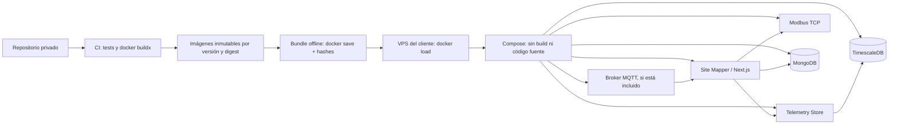

# Site Mapper MK1 — contrato de distribución Docker para VPS del cliente

**Estado: diseño de entrega aprobado conceptualmente; empaquetado de cliente todavía pendiente de implementación y certificación.**

Esta especificación define **cómo debe salir Site Mapper del repositorio privado y llegar a un VPS del cliente**. El cliente recibe imágenes Docker construidas y versionadas por nosotros, junto con un manifiesto de despliegue, configuración mínima y procedimientos operativos. **No recibe el repositorio, TypeScript fuente, proyectos de build ni instrucciones para compilar.**

Esta es una especificación de producto/distribución; **no** acredita que un bundle offline de producción haya sido construido, firmado, publicado, instalado o probado. La base inicial del trabajo es el `main` integrado tras PR #109 (`82ad57b7646dc873a6fbb43d8014ab5d05e47ceb`); nuevas versiones deberán registrar su SHA real y la aprobación de CI.

## 1. Decisión y límites

- **Destino:** VPS Linux del cliente con Docker Engine y Docker Compose Plugin. Plataforma mínima objetivo: `linux/amd64`; `arm64` solo cuando exista build y prueba específica para esa arquitectura.
- **Compilación:** exclusivamente en infraestructura nuestra/CI; no en el VPS del cliente.
- **Entrega principal:** bundle offline versionado, por ejemplo `site-mapper-mk1-rc1-linux-amd64.tar` producido con `docker save`, más `compose.client.yaml`, plantilla de configuración, manifiesto de hashes y guía operativa.
- **Alternativa:** distribuir esas mismas imágenes por registry privado (pull por digest) cuando el cliente tenga conectividad y acceso permitido.
- **Orquestación:** un servicio por contenedor; Docker Compose une imágenes, redes, dependencias y volúmenes. **No** construir una imagen monolítica que ejecute MongoDB, TimescaleDB, Next.js y el broker en un solo contenedor.
- **Persistencia:** datos, colas, claves y configuración viven fuera de las imágenes. Un `docker load` o reemplazo de contenedor jamás equivale a migrar o borrar datos.
- **Alcance operativo:** la entrega de imágenes no sustituye el consentimiento para migraciones, certificación de hardware, seguridad de red, RPO/RTO ni puesta en producción.



El contenedor se **crea** al ejecutar una imagen. `docker build` genera imágenes; `docker run` o `docker compose up` crea los contenedores. Se distribuyen **imágenes**, no contenedores en ejecución ni volúmenes con datos del cliente.

## 2. Inventario del stack y origen de las imágenes

**Imágenes propias (construidas en CI):**

- **`site-mapper/app`:** Next.js y APIs; el Dockerfile de laboratorio ya existe en `infra/site-mapper/Dockerfile`. Endurecerlo para distribución (artefacto runtime mínimo, ejecución sin root, healthcheck y dependencias de producción verificadas). El Dockerfile actual **no** usa Next.js standalone ni demuestra esa reducción.
- **`site-mapper/telemetry-store`:** adaptador HTTP privado del histórico y sus scripts SQL; origen `infra/telemetry-store/Dockerfile`. Revisar usuario no root, healthcheck, versiones fijadas y migraciones.
- **`site-mapper/modbus-tcp`:** salida privada FC03 y bridge; origen `infra/modbus-tcp/Dockerfile`. No publicar su endpoint de ingesta HTTP. Publicar Modbus **solo** en la interfaz/VLAN OT autorizada, si corresponde.
- **`site-mapper/snmp-collector` (perfil opcional):** colector por controlador; origen `infra/snmp-collector/Dockerfile`. Requiere identidad, credenciales y conectividad OT aprobadas.
- **`site-mapper/operational-console` (perfil administrativo opcional):** origen `infra/operational-console/Dockerfile`. Acceso solo interno/autorizado; no publicar indiscriminadamente su puerto.

**Imágenes de infraestructura (fijadas por versión y digest, no recompiladas con nuestro código):**

- **MongoDB:** `mongo:7.0` en laboratorio; en el paquete de cliente, imagen fijada por digest, credenciales/TLS y replica set compatible con transacciones, además de almacenamiento persistente.
- **TimescaleDB:** el laboratorio usa `timescale/timescaledb:latest-pg16`; **prohibido usar `latest` para un release cliente**. Pin exacto de versión + digest y verificación de compatibilidad de PostgreSQL, extensión y SQL.
- **Mosquitto:** hoy el laboratorio usa un **broker externo**; `docker-compose.telemetry.yml` no lo incorpora. El bundle debe admitir dos perfiles aprobados: broker ya gestionado por el cliente o contenedor Mosquitto con imagen fijada, TLS, ACL por tópico, sesiones/colas y almacenamiento persistentes. Incluir Mosquitto no significa incluir ni simular los publicadores físicos.
- **`mongo-init`/setup del replica set:** inicialización idempotente y controlada **solo para base nueva**. No ejecutar seed ni cambios destructivos sobre inventario existente.

El Compose actual de `docker-compose.telemetry.yml` es **laboratorio de ingeniería**: contiene `build:`, direcciones loopback y `APP_ENV=development` por defecto. **No reutilizarlo sin cambios como Compose de cliente.** Un perfil cliente deberá usar únicamente `image:` y referencias por digest o etiquetas inmutables verificadas.

## 3. Artefactos finales (estructura objetivo, aún no generada)

```text
site-mapper-mk1-rc1-linux-amd64/
├── images/
│   └── site-mapper-mk1-rc1-linux-amd64.tar
├── compose.client.yaml
├── .env.example
├── manifest.json
├── SHA256SUMS
├── install.sh
├── preflight.sh
├── backup.sh
├── restore.sh
├── upgrade.sh
├── RELEASE-NOTES.md
└── OPERATIONS.md
```

El `.tar` se obtiene con `docker save` de **todas las imágenes exigidas por el perfil elegido**; opcionales solo cuando forman parte del contrato del sitio. Un archivo `.tar` multiimagen no es un único contenedor.

`manifest.json` debe listar: producto, release, commit Git y ejecución CI de origen, fecha de construcción, plataforma/arquitectura, nombre/tag/digest de **cada** imagen, dependencias y versiones, esquema/migraciones exigidas, perfiles incluidos, checksum del tar y compatibilidad de actualización. Los nombres `mk1-rc1` son **convención propuesta**, no una release ya emitida.

Distribución offline: ofrecer un checksum `SHA256SUMS` y, para clientes que lo requieran, firma verificable/SBOM y reporte de vulnerabilidades sin incluir credenciales ni datos. Un archivo `.tar` es un artefacto transferible: el cliente puede inspeccionar su contenido compilado. **No** prometer protección técnica absoluta contra reverse engineering. Las claves y configuraciones privadas nunca deben quedar embebidas durante el build.

## 4. Experiencia esperada en el VPS

**Precondiciones:** Docker instalado; disco, CPU/RAM y arquitectura validados; dominio/DNS y proxy HTTPS listos; puertos/firewall aprobados; secretos instalados en el VPS por mecanismo privado; directorios persistentes, permisos y backup definidos.

Ejemplo ilustrativo **del flujo objetivo una vez implementado y certificado el bundle** (los archivos `compose.client.yaml` y scripts todavía no existen):

```bash
cd /opt/site-mapper
sha256sum -c SHA256SUMS
docker load -i images/site-mapper-mk1-rc1-linux-amd64.tar
cp .env.example .env
# El operador completa .env con secretos reales mediante canal privado.
docker compose --env-file .env -f compose.client.yaml config --quiet
docker compose --env-file .env -f compose.client.yaml up -d --no-build --pull never
docker compose --env-file .env -f compose.client.yaml ps
```

**No ejecutar ese bloque contra producción hasta disponer del bundle real y validar los preflight.** Las imágenes cargadas deben tener **exactamente** los nombres/tags referidos por Compose. En una instalación nueva, completar un bootstrap autenticado de la primera cuenta; nunca publicar una cuenta o contraseña predeterminada. En una existente, preservar identidades, base y sesiones según plan aprobado.

El cliente **no** ejecuta `git clone`, `npm ci`, `npm run build`, `docker compose build` ni `docker compose up --build`. Tampoco debe instalar MongoDB o PostgreSQL manualmente cuando esos servicios estén incluidos en el bundle.

Para una actualización se entregan nuevas imágenes más un manifiesto de compatibilidad. La operación preflight → backup verificable → migración supervisada (si corresponde) → reemplazo de **contenedores** → healthchecks → smoke test → recibo/rollback debe estar automatizada o claramente guiada. **Nunca** ejecutar `docker compose down -v` o borrar volúmenes para «solucionar» una instalación.

## 5. Contrato obligatorio de producción (no usar defaults de laboratorio)

- **Aislamiento:** exponer públicamente solo el reverse proxy HTTPS (80/443 según política). Aplicación, MongoDB, TimescaleDB, Telemetry Store, ingesta privada de Modbus y consola permanecen en redes internas; Modbus TCP únicamente hacia clientes de la red OT aprobada. No exponer `27017`, `5432`, `18081`, `18082`, `3100` o `1502/1503` a Internet.
- **Ejecución:** `APP_ENV=production`, `APP_PERSISTENCE=mongodb`, variables exigidas presentes y sin fallback a memoria. HTTPS y política de cookies de producción; reverse proxy con headers confiables configurado explícitamente.
- **MongoDB:** autenticación, conexión TLS y replica set transaccional. No confundir el Mongo sin TLS del Compose de laboratorio con un despliegue productivo. Identificar y validar `MONGODB_DB_NAME`; revisar versión de esquema y ejecutar la migración versionada **solo con backup y autorización del operador**.
- **MQTT:** cuando está habilitado, `mqtts://`, usuario/clave/ACL, perfil industrial autorizado, `MQTT_CLIENT_ID` estable y exclusivo por réplica, spool privado `INDUSTRIAL_MQTT_SPOOL` en volumen persistente y broker con persistencia/retención definidas. No asignar el mismo client ID a dos consumidores simultáneos.
- **Histórico:** `TELEMETRY_STORE_TOKEN` privado, DSN protegido, base Timescale persistente e índices/migraciones correctos. Configurar retención y probar recuperación de tablas y progreso de ingesta, no solo health HTTP.
- **SNMP:** en producción, configurar `SNMP_INGEST_SOURCES_JSON` por identidad en la app, token individual por colector, SNMPv3 y transporte autenticado/privado; no copiar el token compartido de laboratorio a producción.
- **Modbus:** `MODBUS_SOURCE_UNITS_JSON` validado, `MODBUS_BRIDGE_TOKEN` secreto y FC03 de solo lectura en red OT segmentada. El valor cero de un registro vencido no equivale a medición certificada.
- **Credenciales de Equipment:** guardar `SITE_MAPPER_CREDENTIAL_KEY` fuera de imágenes y repositorio, con custodia/backup seguros. Si se pierde, los secretos ya cifrados pueden volverse irrecuperables.
- **Datos:** volúmenes independientes, persistentes, cifrados cuando corresponda, para Mongo, Timescale, MQTT broker, spool MQTT, cola SNMP y cualquier estado operativo durable. Nunca hornear datasets o contraseñas de cliente en capas Docker.
- **Recursos:** fijar mínimos y sizing de VPS según pruebas de carga; no inventar CPU/RAM/disco garantizados. Registrar alertas por disco, spool, reintentos, errores de ingestión y servicios no saludables.

Referencias del contrato vigente: [entorno](../operations/environment-reference.md), [hardening](../operations/mk1-critical-hardening-2026-10-26.md), [backup y restore](../operations/backup-restore.md), [preparación MVP](MVP-READINESS.md).

## 6. Proceso de generación y publicación propuesto

1. Elegir commit/versión y congelar dependencias (incluidas imágenes de terceros) y arquitectura; registrar origen y permisos del workflow de release.
2. Ejecutar CI, pruebas industriales y certificación de instalación aislada; fallar el pipeline ante cualquier gate crítico rojo.
3. Construir imágenes propias con build multi-stage, capa runtime mínima, usuario no root, sin `src` editable ni dependencias dev innecesarias; conservar únicamente guías/archivos que Next necesita en runtime. Revisar `infra/site-mapper/Dockerfile` y `next.config.ts` para hacer tracing/standalone real, no asumirlo implementado.
4. Analizar dependencias e imágenes, generar SBOM y firmar hashes/digests. No incluir secretos de build, variables privadas, inventario real, bases, keys ni logs sensibles.
5. Fijar imágenes por digest, ensamblar el Compose **sin `build:`** y generar `docker save` + `SHA256SUMS` + manifiesto + scripts.
6. Probar **instalación realmente offline** desde un VPS/runner limpio, sin acceso al repo ni registry y sin herramientas de build; validar que `--pull never --no-build` funciona con las imágenes del tar.
7. Probar instalación nueva, actualización sobre datos persistentes, caída/reinicio de servicios, backup/restore en destino aislado y rollback no destructivo; registrar hashes, logs sanitizados, tiempos y resultados.
8. Emitir la release aprobada; entregar el tar por canal privado, instrucciones y secretos **por canal separado**. No poner builds de clientes en Git público por accidente.

Un registry privado puede usar las mismas imágenes/digests, pero **no sustituye el artefacto offline** definido para clientes que no tengan acceso al registry.

## 7. Puertas de aceptación para «easy to deploy»

- [ ] CI de release valida tipo/lint/tests/build y auditoría de dependencias.
- [ ] Cada imagen necesaria tiene tag inmutable, digest, plataforma y versión documentados.
- [ ] Los Dockerfiles propios ejecutan un usuario no root y tienen arranque/healthcheck apropiados.
- [ ] El archivo `compose.client.yaml` no tiene `build:`, no requiere rutas al código ni `npm` en el VPS y separa perfiles opcionales.
- [ ] El bundle offline se instala con `docker load` y `compose up --no-build --pull never` en host limpio sin acceso a GitHub.
- [ ] `preflight.sh` verifica plataforma, Docker, recursos, puertos, volúmenes, variables, permisos y requisitos de seguridad sin cambiar datos.
- [ ] TLS, Mongo autenticado, broker seguro, red OT y custodia de secretos probados según perfil real.
- [ ] Datos sobreviven al recrear contenedores y al actualizar imágenes; esquemas antiguos requieren plan/migración versionada.
- [ ] `backup.sh`, `restore.sh` y `upgrade.sh` están implementados, revisados y ensayados en staging; ningún script elimina datos automáticamente.
- [ ] El primer usuario se inicializa de forma segura; no hay contraseñas embebidas.
- [ ] API, login, topología, bindings, histórico, Modbus y colector opcional pasan smoke test en la instalación final.
- [ ] Existe evidencia de restore coordinado y RPO/RTO/retención aprobados por el dueño del sistema.
- [ ] Integraciones Acrel/gateway/canal/breaker y mediciones reales tienen **aceptación de campo independiente**, cuando forman parte del contrato cliente.
- [ ] Se entrega `RELEASE-NOTES.md`, matriz de puertos, guía de instalación, actualización, reversión y contactos de soporte.

**Criterio de salida:** «Image distribution ready» solo cuando todas las puertas aplicables están verificadas en una instalación desde imágenes. CI verde del código **no** equivale a bundle validado ni a despliegue productivo.

## 8. Trabajo pendiente, separado de esta documentación

Esta documentación **no implementa**: `compose.client.yaml`, pipeline release/buildx multiimagen, Mosquitto integrado, empaquetado `docker save`, scripts de install/preflight/upgrade/backup/restore, imagen Next standalone mínima ni certificación offline. Es el contrato para implementar esas piezas de forma coherente.

No ejecutar despliegue, migraciones, restauraciones o commissioning físico sobre infraestructura real del cliente sin aprobación operativa y respaldo recuperable. La imagen entregada al VPS es un **artefacto ejecutable**; la puesta en servicio requiere una configuración específica y pruebas de aceptación del sitio.
