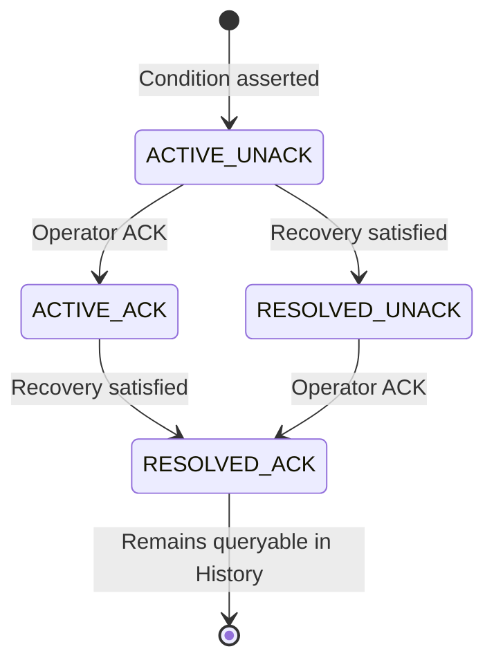
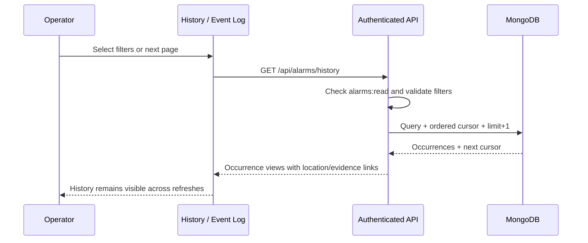

# MK1 · SPRINT 02 — Alarm Engine & Event Log

**Scope:** HU-015 to HU-021.  
**Branch:** `feat/mk1-s02-alarm-history` (branched from `main`).  
**Integration:** only after S01 is accepted and merged to `main`.  
**Release authority:** none; no TFARM04 deployment, no live database mutation.

## Product contract

An alarm is an **occurrence**, not a temporary UI notification. One occurrence belongs
to one canonical Device/Equipment ID and a correlation key. Its physical path is
captured when asserted, so a resolved historical event does not change location
meaning if the topology is later edited.

- `lifecycle: ACTIVE | RESOLVED` describes the physical/operational condition.
- `acknowledgement: UNACKNOWLEDGED | ACKNOWLEDGED` describes operator awareness.
- ACK must not activate, clear or resolve an electrical condition.
- RESOLVED + UNACKNOWLEDGED is valid and can be acknowledged later.
- After recovery the occurrence leaves the ACTIVE view but remains in History.
- New occurrences after recovery have new IDs. Old evidence/transitions are retained.
- The `History / Event Log` screen is a primary navigation tab, not a hidden
  subcontrol of `Resolved`.

### State-machine diagram (equivalent to the prose)



The final arrow means the active operational process ends; **it does not mean
deletion of the occurrence, evidence or audit transitions**.

## Evidence contract

Each alarm includes its target ID, target type, original topology-path snapshot,
source context, observed timestamp, lifecycle and acknowledgement. Sample evidence
can include protocol MQTT/SNMP, source identity and point, metric, value, unit,
observed time and operator note. For commissioned LOW_VOLTAGE/OVERCURRENT policies,
capture the **effective assertion/clear thresholds and policy ID at event time**.
Both assertion and recovery observations are retained in `evidenceRefs`; the
transition to RESOLVED references the recovery evidence ID.

Thresholds are **snapshots**, not certified ratings. S01 remains authoritative
for breaker rating, provisional/verified provenance, policy authoring and RBAC.
A future rating edit does not rewrite an existing alarm occurrence.

## History query contract

GET `/api/alarms/history` requires `alarms:read` and returns:

```json
{
  "items": ["AlarmOccurrenceView, ..."],
  "nextCursor": "ISO_TIMESTAMP|OCCURRENCE_ID or null"
}
```

Supported filters: `lifecycle`, `ack`, `severity`, exact `targetId`,
`fromDate`, `toDate` (UTC day bounds) and a bounded `limit` (1–100; UI 50).
The cursor sorts by `openedAt DESC, id DESC` and is opaque to the user.
The filter applies in MongoDB, not to a limited client-side snapshot.
The in-memory adapter follows equivalent semantics.



Indexes are supplied separately by
`scripts/migrations/s02-alarm-history-indexes.mongosh.js`. The migration must
be applied deliberately after a backup; it does not delete or transform data.

## Acceptance cases

| ID     | Required observation                                                   | Status                                             |
| ------ | ---------------------------------------------------------------------- | -------------------------------------------------- |
| HU-015 | Breaker/equipment ID and stored location remain identifiable           | Implemented, not certified                         |
| HU-016 | Trigger reading, unit, source, timestamp and thresholds visible        | Implemented, not certified                         |
| HU-017 | Assert/recovery policy changes condition state without erasing history | Existing engine + recovery evidence; not certified |
| HU-018 | ACK acts independently and supports RESOLVED + UNACK                   | Implemented, not certified                         |
| HU-019 | Dedicated History tab is discoverable next to Active and Resolved      | Implemented, not certified                         |
| HU-020 | Historical results remain queryable beyond the former 500 cap          | Implemented, not certified                         |
| HU-021 | Server-filtered state/ACK/severity/equipment/date and pagination       | Implemented, not certified                         |

### Additional regression scenarios

- Same timestamp + different event IDs paginate without duplicates.
- 526 occurrences are discoverable across six pages of size 100.
- A resolved UNACK occurrence may be acknowledged once; duplicate ACK is idempotent.
- Resolution retains the original triggering evidence and recovery observation.
- MQTT/SNMP source identity and physical hierarchy are never synthesized.
- Unauthenticated history request is denied.
- Bad cursor, date range, invalid enum or excessive limit returns 400.
- Permission checks and confidential source metadata remain server-authoritative.

## Git sequence and acceptance gate

1. Finish and accept PR #155 (S01); merge S01 to `main`.
2. Integrate the resulting `main` into this S02 branch without force-push.
3. Resolve translation conflicts (`src/messages/en.json`, `es.json`) if present.
4. Check that S01's breaker-limit policies feed this alarm evaluator correctly.
5. Run CI, unit, integration, HTTP/Mongo E2E and operator acceptance.
6. Apply indexes in a safe lab/release process after backup.
7. Only then mark PR #156 ready and authorize merge to `main`.

**Current certification status: NOT ACCEPTED.** GitHub Actions execution has
reported failures including on the baseline `main` (2026-11-05); job logs were
not retrievable from the connector, so no successful CI result is claimed.
