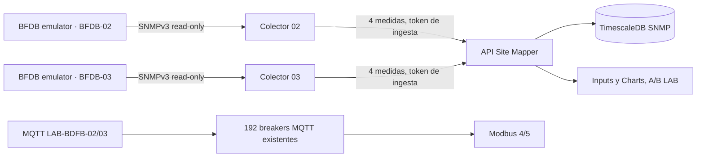

# BDFB-02/03 — SNMPv3 Config2 A/B · plan aditivo y evidencia de software

**Fecha:** 24 oct. 2026 · **Rama:** `feat/site-mapper-work-2026-10-23` · **Alcance:** únicamente simulación de laboratorio. **No desplegado en el Docker del operador al publicar este contrato.**

## Estado y origen de la necesidad

Antes de esta implementación, una auditoría de **solo lectura** sobre `site_mapper_crud_acceptance_02` demostró:

| Device | Profile | POWER INPUT SNMP | OIDs SNMP | Breakers MQTT | Resultado |
|---|---|---:|---:|---:|---|
| BDFB-01 | `ELTEK_BDCBB_CONFIG_2` | 2/2 | 4 | 3 | SNMP A/B LIVE e histórico visual comprobados |
| BDFB-02 | No seleccionado | 0 | 0 | 96 | Pendiente SNMP |
| BDFB-03 | No seleccionado | 0 | 0 | 96 | Pendiente SNMP |

El operador ya confirmó MQTT 24/24 en paneles de laboratorio, histórico Timescale y un FC03 **8/8 representativo** para Modbus Units 4/5, preservando Units 1/2/3. **SNMP es una entrada de corriente/voltaje independiente y no se deriva de esos 96 breakers.**

## Qué prepara exactamente este cambio



Dos **Devices** conservan su identidad actual, rack, 4 PANEL/96 CIRCUIT_BREAKER y sus 385 bindings MQTT por fuente. Solo se añaden:

- `attributes.bdfbHardwareProfile=ELTEK_BDCBB_CONFIG_2` a cada Device (sin eliminar sus demás atributos).
- Un `POWER INPUT / EXTERNAL / SNMP` A y otro B en el **CHASSIS existente de cada BDFB**; las entradas **A → paneles 0_1/0_2** y **B → paneles 0_3/0_4**. La relación es una **asunción del laboratorio**; no significa cableado confirmado.
- Cada nuevo puerto tiene `snmpFeedInput=true`, `independentInputConfirmed=false`, `lifecycle=ACTIVE` y el identificador del BDFB propietario.
- Dos bindings por puerto, CURRENT y VOLTAGE, total **8 nuevos SNMP TelemetryBindings** (4 por Device), todos `SYNTHETIC_LAB_ONLY`.
- Dos nuevas parejas agente/colector `snmp-lab-agent-02/03` y `snmp-lab-collector-02/03`. Solo red Docker privada; sin puertos UDP publicados.

Los OIDs **de laboratorio** (no MIB física Delta) son los mismos cuatro identificadores relativos por controlador:

| Feed | Métrica | OID sintético |
|---|---|---|
| A | CURRENT | `1.3.6.1.4.1.8072.9999.2026.48.1.1.0` |
| B | CURRENT | `1.3.6.1.4.1.8072.9999.2026.48.1.2.0` |
| A | VOLTAGE | `1.3.6.1.4.1.8072.9999.2026.48.2.1.0` |
| B | VOLTAGE | `1.3.6.1.4.1.8072.9999.2026.48.2.2.0` |

Los controladores son independientes: `EMU-DELTA-BFDB-02` y `EMU-DELTA-BFDB-03`. **La identidad del controlador forma parte del binding.** Nunca reusar `EMU-DELTA-BFDB-01` para comisionar BDFB-02/03.

## Comprobaciones y protecciones implementadas

- Predeterminado **read-only**; las acciones de escritura necesitan `--ack-synthetic-only`.
- Verifica la instalación y el proyecto Docker **originales**, el gateway Modbus con 5 Unit IDs intactos, credenciales SNMPv3 (mín. 8 caracteres auth/priv), token de ingesta actual y checkout externo autorizado.
- Rechaza estados SNMP parcialmente configurados, perfiles físicos previos, OIDs reclamados, ausencia de los 4 paneles o 96 breakers, y diferencias de los 385 bindings MQTT existentes.
- Antes de la única transacción Mongo escribe un **backup privado nuevo** bajo `$HOME/site-mapper-backups/snmp-bdfb23-YYYYMMDDTHHMMSSZ/`, con archivo `mongodb-before-bdfb23.archive.gz` y `SHA256SUMS`, y verifica el checksum.
- Hace las inserciones de puertos y bindings **en una transacción de Mongo con writeConcern majority**. Si ocurre un conflicto, cancela la transacción; nunca borra datos anteriores para reintentar.
- El despliegue de contenedores usa solo los cuatro nuevos servicios con `--no-deps`; **no reconstruye la aplicación ni las bases de datos**.
- SNMPv3 usa **authPriv** y origen local aislado. SNMPv2c no es el camino de activación. Ninguna marca sintética cambia a verificado físico.

## Instrucciones de uso

Comenzar con la [guía paso a paso para principiantes](../operations/laboratorio-industrial-para-principiantes.md), sección **Nuevo: ampliar SNMP**. Resumen técnico:

```bash
# Solo lectura. Identidades y puertos deben aparecer READY o ALREADY_READY.
python3 scripts/telemetry/setup-bdfb23-snmp-lab.py

# Opt-in: realiza backup + commit transaccional solo del inventario LAB 02/03.
python3 scripts/telemetry/setup-bdfb23-snmp-lab.py \
  --apply-inventory --ack-synthetic-only

# Opt-in, una sola vez: crea solo los cuatro contenedores SNMP nuevos.
python3 scripts/telemetry/setup-bdfb23-snmp-lab.py \
  --start-collectors --ack-synthetic-only
```

La variable `SNMP_LAB_ENABLED` del proceso Site Mapper ya existente puede continuar sin establecerse: el endpoint auxiliar de comisionamiento interactivo está desactivado, pero la **API de ingesta autenticada** ya funcionó para BDFB-01 sin cambiar esa variable. Este plan no fuerza su reinicio.

### ¿Qué hacer si se interrumpe?

| Situación | Recuperación segura |
|---|---|
| Falta checkout o archivo privado `.env.snmp` | Obtenerlos del administrador, no crear claves públicas ni habilitar v2c |
| No existe la base/Device LAB esperado | No arrancar servicios ni crear DB alternativa |
| Error `BLOCKED` en preflight | Conservar salida sin secretos; revisar identidad/volumen y ejecutar nuevamente la consulta |
| Falla el backup | No hay mutación; revisar almacenamiento disponible y permiso de Docker |
| Transacción falla | No reiniciar ni borrar; validar estado de Mongo, conservar copia de seguridad |
| Inventario ya comisionado | El plan dirá `ALREADY_READY`; no volver a insertar ni resetear |
| Colector `snmp.poll.failed` | Consultar logs y conectividad/auth SNMPv3; **no** cambiar bindings MQTT |
| Contenedor nuevo detenido tras primera creación | Usar el procedimiento de **reanudar contenedores existentes**, sin forzar recreación |
| Inputs muestra PENDING | Comprobar el plan, los cuatro OIDs, agent/collector logs y API de ingesta |
| Charts SNMP vacío | Comprobar polls aceptados, existencia de muestras y ventana 24H; no asumir fallo MQTT |

## Pruebas y lo que todavía NO prueban

El workflow de GitHub Actions [Industrial lab operator safety](../../.github/workflows/industrial-lab-operator-safety.yml) valida sintaxis Python, sintaxis `mongosh` mediante Node y pruebas offline de aislamiento, identidad, Modbus y credenciales. La ejecución para el commit `65db4645` terminó **success**. Esto certifica esas comprobaciones **de software**, no el resultado de ejecutar el plan en el Mongo del operador.

**Criterio para declarar BDFB-02/03 LAB PASS:** cada colector imprime `snmp.poll.accepted`, la UI muestra dos shunts `LAB LIVE · SIMULATED` con V/A en Inputs, las curvas históricas A/B aparecen en Charts 24H, ambos equipos conservan sus 96 breakers MQTT y el gateway Modbus mantiene Units 1–5.

**Pendiente de campo:** MIB real, correspondencia física de alimentadores, autenticación SNMP con equipos reales y pruebas Metasys en red OT. El laboratorio Config2 no autoriza marcar un shunt como instalado/verificado.

[Regresar al README](../../README.md) · [Guía de la interfaz desde Login](../user-guide/recorrido-completo-login-mqtt-snmp-modbus.md).
