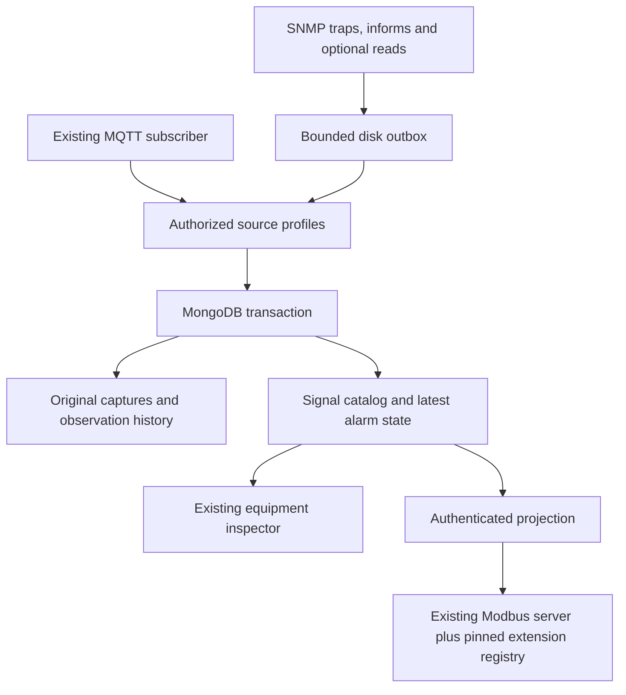

# Industrial integration — MQTT, SNMP and stable Modbus extensions

This extension keeps the current application, MQTT parser, electrical bindings, historical service,
GET collector, FC03 addresses 0–767, word order and missing-data policy in place.
It adds infrastructure inside Site Mapper; BFDB remains the simulation laboratory.

## Data flow



Raw capture is JSON/decoded BER data, with original varbind types and binary bytes encoded as
base64. It is not a PCAP. SNMP communities and authentication/privacy secrets never enter captures.
Unknown valid fields/OIDs remain available without invented units or automatic inventory creation.
JSON pointer MQTT keys escape `/` and `~`; SNMP keys retain full OID instances.

## Source commissioning

1. Copy `config/industrial/profiles.example.json` to a private configuration location.
2. Replace synthetic serials and select the exact source identities/topics authorized by the broker.
3. Add `targetId` only after matching an existing Site Mapper inventory ID. A rule-level target
   overrides its source target. No physical association is inferred from panel labels or photographs.
4. Set `INDUSTRIAL_PROFILES_JSON` to the compact JSON array. MQTT capture is opt-in per source;
   sources outside this array continue through the existing application path.
5. For SNMP, set `INDUSTRIAL_INGEST_SOURCES_JSON` to an object mapping each source identity to a
   **distinct private bearer of at least 32 characters**. This is independent of the old GET collector.
6. Set `SNMP_TRAP_SOURCES_JSON` to receiver profiles, matching source identity and bearer above.

Receiver profile shape (the placeholders must be replaced in an ignored private environment file):

```json
[
  {
    "sourceIdentity": "EMU-SNMP-QDF-01",
    "address": "127.0.0.1",
    "version": "3",
    "token": "<distinct private ingestion bearer, 32+ characters>",
    "user": {
      "name": "<configured USM user>",
      "level": "authPriv",
      "authProtocol": "sha",
      "authKey": "<private authentication key>",
      "privProtocol": "aes",
      "privKey": "<private privacy key>"
    }
  }
]
```

For v1/v2c use `version: "1"` or `"2c"` and `community` instead of `user`.
The source IP **as observed by the receiver**, version and principal must all match exactly.
Use separate per-controller users for v3. Current receiver transport is UDP/IPv4; bind/firewall
appropriately and account for container NAT. An IP allowlist is not cryptographic authentication.
Keep v1/v2c on an isolated approved network. Production v3 profiles require `authPriv`.

Optional read-only polling uses this additional profile property:

```json
{ "poll": { "method": "get", "port": 161, "intervalMs": 30000, "oids": ["1.3.6.1.2.1.1.3.0"] } }
```

Methods are `get`, `getnext`, `getbulk`; v1 rejects GETBULK. Each round is bounded (64 requested
OIDs, 8 repetitions for GETBULK). It is not an unbounded MIB walk. SET is never issued.
Existing commissioned feed GET ingestion remains separate and unchanged.
Poll failures are diagnostic logs, not native power-loss alarms.

## Interpretation and alarm lifecycle

Rules match an **exact key**, carry a profile version and declare kind, unit, scale and optional
offset. Numeric strings do not silently become confirmed engineering measurements. Measurement
rules require explicit unit and scale. New numeric fields with no rule stay `UNKNOWN`.

The supplied Eltek rev54 MIBs were extracted reproducibly by
`scripts/telemetry/build-eltek-catalog.py`. The generated catalog records input SHA-256 hashes,
1,553 OBJECT-TYPE entries and 16 NOTIFICATION-TYPE entries per main variant. These variants
share OIDs; they are not 3,106 independent measurements. Metadata is independent of engineering
scaling; decimal configuration still requires commissioning.

All 16 notification identifiers are cataloged. For the 15 alarm notification types, the decoder
uses `alarmSubsysStatusOid`, `alarmSubsysStatusValue` and `alarmSubsysStatusOnOff` to create a
condition key `alarm:<reported-status-OID>:<condition-code>`. Heartbeat is an event.
ON activates that condition; OFF resolves the same condition. Different conditions/subsystems
never overwrite each other's alarm. Missing or unrecognized flags do not clear a prior alarm.
SNMPv1 enterprise-specific notification aliases are matched only against this known catalog.
No breaker-level relationship is inferred from a controller-level trap.

The catalog preserves last value, raw value/type, profile version, source, target, provenance,
first/last observation and alarm activation/resolution times. Partial messages leave absent
signals untouched. Older observations are retained in history and cannot replace newer state.
MQTT uses the existing BFDB `msgid`/epoch timestamp contract where validated. Otherwise a missing
message identifier means independent observations, not aggressive content deduplication.
SNMP deduplication includes PDU identity/uptime and content when available. Reusing an identifier
with altered content is rejected. Deduplication scope ends when its retained original expires.

`STALE` indicates age; silence never becomes native Power Loss. `OFFLINE` is reserved for explicit
confirmed diagnostics and is not assigned from missing traps. An active alarm survives silence,
staleness and restart until an explicit clear is observed.
Correlation reports only `SAME_TARGET_TIME_WINDOW` links between MQTT and SNMP observations with
an explicitly shared target. It preserves both originals and does not assert electrical causality.

## Persistence, bounded operation and recovery

MongoDB **replica-set transactions** commit raw event, per-signal history and latest catalog state
together. A source cursor serializes concurrent updates across application replicas. Unique
indexes protect source cursors, event identifiers and signal IDs. No existing collections are
migrated or reset. Additive collections are `industrial_sources`, `industrial_events`,
`industrial_signal_history`, `industrial_signals`.

Raw/history retention defaults to 90 days; configure `INDUSTRIAL_RETENTION_DAYS` from 1 to 3,650.
MongoDB TTL cleanup is asynchronous. Latest state/active alarms do not expire with historical
retention. Configure backups and monitoring to the installation's retention/recovery policy.

Bounds: 256 KiB captures, depth 16 for MQTT, 12,000 walked nodes, 4,096 signals per message by
default (profile maximum 10,000), 10,000 catalog signals per protocol/source, 1,000 source profiles.
Each SNMP receiver/source-token set supports at most 64 sources; deploy additional instances when
needed. The receiver disk outbox holds at most 1,000 pending captures by default; queue-full and
write/delivery failures emit diagnostic events. Informs are acknowledged at protocol reception
by net-snmp **before** database commit. They are not an end-to-end durable delivery guarantee.
Outbox files are written through atomic rename; tested recovery covers process restart, not
hardware power loss. Protect and monitor the persistent volume. Conventional UDP traps may be lost.

MQTT originals are written to a bounded private disk outbox **before** delivery to MongoDB.
`INDUSTRIAL_MQTT_SPOOL` must reference a persistent directory in production, unique per application
replica; the compose overlay provides a named volume. Capacity defaults to 1,000 pending captures.
A gateway capture UUID makes a retry idempotent even when the source supplies no message ID.
Database failures retain the queued original and emit `industrial.mqtt.delivery_retry`; process
restart replays it with its original acquisition time. Queue-full/disk failures emit
`industrial.mqtt.capture_failed` and require an operator alert; existing electrical telemetry stays
independent. This does not replace broker/session delivery guarantees or hardware power-loss
recovery testing. Disk/queue bounds and the filesystem must be monitored.

## Modbus commissioning and stable publication

1. Prepare an operator-approved point list using
   `config/industrial/commissioning.example.json` as a **synthetic** example.
2. Generate its manifest:

   ```bash
   node scripts/telemetry/commission-points.mjs /private/approved-points.json /private/points.json
   ```

3. Set `MODBUS_POINTS_LOCAL_PATH` to that manifest, `INDUSTRIAL_PROJECTION_TOKEN` to a separate
   private bearer, and mount a persistent registry volume.
4. `MODBUS_REGISTRY_PATH` pins the commissioned manifest on first start. Later versions may append
   points with a higher version; changing/removing an already published point is rejected.
5. Supply the generated table to the Metasys integrator and approve it in their commissioning flow.

No observed point is auto-published. The legacy register block remains 0–767. Each extension point
occupies three explicit registers at offset >=1024: FLOAT32 ABCD/high-word-first value (two words),
then UINT16 quality. FC03, Unit IDs 1–247 and address limits are validated. Overlaps are rejected.
The maximum is 10,000 published points per manifest; each FC03 request remains limited to 125 words.

| Quality    | Code | Extension value                                                |
| ---------- | ---: | -------------------------------------------------------------- |
| UNOBSERVED |    0 | IEEE NaN                                                       |
| VALID      |    1 | Engineering value, boolean 0/1, or alarm ACTIVE=1 / RESOLVED=0 |
| STALE      |    2 | IEEE NaN                                                       |
| INVALID    |    3 | IEEE NaN                                                       |
| UNKNOWN    |    4 | IEEE NaN                                                       |
| OFFLINE    |    5 | IEEE NaN                                                       |

A real zero with VALID differs from absence. Strings, incompatible units and FLOAT32 overflow do
not become plausible numbers. The old block's `zero`/`exception` policy is unchanged.
The bridge pulls commissioned signals every two seconds using a distinct machine credential;
restart replay preserves original acquisition times, so recovery cannot make old data fresh.
Export `/registry.csv` on the private bridge HTTP port with its bearer for the versioned address,
function, type, word order, quality address, unit and description table. CSV does not replace Modbus.

## Run the isolated laboratory

The existing telemetry compose file remains the base. The new overlay is for a private lab:

```bash
docker compose --env-file /private/industrial.env \
  -f docker-compose.telemetry.yml -f docker-compose.industrial.yml up -d --build
```

Set the required existing Mongo/Timescale/MQTT/bridge secrets as before and the new variables above.
Set a persistent hexadecimal `SNMP_TRAP_ENGINE_ID`. Named volumes preserve traps and the registry;
containers continue running as the unprivileged `node` user. Loopback-bound UDP 1162 and TCP 1503
are lab defaults. Do not expose the ingestion/projection ports publicly. Production requires TLS
for the receiver-to-application link; replace the lab HTTP URL with an HTTPS endpoint before using
`APP_ENV=production`, and apply existing production Mongo/MQTT authentication requirements.

BFDB companion branch supplies `npm run traps` in `apps/snmp-emulator`. Set target address/port,
SNMP credentials, `SNMP_TRAP_NAME=ALL` to emit all rev54 notifications, `SNMP_TRAP_ACTIVE=false`
for clear, `SNMP_TRAP_UNKNOWN=true` for an additional binary OID, and `SNMP_TRAP_INFORM=true` for
informs with v2c/v3. Existing BFDB agent and MQTT services remain unchanged. For silence/recovery,
stop/restart the sender; do not interpret silence as an electrical alarm.

## Application APIs and operator inspection

All human read APIs below require the existing `telemetry:read` permission, with no cookie-based
identity shortcut. Equipment telemetry gains a collapsed, translated signal table only when
explicitly associated signals exist; navigation, styling, topology and existing views remain.

| Endpoint under `/api/telemetry/industrial` | Access and purpose                                                                               |
| ------------------------------------------ | ------------------------------------------------------------------------------------------------ |
| `POST /ingest`                             | Per-source collector bearer, bounded SNMP captures and durable source quota                      |
| `POST /projection`                         | Distinct machine bearer; only requested signal IDs, maximum 10,000                               |
| `GET /signals?source=...&target=...`       | Catalog, quality and evidence-only correlations; maximum 1,000 rows with truncation indication   |
| `GET /history?signalId=...&cursor=...`     | 100 original normalized observations per page; cursor includes timestamp/event ID to retain ties |
| `GET /events?id=...`                       | Retained original capture associated with an observation                                         |

## Verification and remaining commissioning

Run `npm ci`, `npm ci --prefix infra/snmp-collector`, `npm run test:industrial`, `npm test`,
`npm run typecheck`, `npm run lint`, `npm run format:check`, `npm run docs:check`, `npm run build`.
The default test suite skips external Mongo/BFDB laboratories unless explicitly configured.
For real Mongo transactions and the cross-repository wire chain:

```bash
MONGOD_BINARY=/path/to/mongod \
BFDB_TRAPS_MODULE=/path/to/bfdb/apps/snmp-emulator/eltek-traps.mjs \
npm run test:industrial:mongo
```

The runner creates/disposes an isolated loopback Mongo replica set. Never supply a production URI.
Assertions cover concurrent transactions, conflicting-message rollback, restart recovery,
four MQTT sources, three SNMP sources, raw binary OIDs, alarm activation/clear, authenticated HTTP
projection, and an independent socket client reading FLOAT32/quality from Modbus before/after
bridge restart. Separate UDP tests cover v1/v2c/v3 authPriv/informs and all 16 Eltek notifications.
See [laboratory evidence](industrial-lab-evidence.md).

Still requiring real commissioning: controller firmware/MIB branch, allowed sender addresses,
USM/communities, decimal scales, sensor-to-inventory associations, actual emitted OIDs, electrical
A/B wiring, approved Metasys table, deployment network/TLS, backup/restore drills, larger capacity
benchmarks and operator visual acceptance. Supplied photographs/PDFs/XLSX are references; this
change does not publish their customer data or invent those missing associations.
