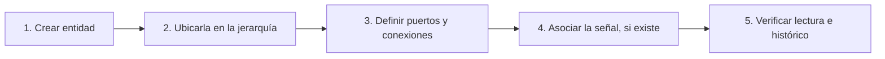
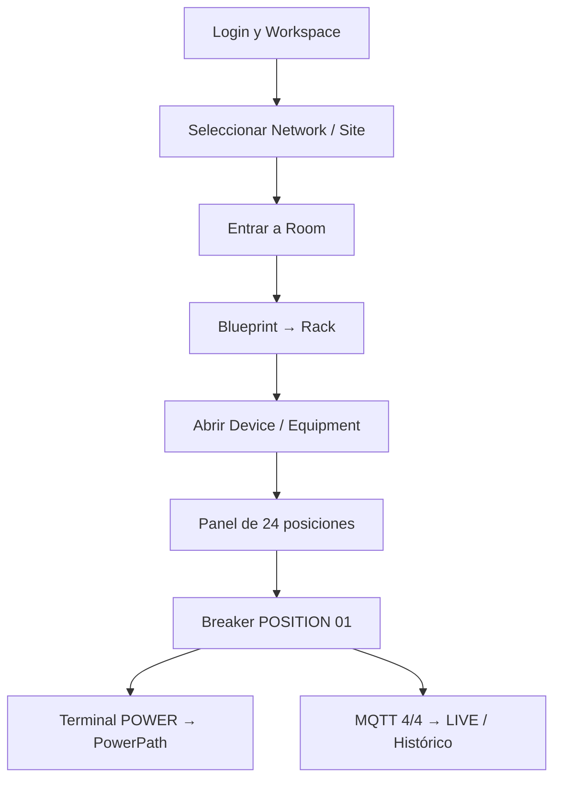

# Manual del operador · Site Mapper MK1

**Para personas que nunca han usado el sistema.** Este manual explica el trabajo cotidiano desde la interfaz web, sin solicitar comandos, JSON, consultas SQL ni cambios directos en MongoDB. La guía está basada en los formularios y botones implementados en MK1 (19 oct. 2026), no en pantallas propuestas de PR sin fusionar.

> **Antes de empezar:** utiliza un entorno autorizado de entrenamiento. Si tienes permisos STANDARD, puedes consultar pero no crear/modificar topología o PowerPaths. Para las prácticas de edición necesitas ADMIN o SUPERADMIN según las reglas de cada pantalla. Nunca uses la base del cliente para experimentar.

## ¿Qué se aprende?

| Lección | Objetivo observable | Enlace |
| --- | --- | --- |
| 0. Conceptos y permisos | Saber distinguir entidad, lugar, puerto, conexión y señal | [Conceptos esenciales](conceptos.md) |
| 1. Crear infraestructura | Dar de alta Network, Site, Structure, Level y Room | [Crear y navegar entidades](entidades.md) |
| 2. Trabajar con planos | Dibujar una sala, un Bay, posiciones y racks | [Blueprint y Rack](espacios-y-racks.md) |
| 3. Componer Equipment | Crear un Device, anidar Equipment e instalar un breaker en un Panel | [Device, Equipment y posiciones](equipos-y-posiciones.md) |
| 4. Conectar alimentación | Definir terminales POWER OUTPUT/INPUT y confirmar un PowerPath | [Conexiones físicas de potencia](conexiones.md) |
| 5. Conectar datos | Confirmar publisher, prefijo, punto y cuatro bindings MQTT | [Commissioning MQTT](telemetria.md) |
| 6. Interpretar resultados | Diferenciar LIVE, histórico, NO DATA, UNMAPPED y STALE | [Comprobaciones y errores](verificacion.md) |
| 7. Ejercicio completo | Repetir un caso real desde inventario hasta verificación | [Práctica guiada](practica-guiada.md) |

## La lógica fundamental del producto

**No son lo mismo:**

- **Existir:** tener un Device o Equipment guardado en inventario.
- **Estar instalado:** ocupar una ubicación o posición física documentada.
- **Estar conectado eléctricamente:** tener un `PowerPath` entre dos terminales `POWER` reales.
- **Tener telemetría mapeada:** cuatro `TelemetryBindings` (V/A/W/kWh) hacia un breaker específico.
- **Estar LIVE:** recibir una muestra reciente válida. `4/4` por sí solo no garantiza LIVE.

## Cómo estudiar las guías

Cada procedimiento seguirá este orden: **dónde entrar → antes de comenzar → qué presionar → qué escribir → cómo comprobar → qué errores evitar**. Los nombres en mayúsculas son etiquetas literales de la UI actual (por ejemplo, `CONFIGURE EQUIPMENT` o `MQTT POINT COMMISSIONING`).

No es necesario aprender IDs internos: el operador selecciona objetos por nombre en la interfaz. Los UUID solo aparecen en ejemplos de diagnóstico para administradores.

## Dos formas de entrenarse

1. **Demo visual en memoria:** `npm run local:dev` prepara un inventario sintético que desaparece al detener el proceso. Útil para navegación y reconocimiento. No afirmar que es persistente.
2. **Laboratorio persistente autorizado:** usar el Compose existente con su MongoDB y su fuente externa MQTT, siguiendo [quickstart](../operations/quickstart.md). **No recrear** inventario, seriales o datos ya comisionados para realizar un ejercicio.

Si no hay broker o permiso para cambiar el inventario, realiza las lecciones 0–3 con datos de entrenamiento y deja las lecciones 4–6 como recorrido de observación.

## Ruta sugerida para la primera sesión

La práctica final utiliza el caso **PANEL-01 → CB-01**, ya verificado anteriormente con un emulador. Los valores son históricos de ese laboratorio y **no** deben presentarse como lecturas actuales.

## Material visual

Este manual incluye diagramas Mermaid reproducibles en GitHub. Las capturas de pantalla del producto requieren una sesión de grabación en un entorno de entrenamiento y revisión para retirar cuentas, secretos y datos privados. **No se adjuntan capturas inventadas.** El [plan de capturas](capturas-y-capacitacion.md) indica exactamente qué fotografiar y qué debe verse.

## Para evaluación del MVP

La [guía de demostración](../product/MVP-DEMO-ES.md) explica cómo presentar la plataforma a un cliente; este manual enseña **cómo operarla**. La [matriz de readiness](../release/MVP-READINESS.md) distingue software implementado, laboratorio probado y pendientes de producción.
