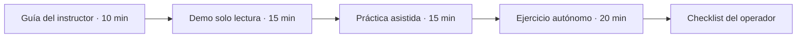

# Material visual y plan de capacitación · Manual MK1

Los **diagramas** del manual están incorporados en Markdown con Mermaid y se muestran directamente en GitHub. Las **capturas reales** deben proceder de un entorno autorizado de Site Mapper y reflejar la UI del release que se vaya a enseñar, sin simular estados que no se hayan observado.

## Capturas necesarias para un manual ilustrado definitivo

| ID  | Vista real                        | Debe verse claramente                                              | Texto descriptivo / regla                      |
| --- | --------------------------------- | ------------------------------------------------------------------ | ---------------------------------------------- |
| S01 | Login y Workspace                 | Dónde entrar, dónde volver al inicio                               | Acceso y contexto de sesión                    |
| S02 | EXPLORE y árbol global            | Network → Site → Structure → Level → Room                          | Ubicación lógica del activo                    |
| S03 | Formulario `+ CREATE SITE`        | Name, **Define boundary**, editor de polígono                      | Guardar la entidad y su límite                 |
| S04 | Blueprint de Room                 | `EDIT ROOM`, `+ Draw Bay / Cluster`, `+ Place Rack`, `SAVE LAYOUT` | Diferencia entre borrador y guardado           |
| S05 | Vista de Rack / CAS               | Rack físico y reserva/montaje                                      | Reservar U no crea PowerPath                   |
| S06 | Composición Equipment             | Device → Chassis → Shelf → Frame → Panel                           | Los Equipment pueden anidarse                  |
| S07 | Panel posicional                  | `POSITIONAL · 24 slots`, posición 01 instalada                     | Distinguir ocupado y libre                     |
| S08 | CB-01 seleccionado                | `Power output`, `CONNECTED`, `FEEDS → NETWORK BOARD / AP-01-01`    | Destino visible y AP ocupado                   |
| S09 | NETWORK BOARD seleccionado        | `AP-01-01`, `CONNECTED`, `POWERED BY ← CB-01`                      | Conexión inversa visible                       |
| S10 | Connect Equipment Power           | 1. Source, 2. Destination, 3. Verify and confirm                   | No crear enlace sobre AP ocupado               |
| S11 | Error source ocupado              | `SOURCE_ALREADY_CONNECTED` y `VIEW POWERPATH`                      | La aplicación bloquea un segundo destino       |
| S12 | FULL POWER TRACE                  | Feed A verificado, Feed B no configurado                           | No confundir camino registrado con redundancia |
| S13 | Panel MQTT commissioning          | Source, prefijo, posición, `4/4 · VERIFIED MAPPING`                | Telemetría explícitamente asociada             |
| S14 | CB-01 LIVE / HISTORY              | Valor, unidad, origen, fecha y ventana 7D                          | Diferenciar lectura actual e histórico         |
| S15 | Estado degradado (solo si ocurre) | `NO DATA`, `STALE` o `HISTORY_STORE_UNAVAILABLE`                   | No ocultar ni falsificar incidentes            |

### Reglas al producir las capturas

1. Usar datos **de capacitación o autorizados**. No publicar capturas de topologías de cliente ni seriales de campo sin autorización.
2. Ocultar correos, identidades de sesión, tokens, cookies y URIs privadas. No publicar variables `.env`.
3. Mostrar **el control que se va a pulsar** y **su resultado**, preferiblemente dos imágenes consecutivas del mismo paso.
4. Capturar al menos una laptop 1366×768 con el formulario desplazado hasta el botón de confirmación, una vista 1440×900 y un móvil. Comprobar zoom 125 %.
5. Incluir bajo cada imagen: **Dónde estoy**, **Qué debo hacer**, **Qué espero ver**, **Qué hago si falta**.
6. Si se reutilizan las capturas del laboratorio CB-01, rotularlas **Ejemplo sintético de laboratorio · octubre de 2026**, no una instalación certificada del cliente.
7. No añadir capturas “parecidas” de software distinto ni generadas artificialmente como si correspondieran al producto real.

## Kit sugerido de enseñanza

**Iniciación (45–60 min):** conceptos, navegación, inspección y comprobación de conexiones y telemetría. **Taller de creación (60–90 min):** solamente con una base de entrenamiento, geometría e inventario aislados y permisos autorizados.

Al terminar, el instructor debería poder pedirle al alumno: **“Muéstrame qué alimenta el Power output de este breaker y comprueba si tiene telemetría LIVE”**. La respuesta correcta requiere tanto **VIEW POWERPATH** como **LIVE TELEMETRY**: no basta con abrir uno.

## Estado de este material

- **Disponible ahora:** guías de operación, tablas de decisiones, diagramas de flujo, escenarios y checklist de aprendizaje.
- **Pendiente de capturar y aprobar visualmente:** secuencia S01–S15 real sobre un entorno de entrenamiento. No afirmar que la guía ya contiene capturas que aún no se han tomado.
- **Futuro producto:** ayuda contextual `?`, enlaces de “¿Qué significa?” y un recorrido de primer uso dentro de la aplicación, sujeto a diseño y validación aparte.

[Índice del manual](README.md).
