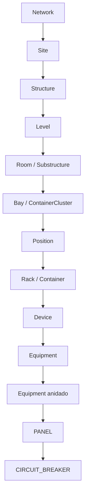
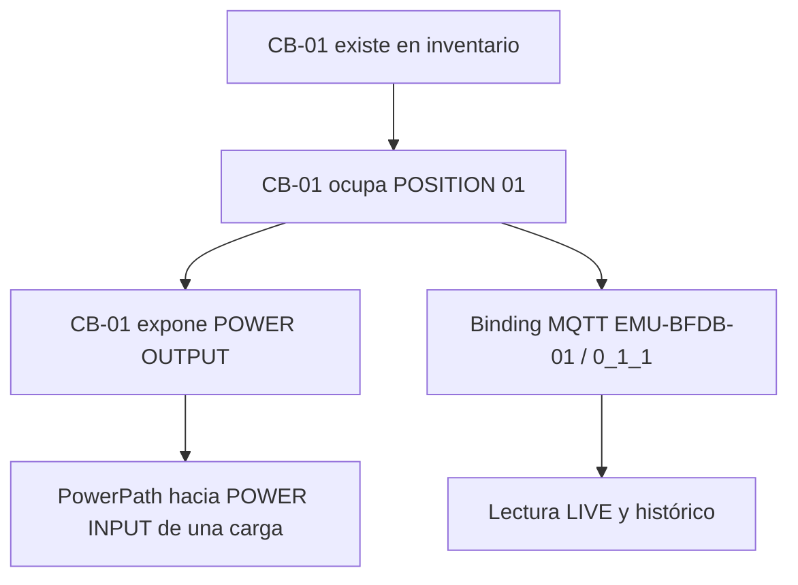

# 0 · Conceptos esenciales y permisos

## ¿Qué representa Site Mapper?

Es un inventario con **contexto físico**. Cada entidad tiene un nombre, un tipo y una ubicación dentro de una jerarquía. Puedes explorar esa jerarquía y, con los permisos correctos, añadir componentes y registrar sus relaciones.

**Ejemplo fácil:** una ciudad no contiene directamente un breaker. Primero ubicamos **instalación → edificio → nivel → sala → rack → dispositivo → componentes**.

### Diccionario para operadores

| Palabra que verás   | Explicación sencilla                                       | Ejemplo                         |
| ------------------- | ---------------------------------------------------------- | ------------------------------- |
| Network             | Contexto general que agrupa instalaciones                  | Network-Lima-1                  |
| Site                | Instalación o localización física                          | TELXIUS-LURIN-1                 |
| Structure           | Edificio o estructura del Site                             | EDIFICIO-01                     |
| Level               | Piso o nivel del edificio                                  | LEVEL-01                        |
| Room / Substructure | Sala con geometría                                         | SALA DE TRANSMISIONES           |
| Bay / Cluster       | Agrupación física dentro de una Room                       | Bay-01                          |
| Position            | Lugar donde situar un rack                                 | Una posición del plano          |
| Rack / Container    | Estructura que alberga Devices                             | Rack-01-BDFB                    |
| Device              | Equipo inventariado y montable en rack                     | BDFB-01                         |
| Equipment           | Componente interno con identidad propia                    | Chassis, Shelf, Frame, Panel    |
| PANEL               | Equipment que puede tener posiciones físicas               | Panel de 24 posiciones          |
| CIRCUIT_BREAKER     | Interruptor instalado como Equipment                       | CB-01                           |
| DYNAMIC             | Los hijos no ocupan una ranura numerada                    | Chassis con módulos sin slots   |
| POSITIONAL          | Los hijos ocupan slots numerados                           | Panel 01–24                     |
| Access Port         | Terminal físico identificable de una entidad               | Power output, Power input       |
| PowerPath           | Conexión persistida entre dos Access Ports                 | CB-01 OUTPUT → SWITCH INPUT     |
| MQTT Source         | Identidad del publicador de datos                          | EMU-BFDB-01                     |
| Raw point           | Etiqueta del dato que envía la fuente                      | 0_1_1                           |
| TelemetryBinding    | Asociación aprobada entre fuente, punto, métrica y destino | `VOLTAGE` de `0_1_1` a CB-01    |
| LIVE                | Lectura reciente aceptada                                  | 12.22 V en una muestra concreta |
| Histórico           | Muestras persistidas para consulta por periodo             | 24h, 7d                         |

**Importante:** `Room / Substructure` o `Rack / Container` son variantes de un mismo nivel del modelo; la barra no indica una capa adicional.

## Identidad, ubicación, electricidad y telemetría son conceptos independientes

Puedes tener un breaker sin PowerPath, o un breaker correctamente mapeado sin LIVE si la fuente no está publicando. La UI debe mostrarlo como **pendiente**, nunca inventar una conexión.

## Roles y permisos

| Operación                                 | STANDARD | ADMIN                                        | SUPERADMIN |
| ----------------------------------------- | -------- | -------------------------------------------- | ---------- |
| Consultar topología, energía y telemetría | Sí       | Sí                                           | Sí         |
| Crear/modificar topología                 | No       | Sí                                           | Sí         |
| Crear/modificar PowerPath                 | No       | Sí                                           | Sí         |
| Crear binding y confirmar commissioning   | No       | Sí, mediante `topology:write` | Sí         |
| Administrar usuarios                      | No       | No | Sí, únicamente con `users:manage` |
| Cambiar ajustes protegidos                | No       | Sí según permiso                             | Sí         |

Si un botón no aparece, **primero comprueba el rol, el estado del objeto y la ruta desde la que entraste**. No cambies manualmente un campo en MongoDB para eludir un permiso.

## Cinco errores habituales

1. Intentar crear un Rack desde el formulario general de topología. **Los Bays, Positions y Racks se dibujan/ubican desde Room Blueprint**.
2. Crear un `PANEL` con `DYNAMIC` cuando necesitamos posiciones 01–24. Para posiciones numeradas, usar `POSITIONAL` y definir capacidad.
3. Confundir `Device` con `Equipment`. El primero representa inventario del rack; el segundo puede ser un componente **anidado**.
4. Suponer que `0_1_1` pertenece a CB-01 porque está en la primera posición. **Se confirma en commissioning**.
5. Creer que un Access Port de tipo POWER ya constituye un PowerPath. Debes conectar **dos terminales concretos** y confirmar la conexión.

[Siguiente: crear entidades](entidades.md).
