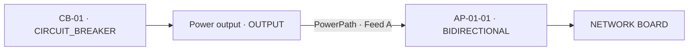
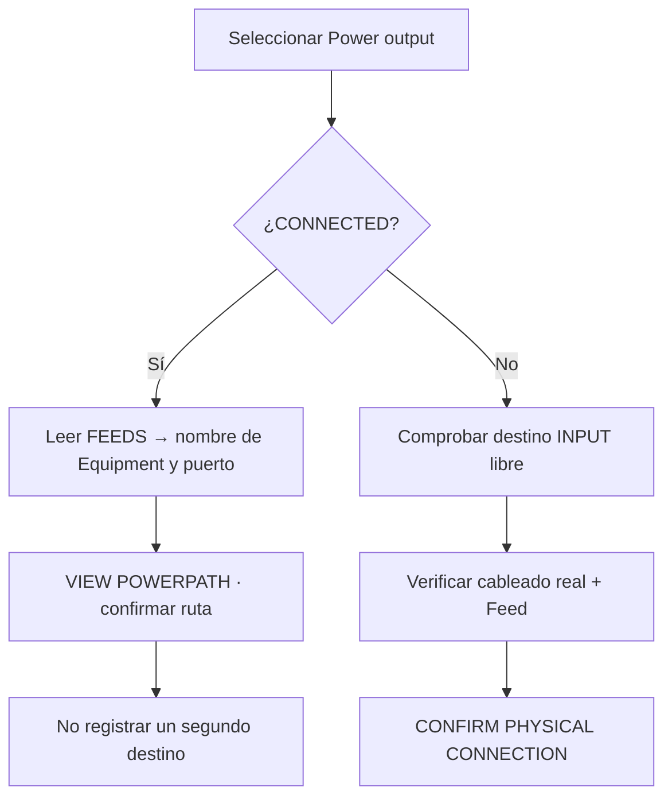

# 4 · Conectar puertos POWER sin duplicar enlaces

**Resultado de esta lección:** una persona puede señalar exactamente **de dónde sale la alimentación**, **qué Equipment la recibe**, **qué Access Port participa en cada extremo** y **si la conexión ya existe**.

> Solo un administrador autorizado debe registrar un PowerPath después de comprobar la instalación física. Registrar la ruta **no energiza** el hardware. El sistema implementa la regla aprobada: **1 Access Port de origen → 1 Access Port de destino**.

## 1. Diferencia entre puerto y conexión

- **Access Port:** terminal físico de un Equipment. Puede existir aunque esté libre.
- **PowerPath:** conexión persistida que enlaza dos terminales específicos.
- **Feed A/B:** identificación de una vía de alimentación. Que exista A no implica que B esté configurada ni que haya redundancia.
- **CONNECTED:** el puerto ya tiene una ruta **registrada**. No lo consideres disponible para otra.
- **VIEW POWERPATH:** abre la ruta registrada, para consultar su trazado.

El ejemplo real de entrenamiento es **CB-01 / Power output → NETWORK BOARD / AP-01-01 · Feed A**. El terminal AP-01-01 está registrado como POWER · BIDIRECTIONAL. Si físicamente recibe solo potencia, corresponde revisar su definición como POWER INPUT; registrar RS-485 como protocolo del mismo AP no confirma cómo se cableó.

## 2. Antes de conectar: inspeccionar los extremos

1. Abre la ficha del Equipment fuente desde el Rack, la jerarquía o la búsqueda.
2. Baja a **PHYSICAL TERMINALS**, haz clic en su terminal POWER (ejemplo: `Power output`).
3. Verifica el nombre, **tipo POWER**, dirección **OUTPUT** (o **BIDIRECTIONAL**, si corresponde), y estado. Si muestra **CONNECTED**, **no intentes crear otra ruta**.
4. Si está conectado, la tarjeta seleccionada indica **FEEDS → Equipo destino / Puerto**, además de un enlace **VIEW POWERPATH**. El inspector **ACCESS PORTS** muestra el mismo destino.
5. Abre el Equipment destino y confirma que dispone de un puerto POWER **INPUT** o **BIDIRECTIONAL** físicamente apto. Si aparece **CONNECTED**, muestra **POWERED BY ← Equipo fuente / Puerto** y ya está ocupado.
6. Verifica en sitio con el responsable eléctrico que **ese par concreto de terminales** corresponde al cableado real.

Los nombres de Equipment no bastan para identificar una ruta. La conexión es entre **dos puertos**, no entre etiquetas de Racks.

## 3. Registrar una conexión nueva

Solo si ambos puertos están libres y has confirmado el cableado:

1. Abre **PHYSICAL TERMINALS** de la fuente, selecciona su OUTPUT y pulsa **CONNECT LOAD**. Esto abre **Connect Equipment Power**.
2. En **1 · Electrical source**, selecciona el **Source Equipment / POWER OUTPUT** que verificaste.
3. En **2 · Destination load**, utiliza **Search destination Equipment** y selecciona el **Destination Equipment / POWER INPUT** correspondiente. Puede ofrecer un terminal BIDIRECTIONAL si el modelo lo permite.
4. En **3 · Verify and confirm**, observa el resumen **origen → destino** y selecciona **Feed A** o **Feed B** según el circuito real. Si un extremo tiene feed fijo, la UI puede fijar ese valor.
5. Añade opcionalmente **Connection label** para facilitar la auditoría. No uses etiquetas ambiguas como “cable 1”.
6. Solo si el resumen coincide con la evidencia física, pulsa **CONFIRM PHYSICAL CONNECTION**.
7. El sistema navega a la vista del PowerPath creado. Regresa a los dos Equipment y confirma el estado **CONNECTED** desde cada extremo.

La ventana es responsive y tiene desplazamiento vertical propio. En una laptop, desplázate hasta el final para acceder a los mensajes, advertencias y botón de confirmación. No uses el zoom para ocultar un error.

## 4. ¿Qué pasa si el puerto ya alimenta algo?

La interfaz marca **ALREADY CONNECTED** en el selector de origen y muestra la advertencia **SOURCE_ALREADY_CONNECTED** cuando se abrió con un origen ocupado. No permite confirmar otra conexión usando ese AP. Si el destino está ocupado, aparece **TARGET_ALREADY_CONNECTED**. Si eliges origen y destino del mismo Equipment o feeds incompatibles, también se bloquea.

**Para alimentar varias cargas:** modela un **Equipment distribuidor** con puertos físicos separados. Cada OUTPUT del distribuidor debe conectar con un único INPUT de carga. No registres dos PowerPaths desde el mismo OUTPUT de un breaker.

## 5. Cómo confirmar que quedó bien registrada

En el ejemplo de laboratorio:

| Lugar | Qué debes ver | Qué significa |
| --- | --- | --- |
| CB-01 → **PHYSICAL TERMINALS** | `Power output · CONNECTED` | Puerto ya usado |
| CB-01 → terminal seleccionado | `FEEDS → NETWORK BOARD / AP-01-01 · Feed A` | Destino identificable |
| NETWORK BOARD → terminal | `CONNECTED` + `POWERED BY ← CB-01` | Alimentación registrada |
| **VIEW POWERPATH / FULL POWER TRACE** | Camino A con los objetos del circuito | Recorrido auditable |
| Inspector → Power A / B | A: `Path recorded`; B: `No recorded path` | Solo vía A registrada |

Que el trazado figure como VERIFIED es una validación de la representación/identidad del recorrido. **No acredita por sí mismo que haya tensión física real**, ni certifica redundancia A+B. La telemetría LIVE es otra comprobación distinta.

## 6. Errores que se deben evitar

- Si el terminal muestra **CONNECTED**, no crear otro PowerPath “para probar”.
- No reutilizar el mismo puerto BIDIRECTIONAL como entrada **y** salida de rutas distintas.
- No modificar el serial o los cuatro TelemetryBindings para arreglar una conexión eléctrica.
- No crear Equipments/cables ficticios para completar Feed B.
- Si el cableado cambia, solicita una revisión y retiro controlado de la ruta existente antes de registrar la nueva. No archives automáticamente sin el procedimiento aprobado.

**Resultado aprobado:** localizar el puerto fuente y destino en ambas fichas, abrir el mismo PowerPath y explicar correctamente la diferencia entre conexión registrada, telemetría LIVE y redundancia.

[Siguiente: enlazar señales MQTT](telemetria.md) · [Contrato técnico de un puerto](../operations/power-port-cardinality.md).
