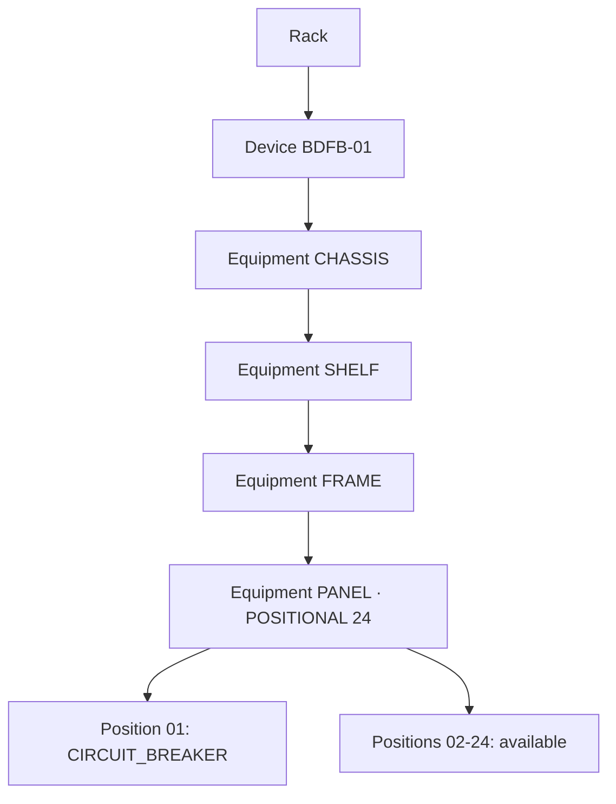

# 3 · Device, Equipment and breaker positions

**Goal:** describe the entire Device installed in a Rack and its internal components without conflating them.

## Two different identities

- **Device:** main inventory unit under a Rack (for example BDFB-01).
- **Equipment:** individually identified component beneath a Device **or another Equipment**: Chassis, Shelf, Frame, PANEL and CIRCUIT_BREAKER.

This is an example composition, not a mandatory template for all equipment.

## A. Create the Device

1. From **EXPLORE**, navigate through the intended Network, Site, Room and Rack.
2. In the Rack inventory context, find the available Device creation control. Do not add the Device directly below Room.
3. Give it a clear name such as BDFB-TRAIN-01 and the correct Device type.
4. Enter a **Serial number** only if it identifies that specific physical unit. Leaving it blank is safer than reusing another publisher's serial.
5. Save and open the new Device. Confirm that the correct Rack owns it.

**Creating a Device is not a CAS mount and does not establish a power connection.**

## B. Add an Equipment within a parent

1. Open the parent Equipment's composition page, e.g. /device/<equipment-id>.
2. In **PHYSICAL COMPOSITION**, select **+ ADD EQUIPMENT** for a DYNAMIC parent, or **MANAGE POSITIONS** and a free slot for POSITIONAL.
3. Choose:
   - **FROM WAREHOUSE** to instantiate a compatible template with an instance name, Equipment type, children mode, capacity, serial and display settings.
   - **ONE-OFF** to create a single part by providing its Name, Equipment type, children mode, serial and category.
4. Complete **Install Equipment** (Warehouse) or **Create and install** (One-off).
5. Open the new child and confirm its parent in the composition tree.

Templates may restrict permissible child types. Do not bypass those rules by changing the type to CUSTOM.

## C. Example: create a 24-slot Panel

In the intended parent Equipment select **+ ADD EQUIPMENT**, then ONE-OFF:

| UI field          | Training example                         | Meaning                                  |
| ----------------- | ---------------------------------------- | ---------------------------------------- |
| Name              | PANEL-01                                 | Human-readable identity                  |
| Equipment type    | PANEL                                    | Enables panel semantics                  |
| Children mode     | POSITIONAL                               | Numbered child slots                     |
| Child slots       | 24                                       | Physical position count                  |
| MQTT point prefix | 0_1, only if documented                  | Suggested raw point group, not a binding |
| Serial number     | EMU-BFDB-01, only if truly its publisher | Verified unique source ownership         |

Select **Create and install**. The Panel should show PANEL, ACTIVE, POSITIONAL and 24 slots. Never copy a publisher serial merely because a tutorial uses it.

## D. Install a breaker at Position 01

1. Open the Panel's **INTERNAL COMPOSITION**.
2. Select **MANAGE POSITIONS** or **EXPLORE POSITIONS** when appropriate.
3. Find **POSITION 01 · AVAILABLE**, then **+ ADD EQUIPMENT** for that _specific slot_.
4. Choose ONE-OFF, name PANEL-01-CB-01, choose **CIRCUIT_BREAKER** and DYNAMIC children.
5. Complete **Create and install**.
6. Confirm Position 01 is OCCUPIED, with one installed and 23 available, and that the new breaker opens as Equipment.

Some breaker types automatically receive a **POWER OUTPUT** terminal. Inspect **ACCESS PORTS** to verify it, but do not assume a PowerPath was created.

## E. When to use Warehouse

When installing multiple equivalent components, maintain a template in **WAREHOUSE** with manufacturer/model, type, category and allowed child types. Then instantiate using FROM WAREHOUSE. The template is reusable; each deployed instance still needs its own serial, capacity and confirmed position.

**Do not create all 24 breakers just to fill the visualization.** Every installed Equipment represents a known circuit.

**Pass:** identify the Device, nested Equipment, Panel, breaker at position 01 and any uninstalled slots; explain what is not yet connected or mapped.

[Next: power connections](conexiones.md).
