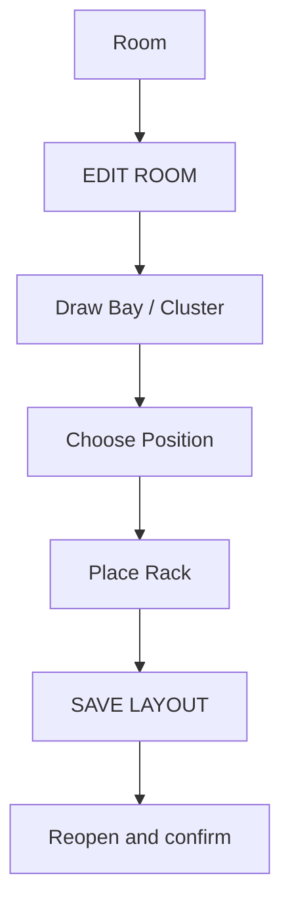

# 2 · Blueprint: draw a Room and place a Rack

**Goal:** move from a textual Room into a saved visual plan containing Bay, Position and Rack, without entering raw coordinates.

## Before editing

Open an existing Room with its boundary saved. Your account needs topology write permission. The Room editor changes a **draft**, and the draft is **not persistent** until **SAVE LAYOUT** succeeds.

## Guided steps

1. In the global navigation tree open the intended Room, for example ROOM-01.
2. Open its **Blueprint** page, at the route /blueprint/<room-id>.
3. Select **EDIT ROOM** and recognize **EDIT · UNSAVED DRAFT**.
4. If the room perimeter needs adjustment, choose **DRAW ROOM BOUNDARY** or **EDIT ROOM BOUNDARY**, trace it and apply the change to the draft.
5. Use **+ Draw Bay / Cluster**, choose Bay or Cluster, name it and trace its polygon inside the Room.
6. Use **+ Place Empty Position**, then **Choose cell on canvas**, if you need a reserved empty location.
7. Use **+ Place Rack** and enter requested dimensions/capacity. Follow the placement mode; the editor may offer **Add rack left-to-right**.
8. Select the Rack on the plan. Check its location, occupied cells and overlaps.
9. Select **SAVE LAYOUT**. Do not claim that any edit was saved before the operation finishes successfully.
10. Reopen the Rack, return to Room and verify its saved location.

## What saving does and does not do

Blueprint records a physical layout. It does **not** automatically create Device, nested Equipment, electrical PowerPaths or MQTT TelemetryBindings. An empty Rack can still be placed correctly.

### Rack Elevation and CAS

From the Rack view inspect elevation and U allocations. Depending on role/state you may see **EDIT CAS**, **Reserve / split available span**, **Mount Equipment** and **Free allocation**.

- Review capacity and occupied/reserved U spans before reserving.
- Mounting requires a compatible reservation/entity; naming a Device is not enough.
- Do not free occupied spans to make room for a test.
- Rack CAS U positions and a Panel's internal 24 breaker slots are distinct.

## If something disappears or refuses an edit

| Problem                    | Check                                        |
| -------------------------- | -------------------------------------------- |
| No EDIT ROOM               | Correct Room context and edit permission     |
| Draft disappeared          | Was SAVE LAYOUT successful?                  |
| No general CREATE RACK     | Rack is placed within Blueprint              |
| CAS mount rejected         | Available U, reservation and compatibility   |
| Rack not visible elsewhere | Verify Network, Site, Room and selected Rack |

**Pass:** identify Room, Bay and Rack on the drawing, open the Rack and return, explaining why placement is separate from power and telemetry.

[Next: Devices and Equipment](equipos-y-posiciones.md).
