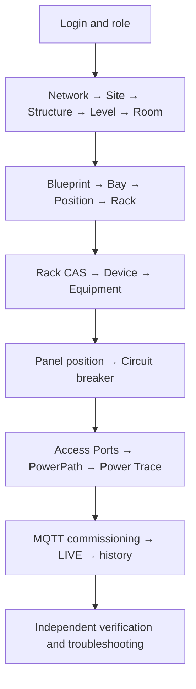

# Site Mapper MK1 · Complete operator manual and data model

**Operator edition · 26 October 2026.** Intended for first-time users, authorized infrastructure operators, inventory owners and technicians. This manual walks through the implemented UI and separates **registered inventory**, **physical placement**, **registered power connections**, **signal commissioning** and **live measurements**.

> **Visual evidence:** some authentic screenshots are available from past laboratory sessions. Others are still pending. See the **Visual evidence status** chapter. An instructional diagram is not a real screenshot. Never claim that an undocumented operation succeeded.

## How to use this manual without developer assistance

1. Start at **Login** with an account supplied by your administrator.
2. Read the chapters in sequence if you are new. Otherwise use the Help Center search and choose the exact task.
3. Before editing, identify the parent object, your role and the authorized environment.
4. Each module below explains **where to go, what to select, what success looks like, what not to do and what to check if the operation fails**.
5. Use training names and lab fixtures only in an isolated test database. Do not copy fictitious publisher serials, OIDs or PowerPaths to a customer installation.
6. At any error, verify the current state before retrying. Repeating a write blindly can create duplicates.

## Required learning path

## Part A · Access and permissions

### M01. Sign in for the first time

**Where:** your official application URL, or /login on a local installation.

1. Obtain an authorized email and temporary password privately.
2. Enter **Email / Password** and choose **SIGN IN**.
3. If the application opens **Change password**, provide current/new passwords, with a new password at least 12 characters long.
4. Sign in again because changing the password revokes existing sessions.
5. Confirm that Workspace opens.

**Correct:** you enter using your own account and see only permitted controls.  
**Do not:** share passwords, photograph credentials, look for public registration or manipulate hashes in MongoDB.  
**If blocked:** report the URL, screen and error message without disclosing credentials.

### M02. Create and manage users (SUPERADMIN only)

**Where:** **ADMIN → Settings → Users → + ADD USER**.

1. Enter Name, unique Email, authorized Role and a private Temporary password of 12+ characters.
2. Select **Create user**, confirm ACTIVE status and deliver credentials securely.
3. To archive/reactivate or change a role, select the **correct account row** and verify the result.

**Correct:** the account appears with the approved role. STANDARD is read-only; ADMIN can edit authorized topology/power; only SUPERADMIN can manage users.  
**Do not:** give SUPERADMIN privileges solely to expose controls, or practice on production accounts.  
**If Users is absent:** check role; it is not accessible to ADMIN.

## Part B · Concepts and physical layout

### M03. Entity, location, Device and Equipment

A **Network** contains Sites; a **Site** contains Structures, Levels and Rooms. A Room contains placed objects such as Bays, Positions and Racks. A Rack contains **Devices**; Devices contain **Equipment** such as Chassis, Shelf, Frame, Panel and Circuit Breaker.

**Correct:** each entity has a stable identity and an allowed parent.  
**Do not:** equate a Rack's U allocation with a Panel's numbered circuit position.

### M04. Create Network, Site, Structure, Level and Room

**Where:** **EXPLORE**, always on the parent page.

1. Identify the correct Network. Use **+ CREATE SITE** under it.
2. Provide a name, choose **Define boundary**, draw valid geometry and **Save Site**.
3. Under Site use **+ CREATE STRUCTURE**, define its boundary and save.
4. Under Structure use **+ CREATE LEVEL**.
5. Under Level use **+ CREATE ROOM**, choose Room/Substructure, draw its boundary, then **Save Room**.
6. Verify the full parent/child tree and saved polygons.

**Correct:** created items are nested under their intended parents and spatial limits persist.  
**Do not:** invent real-site polygons, overlap Rooms by area or retry an error before checking whether the object was already written.  
**If the boundary is rejected:** check containment, crossing and overlap. An HTTP error screenshot never proves a successful create operation.

### M05. Room Blueprint, Bay, Position and Rack

**Where:** open a Room's Blueprint at /blueprint/<room-id>.

1. Select **EDIT ROOM**, confirm an unsaved draft exists.
2. Add or edit the Room boundary if needed.
3. Select **+ Draw Bay / Cluster**, then place empty Position and/or **+ Place Rack**.
4. Review placement and possible collisions before selecting **SAVE LAYOUT**.
5. Navigate to Rack and back to confirm persistence.

**Correct:** the Rack appears in the intended Room with valid location and dimensions.  
**Do not:** bypass Blueprint through ad hoc API requests or assume unsaved layout edits persist.  
**If EDIT ROOM is absent:** check topology write permission and that you opened a Room, not its Site.

### M06. Reserve Rack CAS and mount a Device

**Where:** Rack Elevation / **EDIT CAS** in the Rack view.

1. Inspect total Rack capacity, occupied U spans and reservations.
2. Use **Reserve / split available span** only for a real available range.
3. Mount a compatible item through **Mount Equipment** where permitted.
4. Confirm that allocation and Equipment correspond to the intended Rack.

**Correct:** allocations stay within capacity and never overlap existing occupied spans.  
**Do not:** free an occupied span for practice, invent a device height, or confuse Rack U with Panel breaker positions.

## Part C · Equipment composition and electrical links

### M07. Create Device and nested Equipment

**Where:** Rack inventory for Device; an Equipment's **PHYSICAL COMPOSITION** for its children.

1. Create Device under the correct Rack, using a clear name and type.
2. Open the parent Equipment and choose **+ ADD EQUIPMENT** (DYNAMIC) or **MANAGE POSITIONS** (POSITIONAL).
3. Choose **ONE-OFF** or **FROM WAREHOUSE** and supply compatible type, identity, children mode and capacity.
4. Complete **Create and install** / **Install Equipment** and inspect the child's parent.

**Correct:** parent-child navigation works both directions.  
**Do not:** create Equipment directly under Room or borrow another active serial.

### M08. Create a 24-slot Panel and Circuit Breaker

**Where:** Equipment composition.

1. Create Equipment of type **PANEL** with **POSITIONAL**, **Child slots = 24**.
2. Add an MQTT point prefix/serial only after source ownership has been verified.
3. Open **INTERNAL COMPOSITION → MANAGE POSITIONS**.
4. Select **POSITION 01 · AVAILABLE**, then create a **CIRCUIT_BREAKER** one-off.
5. Confirm Position 01 is OCCUPIED and 23 positions remain available.

**Correct:** one installed breaker is represented by one Equipment.  
**Do not:** fabricate 23 other breakers merely to make the display look complete. POSITIONAL 24 does not create 24 signals.

### M09. Create or inspect Access Ports

**Where:** Equipment's **PHYSICAL TERMINALS** and **ACCESS PORTS** inspector.

1. Identify the exact Equipment and terminal type.
2. Confirm POWER versus other service types, and INPUT, OUTPUT or BIDIRECTIONAL direction.
3. Check whether a peer is already shown as CONNECTED.
4. Use the actual port name and feed metadata rather than guessing from the Rack label.

**Correct:** a port refers to a specific terminal, not a vague whole-Device connection.  
**Do not:** duplicate terminals, create POWER for a non-power connector or modify a linked port's direction/feed without approved change control.

### M10. Register a PowerPath from a free output

**Where:** select a free source POWER OUTPUT, **CONNECT LOAD**.

1. Choose the **Source Equipment / POWER OUTPUT**.
2. Search for and choose the correct **Destination Equipment / POWER INPUT**.
3. Verify the actual source/destination pair, Feed A/B and connection label.
4. Only after field confirmation, select **CONFIRM PHYSICAL CONNECTION**.
5. Open the saved PowerPath and both terminal pages to confirm the reciprocal CONNECTED/POWERED BY state.

**Correct:** exactly one source-to-destination pair is registered per occupied port.  
**Do not:** connect INPUT to INPUT, reuse an occupied OUTPUT or BIDIRECTIONAL port on a second path, or change Feed just to make the validation pass.  
**If SOURCE_ALREADY_CONNECTED or TARGET_ALREADY_CONNECTED appears:** open the existing VIEW POWERPATH; do not override.

### M11. Full Power Trace and redundancy

**Where:** **VIEW POWERPATH / FULL POWER TRACE** and Equipment inspectors.

Compare **Feed A** and **Feed B independently**. Follow the source, intermediate Equipment and destination. A registered A path and “No recorded path” for B means **B is not registered**.

**Correct:** both endpoint Equipment views describe the same recorded path.  
**Do not:** interpret “Path recorded” or “VERIFIED” as proof of energization, physical installation or redundant feeders. LIVE telemetry is separate evidence.

## Part D · Commissioning and verification

### M12. Map MQTT to the right Circuit Breaker

**Where:** correct parent PANEL → **MQTT POINT COMMISSIONING**.

1. Verify PANEL publisher serial, MQTT prefix, slot position and intended breaker.
2. Review the proposed raw point, e.g. 0_1_1 for Position 01.
3. Independently confirm the physical source/point-to-breaker mapping.
4. Check the verification box and select **Confirm and commission point**.
5. Confirm **4/4 metric bindings · VERIFIED MAPPING**, then inspect the child breaker.

Four metrics are VOLTAGE, CURRENT, POWER and ENERGY. **4/4 is a mapping state, not a fresh reading.**

**Do not:** retire another source to overcome a conflict, copy unverified serials or confirm based only on a matching position number.

### M13. Read LIVE, STALE and historical values

**Where:** the breaker Equipment's **LIVE TELEMETRY → Own readings** and **HISTORY**.

1. Confirm source identity, raw point, timestamps, units and LIVE/STALE/NO DATA quality.
2. Select 24H or 7D to compare historical samples separately.
3. When using the API, respect its case-sensitive windows LIVE, 24h, 7d, 15d and 1M.
4. For SNMP inputs, use the BDFB Device inspector; SNMP shunts are separate sources from MQTT descendant breakers.

**Correct:** you can state whether readings are current, only historical or unavailable.  
**Do not:** infer that missing telemetry proves an electrically powered-off circuit or that a historical graph certifies wiring.

## Part E · Data model, integrity rules and complete scenario

### M14. What Site Mapper actually stores

The inventory models topological nodes, parents, identities and geometry. Separate records represent Rack CAS allocation, Equipment Access Ports, PowerPaths, verified TelemetryBindings, latest accepted observations, historical samples and user/session authority.

A Device, a Rack CAS reservation, a PowerPath and a telemetry reading answer **different questions**. Do not repair one layer by directly editing another.

### M15. Rules that must never be violated

- Maintain a valid physical parent for every kind of entity.
- Do not reuse active Device/Equipment serials.
- Respect geometry containment and layout collision safeguards.
- Never exceed Rack capacity or overlap CAS allocations.
- Never assign a second active connection to an already occupied Access Port.
- Only commission source/point/metric mappings with verified ownership.
- Distinguish simulated lab measurements from field-certified signals.
- Never wipe MongoDB/TimescaleDB or Docker volumes to “fix” a page.
- Report errors with screen, object, timestamp and observed state; omit secrets.

### M16. End-to-end training example

1. Log in with an authorized ADMIN in an **isolated training database**.
2. Open the training Network and create SITE-TRAIN-01, its Structure, Level and Room, with required boundaries.
3. In Room Blueprint create Bay/Position, place Rack and **SAVE LAYOUT**.
4. Open Rack, register a Device and compose a Chassis → Shelf → Frame → 24-slot Panel.
5. Install a Circuit Breaker in Position 01 and inspect its terminal.
6. **Only with an approved physical/simulated fixture**, connect a free POWER OUTPUT to the correct load INPUT, then inspect the registered PowerPath from both sides.
7. **Only with verified source and point**, commission the breaker MQTT metrics.
8. Observe LIVE with timestamps, then historical 24H/7D and distinguish independent SNMP input readings.
9. Reopen topology, Equipment and connection records to verify persistence.

If the training environment lacks the approved electrical fixture or publisher, **stop after inventory/placement** and inspect an already documented example instead. Never fabricate acceptance evidence.

## When the operator is ready

The operator can perform read-only navigation independently, locate the precise Equipment/port and explain **what exists in inventory, what is placed, what is connected on record, what is mapped, what is LIVE, what is historical and what is still unverified**.

[First login](primer-acceso-y-usuarios.md) · [Blueprint](espacios-y-racks.md) · [Power connections](conexiones.md) · [MQTT](telemetria.md) · [Troubleshooting](verificacion.md) · [Guided practice](practica-guiada.md).
