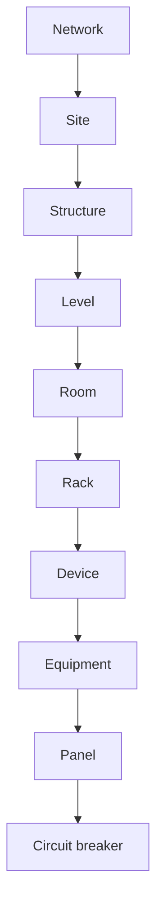

# Data model explained to operators and technicians · Site Mapper MK1

**Purpose:** understand what the database represents without editing it. Physical placement, component identity, electrical connectivity and signal readings are **separate records**.

## 1. A model is not the same as a database collection

A **domain model** defines what Site Mapper considers a Network, Room, Equipment, Access Port, connection or measurement. A **collection** stores those records in MongoDB. A UI that combines several views may read different collections without creating one new combined object.

**Operators should use the application**, not modify Mongo documents. Database inspection is limited to authorized administrators working read-only.

## 2. Topology nodes: basic fields

Each topological object has a stable identifier, human-readable name, type (**kind**), lifecycle and the appropriate relationship to its parent. Domain rules determine which kinds may be nested. Objects can carry spatial geometry, Equipment attributes or a device type.

A UUID or database identifier is not interchangeable with a label or serial number. Changing a name is different from moving an object or changing its source identity.

## 3. Hierarchy: location → asset → component

A Room contains spatially placed objects; a Rack contains Devices; a Device contains Equipment, and Equipment may contain other Equipment. This example collapses Bay/Position for readability; Blueprint models them explicitly.

## 4. Device versus Equipment

**Device** represents an identifiable inventory unit mounted in a Rack. **Equipment** represents individually modeled constituents such as Chassis, Shelf, Frame, Panel and Circuit Breaker. Equipment may have **DYNAMIC** or **POSITIONAL** children.

A 24-slot Panel does not automatically contain 24 installed Circuit Breakers; available slots remain empty until an approved installation is recorded. Real serials are not interchangeable with synthetic MQTT source names.

## 5. Rack CAS is data associated with Rack allocation

CAS is about available/reserved/mounted **U space** within the Rack. A Panel's POSITIONAL 24 slots refer to **circuit positions** within a single Equipment; they are not Rack U allocations.

Placing a Rack in Blueprint does not reserve U for a Device. Reserving CAS space does not commission a telemetry point.

## 6. Access Port: the Equipment's terminal

An **Access Port** belongs to a particular Equipment and can have a service/type (e.g. POWER), direction (OUTPUT, INPUT or BIDIRECTIONAL) and relevant labels, including Feed A/B. This is a physical terminal model, not proof that cables exist.

An Access Port can be registered yet disconnected. CONNECTED indicates a path recorded elsewhere, not electrical energization.

## 7. PowerPath: a separate link between two Access Ports

A **PowerPath** stores the exact source and destination terminal identities, the agreed direction/Feed and audit-relevant connection information. It is not stored simply as a Rack name, a free-text note or a live measurement.

The accepted model protects **one source → one destination** per terminal, avoiding duplicate occupancy. Full Power Trace follows these recorded links. A/B redundancy is not inferred merely from an A path.

## 8. TelemetryBinding: explicit evidence of signal ownership

A TelemetryBinding associates a specific source identity, raw point and metric with an exact Equipment target. A breaker may require four approved metrics: VOLTAGE, CURRENT, POWER and ENERGY.

The point may be suggested by Panel prefix and position, but that is **not proof of the physical mapping**. Source collision or conflicting ownership requires investigation rather than blind override.

## 9. MQTT, latest state and historical readings

A device publishes MQTT to a broker. Site Mapper checks publisher identity and mappings before accepting observations. Latest State supports **LIVE/STALE/NO DATA** displays; TimescaleDB persists eligible readings for windows such as 24h/7d. The system may expose separate Modbus TCP registers with their own quality/freshness policies.

SNMP input shunts are another source path, not the sum of descendant MQTT breakers. A historical observation is evidence of a sample at a past time, not current voltage.

## 10. Identity, users and operational data

User accounts, roles and sessions belong to the identity subsystem. Topology and physical connections belong to domain repositories. MQTT/SNMP mappings, retained observations, latest state, history and Modbus publication each have different ownership and integrity requirements.

Never use a generic “fix the database” action to repair one UI state. First identify the responsible subsystem: authentication, spatial draft, Rack CAS, PowerPath, commissioning, publisher, history storage or Modbus output.

## 11. How to inspect the model safely

1. Record the target object **kind, ID and parent** from the authorized UI.
2. Read the relevant topology and inspector views without modifying anything.
3. For power, trace both Access Ports and the PowerPath.
4. For telemetry, inspect source/prefix/point and exactly which Equipment owns each binding.
5. Compare timestamps and freshness; use the history UI.
6. If a database audit is approved, run documented **read-only** diagnostics with the exact intended database name. Keep connection strings and credentials private.
7. Report inconsistencies with evidence rather than direct Mongo edits.

**Never use** database deletion, direct serial reassignment, invented Equipment or arbitrary changes to Feed A/B as a repair technique.

**Pass:** explain where a Rack is placed, which Device contains a breaker, which Access Port is linked, and which independently verified signals currently measure it.

[Overview](manual-maestro.md) · [Verification](verificacion.md).
