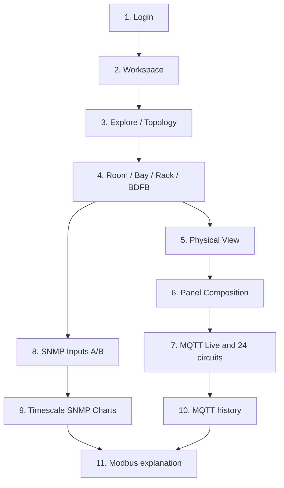
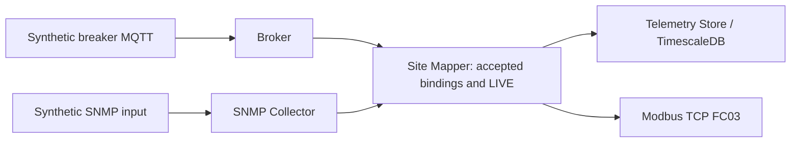

# Site Mapper: from Login to MQTT, SNMP, Timescale and Modbus

**For first-time operators.** A browser, an approved account and access to the authorized laboratory are enough to read the system. You do not need Docker or MongoDB expertise for this walkthrough.

> This example uses **synthetic MQTT and SNMP lab sources**. Lab observations do not certify field shunts, controllers, live wiring or equipment accuracy.

## Walkthrough map

## Step 1. Sign in

1. Open **http://localhost:3000/login** on the laboratory machine, or use your organization's assigned URL.
2. Enter **Email** and **Password**, then **SIGN IN**.
3. If required, complete **Change password** and sign in again.
4. Verify **Workspace** is displayed. An unexpected redirect back to Login may indicate an auth/session problem; **never reset MongoDB** as a quick fix.

Site Mapper provides no public registration. Your administrator creates accounts.

## Step 2. Understand Workspace

- **Equipments (Primary)** counts primary devices, not all breakers or SNMP inputs.
- **Reporting** indicates equipment with recent mapped telemetry.
- **No recent data** means a fresh measurement is unavailable, not that the circuit is electrically off.
- **Direct access** opens a pinned BDFB or other object.
- **BDFB Power Overview** summarizes _descendant MQTT Equipment_ power; it is not the same as SNMP source-side current.

## Step 3. Find the BDFB

From **EXPLORE** or **TOPOLOGY** navigate Network → Site → Structure → Level → Room → Bay → Rack → **Device BDFB**. Then navigate its internal CHASSIS → SHELF → FRAME → PANEL → breaker composition.

An earlier October 2026 lab used BDFB-01 in Bay-01 and BDFB-02/03 in Bays 02/03. Your installation may have other names. Use the actual inventory labels and never copy lab UUIDs into live systems.

## Step 4. Read BDFB PHYSICAL VIEW

Select the parent **BDFB Device**, not an individual breaker. In the evaluated lab there was one CHASSIS, SHELF, two FRAMES and four PANELS with 24 positions each.

- BDFB-01 originally had **3 installed breakers** and **93 empty positions**.
- Synthetic BDFB-02 and BDFB-03 were populated with **96 breaker Equipments each** across four Panels.

A label such as **24 INSTALLED / 0 AVAILABLE** describes inventory slots. It is not live telemetry and does not certify actual wiring.

## Step 5. Inspect Panel MQTT

1. Select **OPEN PANEL COMPOSITION** on an installed Panel.
2. Locate **24/24 positions MQTT LIVE** _only if the source currently publishes accepted data_.
3. Read columns **POS, BREAKER, V · V, I · A, P · W, E · kWh, STATUS**.
4. Open **Telemetry** in the Equipment inspector. Aggregated descendant readings exclude empty or unmapped slots; they must not be interpreted as an SNMP shunt total.

LAB-BDFB-02/03 may use four prefixes 0_1 through 0_4 and 24 circuits each. **LIVE**, **STALE**, **UNMAPPED** and **OFFLINE** describe different conditions.

## Step 6. Inspect SNMP DC inputs

Go back to the BDFB **Device**, then **INSPECTOR → Inputs**.

- A previously reviewed BDFB-01 synthetic **Config2 A/B** showed two simulated shunts and **LAB LIVE · SIMULATED**, with independent current/voltage.
- BDFB-02/03 require their own inventory ports and verified commissioning before expected A/B (Config2) or A1/A2/B1/B2 (Config4) readings appear.

If the relevant SNMP bindings are not commissioned, the view can correctly show **PENDING** or **0/0**. Do not change an MQTT breaker identity to fix SNMP input mapping.

**SNMP input current is independent of the 96 MQTT circuit currents.** Never report an arithmetic sum of circuit readings as a verified input-shunt measurement.

## Step 7. Use TimescaleDB Charts

1. In **INSPECTOR → Charts**, choose **SNMP · TIMESCALEDB HISTORY → 24H → Current**.
2. When samples exist, inspect the A/B input curves; change to **Voltage**, **Power** or **Energy** as available.
3. Power may be derived as the absolute voltage times current; energy may be integrated from valid intervals. This is not necessarily a physical SNMP energy-meter counter.
4. Separately inspect **MQTT · DESCENDANT EQUIPMENT HISTORY** for breaker histories.

**No samples stored for selected range** in SNMP does not invalidate MQTT history. API query parameters use lowercase **24h**, even when the UI button says **24H**.

## Step 8. Understand Modbus TCP

Modbus supplies read-only industrial registers to an authorized integration such as Metasys. It is an **output**, not a sensor configuration feature in Inputs.

Earlier lab evidence covered Modbus Units **1–3** for original publishers and **4–5** for synthetic LAB-BDFB-02/03, with **8/8 representative FC03 reads**. This is not acceptance of the entire map, a field controller, or a real plant.

## Step 9. Investigate unexpected states

| Observation                | Likely interpretation                       | First action                                |
| -------------------------- | ------------------------------------------- | ------------------------------------------- |
| Login rejected             | Credentials or session                      | Contact admin without exposing password     |
| MQTT LIVE but SNMP PENDING | Breaker signal live, shunt not commissioned | Inspect Inputs; do not alter MQTT           |
| MQTT STALE                 | Old/no recent packet                        | Check publisher, broker and source          |
| SNMP LAB LIVE              | Synthetic source is publishing              | Check SNMP historical samples separately    |
| SNMP 0/0                   | No eligible input ports/mappings            | Request authorized lab commissioning        |
| Charts empty               | No data in protocol/time window             | Try correct metric/window; review collector |
| Modbus reads zero          | Actual zero or missing/stale policy         | Check quality and last observation          |

## Completion criteria

You can sign in, find a Rack and BDFB, distinguish inventory and LIVE readings, open the 24 slots of a Panel, inspect MQTT metrics, view SNMP inputs and both histories, and explain the Modbus output **without editing** system configuration.

**Never use as a quick repair:** docker compose down -v, database deletion, reassignment of serials, copying example OIDs into field inventory, or marking simulated shunts as verified physical installation.

[Complete manual](manual-maestro.md) · [Troubleshooting](verificacion.md).
