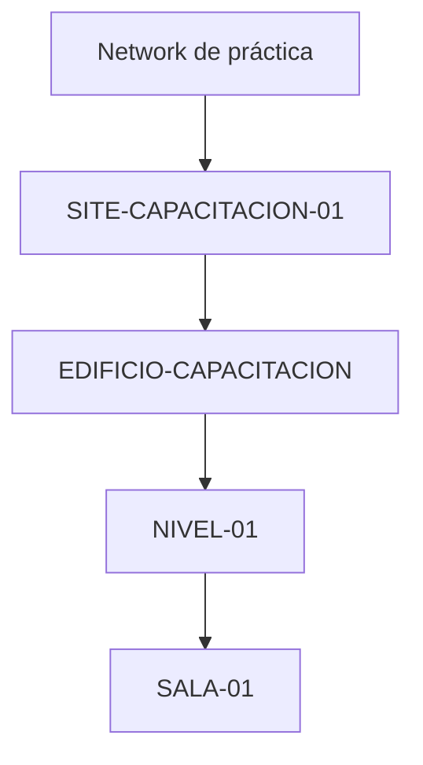

# 1 · Crear entidades y navegar la jerarquía

**Objetivo:** crear entidades básicas sin romper su ubicación y comprender por qué algunos formularios te piden dibujar límites.

## Antes de empezar

Necesitas rol ADMIN/SUPERADMIN, un entorno de prácticas autorizado y claridad sobre **qué entidad es la padre** de la que vas a crear. Los botones disponibles dependen del contexto de la página; Site Mapper no permite crear cualquier tipo bajo cualquier otro.

### ¿Dónde creo cada cosa?

| Nueva entidad | Dónde entrar | Control real |
| --- | --- | --- |
| Network | Vista de exploración / Network | `+ CREATE NETWORK` (si el contexto y el permiso ofrecen el control) |
| Site | Network correspondiente | `+ CREATE SITE` → `Define boundary` |
| Structure | Site correspondiente | `+ CREATE STRUCTURE` → `Define boundary` |
| Level | Structure correspondiente | `+ CREATE LEVEL` |
| Room | Level correspondiente | `+ CREATE ROOM` → `Define boundary` |
| Bay, Position, Rack | Abrir **Blueprint** de la Room | No usar el formulario general: se crean/colocan en el plano |
| Device | Rack/contexto válido | Crear desde la opción de inventario del contexto del Rack |
| Equipment | Device u otro Equipment | `+ ADD EQUIPMENT`, `FROM WAREHOUSE` o `ONE-OFF` |

No todas las vistas muestran todos los botones. Si no ves una acción, vuelve al objeto padre o revisa el permiso.

## Ejercicio A: añadir un Site a una Network

1. Ve a **EXPLORE → Network** y abre la Network **correcta**.
2. Busca `+ CREATE SITE` dentro del contexto de esa Network.
3. Escribe un nombre que puedas reconocer. En un laboratorio: `SITE-CAPACITACION-01`.
4. Haz clic en **Define boundary**. Se abrirá el editor de polígono.
5. Dibuja los puntos de su perímetro, revisa el polígono y confirma con **Save Site**.
6. Comprueba que el Site quedó **debajo de la Network** y que su vista se puede abrir desde el árbol.

**Resultado esperado:** un Site con identidad propia y límite espacial. Un texto escrito en el formulario no basta: los objetos espaciales exigen el paso de geometría.

## Ejercicio B: añadir Structure, Level y Room

1. Entra en el Site y utiliza `+ CREATE STRUCTURE`.
2. Pon `EDIFICIO-CAPACITACION` y **Define boundary**; dibuja la estructura dentro del perímetro del Site cuando exista límite registrado.
3. Dentro de la Structure usa `+ CREATE LEVEL`; crea `NIVEL-01`.
4. Dentro de ese Level utiliza `+ CREATE ROOM`, nombre `SALA-01`, y selecciona **Room** frente a **Substructure**, según corresponda.
5. **Define boundary** para dibujar la Room. Debe quedar dentro de Structure; no debe solaparse en área con otra Room (paredes compartidas pueden ser válidas).
6. Confirma **Save Room** y navega de vuelta desde el árbol.

**Resultado esperado:** cada entrada aparece en su padre correcto y la geometría de Site/Structure/Room queda registrada.

## Formulario de creación: campos que importan

- **Name:** nombre legible, corto y consistente; evita duplicar un nombre ambiguo bajo el mismo padre.
- **Device type / Equipment type:** tipo de objeto; no es un nombre libre que reemplace a la jerarquía.
- **Serial number:** identificación de una unidad concreta. Debe ser única entre Devices/Equipment activos cuando se asigna. No inventes seriales de emulador para completar campos.
- **Children mode:** `DYNAMIC` para hijos sin posiciones numeradas; `POSITIONAL` para slots numerados.
- **Child capacity:** cuántos slots existen (solo `POSITIONAL`, entre 1 y 256 en los formularios implementados).
- **MQTT point prefix:** por ejemplo `0_1`, **solo propone nombres de puntos**; no enlaza breaker y señal.

## ¿Qué hacer si aparece un error?

| Situación | Qué comprobar |
| --- | --- |
| No hay `+ CREATE ...` | ¿Estás en el padre correcto? ¿Tu rol permite escritura? |
| El formulario muestra `Define boundary` | Es normal en Site, Structure y Room: falta dibujar polígono |
| La geometría no se acepta | Revisar contención, cruces y solapamiento de polígonos |
| `CREATE_FAILED_HTTP_...` | Error HTTP: no duplicar rápidamente la solicitud; revisar si el objeto llegó a crearse |
| Duplicidad de serial | No modificar otro Device para forzar un SN; verificar inventario y correspondencia |

**No crees Rack, Bay o Position por API manual para saltarte Blueprint**. El siguiente tutorial enseña su ubicación visual.

[Siguiente: Blueprint, posiciones y racks](espacios-y-racks.md).
