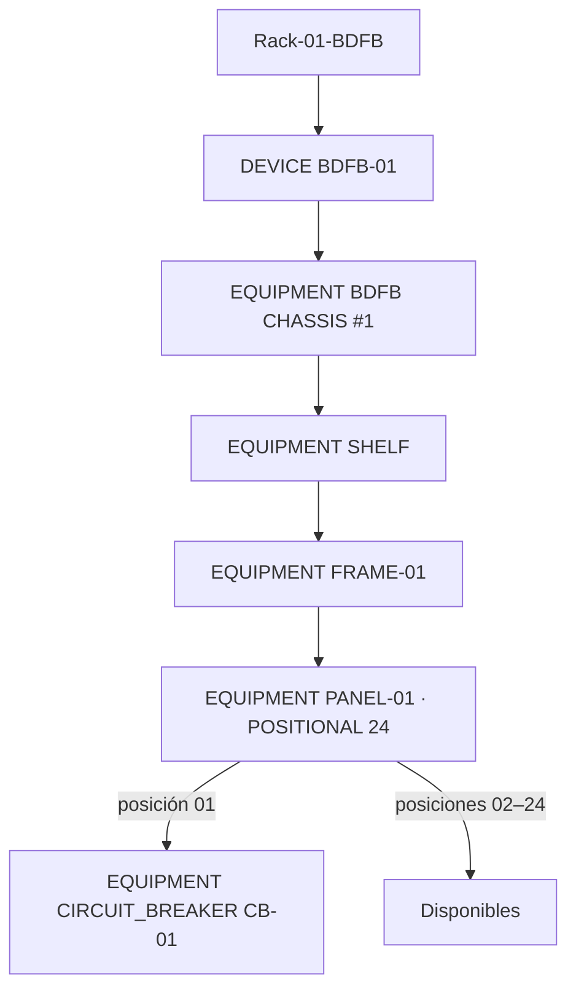

# 3 · Device, Equipment y posición de un breaker

**Objetivo:** representar qué equipo está en el Rack y qué piezas lo componen, sin confundir la unidad completa con sus módulos internos.

## Primero: dos identidades diferentes

- **Device:** unidad de inventario ubicada en un Rack, por ejemplo `BDFB-01`.
- **Equipment:** pieza con identidad propia, situada bajo un Device **o bajo otro Equipment**. Ejemplos: `BDFB CHASSIS #1`, Shelf, Frame, Panel, `CIRCUIT_BREAKER`.

Este árbol es un **ejemplo de composición**, no una plantilla universal para cada Rack.

## A. Crear el Device raíz

1. Desde **EXPLORE** navega a la Network, Site, Room y Rack previstos.
2. Abre el Rack y busca el control disponible para **crear Device** bajo ese contexto de inventario. Los controles exactos dependen de la vista de Rack/topología y de tus permisos; no se debe crear un Device bajo Room directamente.
3. Escribe un nombre claro (ejemplo `BDFB-CAPACITACION-01`) y el tipo que corresponda al equipo real.
4. Solo si conoces el número de serie exacto, asígnalo. Dejar `Serial number` vacío es preferible a reutilizar el serial MQTT de otro Equipment.
5. Guarda y abre su ficha. Comprueba que aparece en el Rack correcto y que se puede navegar desde su identidad.

**No confundir:** crear el Device en la jerarquía no significa asignarle automáticamente unidades CAS ni conectarle energía. Revisa las secciones correspondientes del Rack.

## B. Crear un Equipment dentro de otro

1. Abre el Equipment **padre**, por ejemplo el Chassis, Shelf o Frame. La página de composición está en `/device/<equipment-id>`.
2. En **PHYSICAL COMPOSITION** localiza `+ ADD EQUIPMENT` si el padre usa `DYNAMIC`, o abre **MANAGE POSITIONS** y selecciona el slot libre si usa `POSITIONAL`.
3. En el compositor selecciona uno de los dos modos reales:
   - **FROM WAREHOUSE:** parte de una plantilla de Equipment compatible; puedes indicar nombre de instancia, tipo, `Children mode`, capacidad, serial y presentación.
   - **ONE-OFF:** crea una sola pieza con `Name`, `Equipment type`, `Children mode`, serial y categoría.
4. Guarda mediante `Install Equipment` (Warehouse) o `Create and install` (One-off).
5. Haz clic sobre el hijo creado y verifica el nombre del padre en su ficha.

Si el padre limita tipos mediante una plantilla, el selector solo ofrece tipos permitidos. **No intentes saltarte esa limitación convirtiendo otra cosa en CUSTOM**.

## C. Crear un Panel de 24 posiciones

En el Equipment que será el padre del Panel, selecciona `+ ADD EQUIPMENT` (o un slot correspondiente). En **ONE-OFF**, introduce:

| Campo de la UI | Valor de ejemplo | Importancia |
| --- | --- | --- |
| Name | `PANEL-01` | Identidad humana |
| Equipment type | `PANEL` | Activa la semántica del panel |
| Children mode | `POSITIONAL` | Habilita slots numerados |
| Child slots | `24` | 24 posiciones físicas |
| MQTT point prefix | `0_1` **solo si está documentado** | Propuesta de grupo raw, no binding |
| Serial number | `EMU-BFDB-01` **solo si es esta fuente** | Publisher único y aprobado |

Confirma **Create and install**. En la ficha del Panel debe decir `PANEL · ACTIVE · POSITIONAL · 24 slots`.

**Peligro:** no copies `EMU-BFDB-01` sin comprobar su propietario. MongoDB impide seriales activos duplicados; cambiar el serial de otro Device sin control puede desconectar su fuente.

## D. Instalar un CIRCUIT_BREAKER en POSITION 01

1. En la ficha del Panel ubica **INTERNAL COMPOSITION**.
2. Pulsa `MANAGE POSITIONS` si necesitas mostrar/editor de slots. Para paneles grandes puede ser necesario `EXPLORE POSITIONS`.
3. Localiza `POSITION 01 · AVAILABLE` y pulsa `+ ADD EQUIPMENT` de **esa posición**.
4. Usa **ONE-OFF**, escribe el nombre `PANEL-01-CB-01`, tipo `CIRCUIT_BREAKER` y modo de hijos `DYNAMIC`.
5. Guarda con `Create and install`.
6. Revisa el resultado: posición 01 **OCCUPIED**, 1 instalado, 23 libres y el nuevo Equipment navegable.

Un `CIRCUIT_BREAKER` puede incorporar automáticamente un terminal `POWER OUTPUT` al crearse; **comprueba su existencia en ACCESS PORTS**, no asumas que un PowerPath ya está creado.

## E. ¿Cuándo usar Warehouse?

Si vas a crear piezas repetidas del mismo tipo, registra una plantilla en **WAREHOUSE**, indicando tipo de Equipment, fabricante/modelo, categoría y tipos de hijos permitidos. Luego instánciala con **FROM WAREHOUSE**. La plantilla es una especificación reutilizable; **la instancia** sigue necesitando configuración de capacidad, serial e instalación.

Evita crear 24 breakers a ciegas para llenar el dibujo. Cada posición debe corresponder a un circuito que el operador realmente conoce y que podrá verificar después.

## Resultado de esta lección

La persona debe poder abrir un Panel de 24 posiciones, reconocer el Equipment instalado en el slot 01 y explicar, sin mezclar conceptos, qué representa el Device, qué representa el Equipment y qué **aún no se ha conectado**.

[Siguiente: conectar alimentación](conexiones.md).
