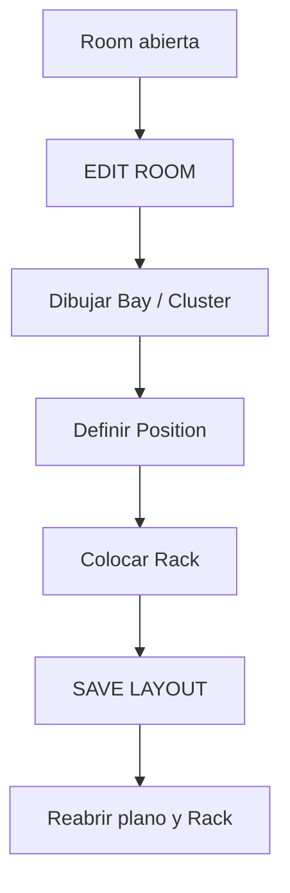

# 2 · Dibujar la sala y colocar un Rack

**Objetivo:** pasar de la jerarquía textual a una sala dibujada y colocar una posición/rack sin escribir coordenadas manualmente.

## Antes de empezar

Debes tener una **Room** creada, con su contorno guardado, y permiso de edición de topología. La interfaz del editor es **Blueprint / Room layout** y trabaja sobre un borrador: los cambios que ves durante `EDIT ROOM` pueden no estar persistidos hasta pulsar `SAVE LAYOUT`.

## Recorrido guiado

1. Desde el árbol global, entra en la Room de prácticas (por ejemplo, `SALA-01`).
2. Abre su vista **Blueprint**; la URL de una Room tiene el formato `/blueprint/<room-id>`.
3. En el plano pulsa `EDIT ROOM`; comprueba que la barra muestra `EDIT · UNSAVED DRAFT`.
4. Si la sala necesita un límite distinto, usa `DRAW ROOM BOUNDARY` o `EDIT ROOM BOUNDARY`, dibuja y aplica al borrador.
5. Para un Bay usa `+ Draw Bay / Cluster`, asigna el nombre y el tipo **Bay** o **Cluster**, y traza su polígono dentro del contexto de la Room.
6. Para reservar un lugar vacío usa `+ Place Empty Position` y después `Choose cell on canvas` en la cuadrícula.
7. Para colocar un Rack utiliza `+ Place Rack` y completa las dimensiones/capacidad solicitadas en el formulario. La pantalla ofrece `Add rack left-to-right` según el modo de colocación vigente.
8. Inspecciona el plano con la herramienta de selección. Comprueba que el Rack no ocupa otra entidad y que corresponde al Bay/posición prevista.
9. Haz clic en **SAVE LAYOUT**. Hasta este paso no debes dar la distribución por persistida.
10. Abre la vista del Rack y vuelve a la Room para comprobar que el objeto sigue ubicado donde se guardó.

## ¿Qué cambia cuando guardas?

Blueprint registra la disposición física de la sala. **No crea automáticamente Devices, Equipment ni PowerPaths dentro del Rack**. Un Rack vacío puede existir y estar correctamente colocado.

### Después: Rack Elevation y CAS

Desde el Rack puedes consultar la elevación y la ocupación CAS. El editor presenta `✎ EDIT CAS` y acciones como `Reserve / split available span`, `Mount Equipment` y `Free allocation`, según los objetos y permisos.

- Antes de reservar U, revisa la capacidad real del Rack y las reservas ya ocupadas.
- `Mount Equipment` exige una reserva/entidad apta; no ocupa automáticamente una ranura libre solo por nombrar un Device.
- No liberes una asignación para “hacer espacio” sin comprobar qué equipo está instalado actualmente.
- El modelado interno Equipment sigue su propia jerarquía. No confundas la posición CAS en el Rack con las 24 posiciones internas del Panel.

## Si algo no aparece

| Problema                             | Qué mirar                                                                       |
| ------------------------------------ | ------------------------------------------------------------------------------- |
| No ves `EDIT ROOM`                   | Permisos o contexto: abre una Room, no el Site                                  |
| Dibujaste pero desapareció al volver | Probablemente no se guardó el borrador con `SAVE LAYOUT`                        |
| No encuentras `+ CREATE RACK`        | Rack se incorpora desde **Blueprint**, no desde el creador general              |
| CAS no permite montar                | Revisa reserva, U disponibles y compatibilidad; no sobrescribas otra asignación |
| Un Rack no se ve en otra página      | Comprueba el Site/Room/Rack seleccionados antes de volver a crearlo             |

**Práctica aprobada:** poder señalar en el plano una Room, su Bay y su Rack, abrir el Rack y volver sin confundir ubicación con conexiones o telemetría.

[Siguiente: Device y Equipment](equipos-y-posiciones.md).
