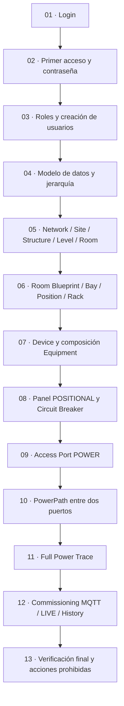
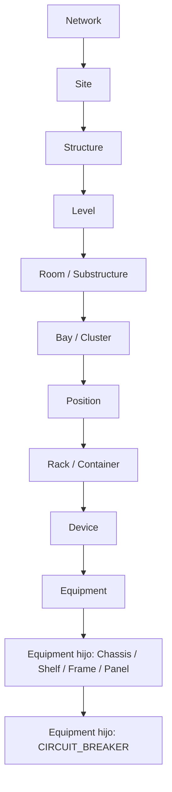
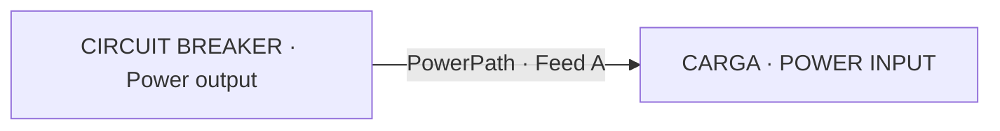
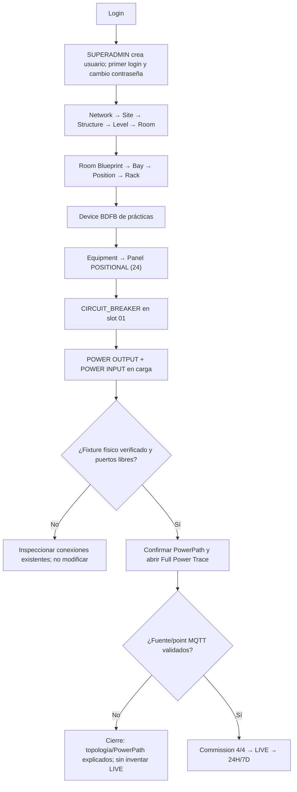

# Site Mapper MK1 · Manual maestro de operación y modelo de datos

**Edición de trabajo 1.0 · 19/10/2026 · Público:** usuarios sin experiencia previa, operadores, responsables de inventario y técnicos.  
**Alcance:** acceso a la aplicación → topología espacial → Rack/Device/Equipment → Access Ports → PowerPath → verificación de MQTT/LIVE/histórico.  
**Autoridad técnica:** interfaz y servicios implementados en `main`, contrato de dominio aceptado y [modelo de datos explicativo](modelo-de-datos.md).

> **Estado de ilustraciones:** este capítulo referencia el [catálogo de evidencia visual](evidencia-visual.md). Disponemos de capturas reales del editor de límites, Equipment/Access Ports y Connect Equipment Power. Las capturas de Login, Users, alta de topología y otros controles deberán obtenerse de una sesión autorizada. **No declarar el manual «ilustrado final» hasta completar esa matriz y el ensayo de usuario autónomo.**

## Cómo usar este manual sin preguntar al desarrollador

- Lee cada procedimiento en orden: **antes de empezar → dónde entrar → acción → resultado esperado → qué NO hacer → error y recuperación**.
- Si falta un dato del mundo físico (serial, ubicación, medidas, terminal, feed, punto MQTT), **detén solo esa operación**. No inventes valores para «completar» un formulario.
- Si un botón no aparece, revisa **rol**, **entidad padre** y **estado**; no saltes la validación utilizando APIs o MongoDB.
- Las rutas `http://localhost:3000` son **solo del laboratorio local**. En una instalación real, usa la URL proporcionada por tu organización.
- Los valores `EMU-BFDB-01`, `0_1_1` y CB-01 son **ejemplos del laboratorio**, no valores predeterminados.

## Ruta de aprendizaje obligatoria

## Parte A · Acceso y permisos

### M01. Entrar por primera vez

**Antes:** credenciales entregadas por el administrador por un canal seguro, navegador compatible y URL correcta.

1. Abre la dirección de Site Mapper y localiza **Sign in**. **Imagen pendiente: UI-01**.
2. Escribe tu correo en **Email** y tu contraseña en **Password**. Pulsa **SIGN IN**.
3. Si tu usuario fue creado con contraseña temporal, el sistema te dirigirá a **Change password**.
4. Introduce **Current password** y **New password** de al menos 12 caracteres. Pulsa **Change password**.
5. Se invalidará la sesión actual y volverás a Login. Inicia sesión con la contraseña nueva.
6. Confirma que puedes acceder a **Workspace** o a tu último contexto de trabajo.

**Correcto:** entras con tu cuenta y el rol asignado.  
**No hagas:** fotografiar contraseñas, compartir sesiones, buscar un botón «Regístrate» —no existe registro público—, cambiar directamente hashes de MongoDB.  
**Si falla:** verifica correo y URL; si continúa, entrega la descripción del error al responsable de usuarios, sin compartir la contraseña.

### M02. Crear y administrar usuarios (SOLO SUPERADMIN)

**Antes:** sesión SUPERADMIN. `STANDARD` y `ADMIN` **no tienen `users:manage`** en la política actual.

1. En la barra superior, entra en **ADMIN** → **Settings**.
2. Selecciona **Users** → **＋ ADD USER**.
3. Introduce **Name**, **Email**, **Role** y **Temporary password** (mínimo 12 caracteres).
4. Pulsa **Create user**. Espera a que aparezca la cuenta en la tabla de usuarios.
5. Confirma nombre, correo, rol, estado **ACTIVE** y obligatoriedad del cambio de contraseña.
6. Comunica las credenciales iniciales por un medio privado; pide al usuario seguir M01.

**Correcto:** la cuenta aparece, el rol coincide con la autorización y el usuario puede reemplazar la contraseña.  
**No hagas:** asignar SUPERADMIN solo para mostrar opciones, crear usuarios reales para practicar, publicar credenciales de entrenamiento.  
**Gestión posterior:** SUPERADMIN puede cambiar roles y alternar entre `ACTIVE` y `ARCHIVED`; el botón **•••** de una fila cambia su estado, no abre un menú general. No intentes archivar al último SUPERADMIN activo.

**Permisos resumidos**

| Capacidad | STANDARD | ADMIN | SUPERADMIN |
| --- | :---: | :---: | :---: |
| Consultar topología, energía, telemetría | Sí | Sí | Sí |
| Crear/mover entidades, modificar Access Ports, PowerPaths | No | Sí | Sí |
| Commissioning del Panel (`topology:write`) | No | Sí | Sí |
| Entrar a Settings → Users | No | No | Sí |

## Parte B · Conceptos y modelo físico

### M03. Diferenciar entidad, ubicación, dispositivo y componente

Site Mapper representa objetos con identidad propia, relaciones con sus padres y estados. Los términos de la pantalla **no** son intercambiables.

**Ejemplo sencillo:** una ciudad contiene instalaciones; cada instalación tiene edificios; un edificio tiene pisos; en una sala hay racks; cada rack alberga Devices; cada Device puede contener Equipment, que a su vez puede contener otros Equipment.

- **Device**: identidad operativa del equipo administrado; se relaciona con un Rack.
- **Equipment**: componente físico canónico de ese Device, con atributos y posibles hijos; puede ser Panel, Chassis, breaker, etc.
- **Rack CAS (U)** y **posición interna de un Panel (01–24)** son mecanismos distintos.
- **Access Port**: terminal físico del Equipment. **PowerPath**: vínculo entre dos terminales concretos; ninguno equivale a energía física verificada.
- **Telemetry Binding**: asociación aprobada entre fuente, punto y métrica y un Equipment. **LIVE**: muestra reciente aceptada, no prueba de cableado.

Consulta las [entidades y colecciones del modelo](modelo-de-datos.md) antes de modificar el inventario.

### M04. Crear Network, Site, Structure, Level y Room

**Antes:** sesión ADMIN/SUPERADMIN y **base de capacitación**. Identifica el padre correcto y la geometría que vas a dibujar.

| Qué vas a crear | Dónde estar | Acción que corresponde |
| --- | --- | --- |
| Network | Raíz de exploración habilitada | `+ CREATE NETWORK` cuando el contexto lo ofrezca |
| Site | Dentro de Network | `+ CREATE SITE` → `Define boundary` → `Save Site` |
| Structure | Dentro de Site | `+ CREATE STRUCTURE` → `Define boundary` |
| Level | Dentro de Structure | `+ CREATE LEVEL` |
| Room | Dentro de Level | `+ CREATE ROOM` → variante `Room` → `Define boundary` → `Save Room` |

**Procedimiento completo para un Site:** abre la Network → pulsa **+ CREATE SITE** → escribe un nombre inequívoco → pulsa **Define boundary** → dibuja el polígono de su perímetro → pulsa **Save Site** → vuelve al árbol y comprueba que quedó debajo de su Network. **Para Room**, repite desde Level respetando el contorno de Structure.

**Correcto:** cada objeto aparece bajo el padre esperado y los objetos espaciales tienen límite guardado.  
**No hagas:** crear un Site debajo de otro Site, inventar polígonos de cliente, superponer Room en área con otras, reintentar guardados fallidos sin comprobar si el objeto se creó.  
**Si el polígono falla:** comprueba contención, autointersección y solapamiento. Una captura histórica del editor refleja errores HTTP; **no** sirve como evidencia de que una operación culminó correctamente.

### M05. Editar Room Blueprint, colocar Bay / Position / Rack

**Antes:** Room guardada; medidas y posiciones físicas conocidas.

1. Desde la Room abre **Blueprint**.
2. Pulsa **EDIT ROOM**: el editor debe mostrar **EDIT · UNSAVED DRAFT**.
3. Si es necesario, ajusta el límite mediante **EDIT ROOM BOUNDARY** y revisa la geometría.
4. Despliega **+ Draw Bay / Cluster**, especifica nombre y tipo y dibuja dentro de Room.
5. Para una ubicación vacía usa **+ Place Empty Position** y selecciona la celda del plano.
6. Para un Rack usa **+ Place Rack**, elige su contexto Bay y establece dimensiones/altura U que correspondan al objeto físico.
7. Comprueba que no invade otros objetos ni está fuera del límite.
8. Pulsa **SAVE LAYOUT** y reabre Blueprint y Rack para verificar la persistencia.

**Correcto:** Rack aparece en su Room, con posición y tamaño coherentes.  
**No hagas:** usar una API para saltarte Blueprint, presuponer que las modificaciones del borrador se guardan solas, confundir Rack con Device.  
**Si no aparece EDIT ROOM:** revisa rol y asegúrate de estar dentro de una Room, no en Site.

### M06. Reservar posiciones CAS / montar el equipo

Un Rack puede tener rangos U **AVAILABLE**, **RESERVED** o **EQUIPPED**. Reservar espacio no crea Equipment ni un PowerPath.

1. Abre el Rack creado y localiza la vista **Rack Elevation / CAS**.
2. Revisa el total de unidades U, las reservas y el espacio libre.
3. Solo si está autorizado, pulsa **EDIT CAS** y utiliza **Reserve / split available span**.
4. Introduce el rango U y las holguras físicas según la documentación del rack.
5. Usa la operación de montaje que presente la vista cuando exista una entidad y reserva compatibles; confirma que la ocupación pasa a **EQUIPPED**.
6. Si solo está reservado, informa **RESERVED**, no «montado».

**Correcto:** ningún rango excede la capacidad ni solapa una ocupación existente.  
**No hagas:** liberar un rango ocupado para «probar» ni alterar el tamaño de un equipo para que encaje.

## Parte C · Crear inventario y composición

### M07. Crear Device y Equipment

**Antes:** el Rack correspondiente existe; conoces identidad, tipo y posible serial.

1. Entra en el Rack desde **EXPLORE** y busca el control contextual de creación de **Device**. Su ubicación concreta depende de la vista; no busques un botón universal.
2. Completa **Name**, **Device type**, y **Serial number** únicamente si está verificado. Guarda.
3. Abre el Device. Identifica la sección de composición y crea su Equipment raíz.
4. Dentro de un Equipment padre usa **+ ADD EQUIPMENT** o la gestión de posiciones, según su **Children mode**.
5. Elige **FROM WAREHOUSE** si existe plantilla compatible o **ONE-OFF** para una pieza individual.
6. Indica **Equipment type**, nombre, modo de hijos, categoría y serial cuando apliquen; termina con **Install Equipment** o **Create and install**.
7. Regresa al padre y confirma que se ve el Equipment hijo.

**Correcto:** puedes navegar del Device a su Equipment y del hijo al padre.  
**No hagas:** crear Equipment directamente bajo una Room, reusar seriales activos o asignar uno del emulador sin autorización.

### M08. Crear un Panel de 24 posiciones y un Circuit Breaker

1. Dentro del Equipment padre del Panel, pulsa **+ ADD EQUIPMENT** → **ONE-OFF**.
2. Define **Equipment type = PANEL**, **Children mode = POSITIONAL**, **Child slots = 24**.
3. Si el panel corresponde a un publicador real, documenta **MQTT point prefix** y serial **solo después** de verificar su relación física.
4. Pulsa **Create and install** y abre el Panel. Confirma **24 slots** y su modo `POSITIONAL`.
5. Usa **MANAGE POSITIONS** / **EXPLORE POSITIONS**, ubica **POSITION 01 · AVAILABLE**.
6. En ese slot pulsa **+ ADD EQUIPMENT**, elige **ONE-OFF**, crea el `CIRCUIT_BREAKER` con nombre propio y `DYNAMIC`.
7. Confirma **POSITION 01 · OCCUPIED**, uno instalado y 23 posiciones restantes libres.

**Correcto:** existe un breaker en la posición 01; el resto puede permanecer libre.  
**No hagas:** llenar el Panel con breakers ficticios para completar el dibujo; **POSITIONAL 24** no genera por sí solo 24 breakers ni 24 señales MQTT.

### M09. Crear o revisar Access Ports

**Antes:** haber abierto la ficha del **Equipment** dueño del terminal y conocido cómo es el terminal real.

1. En la página de Equipment, busca **PHYSICAL TERMINALS** o el inspector **ACCESS PORTS**.
2. Revisa si el terminal ya existe. En un Circuit Breaker puede existir un `Power output` provisionado automáticamente.
3. Si requiere alta, usa **ADD ACCESS PORT** (o la acción equivalente visible en el editor de puertos).
4. Completa **Name**, **Port type**, **Direction**, **Exposure** y, cuando corresponde, **Connector**, **Protocol** y **Feed A/B**.
5. Guarda, vuelve al Equipment y pulsa el terminal recién definido.
6. Lee el estado; **CONNECTED** significa que ese AP ya tiene un PowerPath registrado.

**Direcciones:** `INPUT` recibe, `OUTPUT` entrega, `BIDIRECTIONAL` puede participar en una u otra dirección de acuerdo con el cableado real. `NETWORK`, `DATA`, `CONTROL` o `GROUND` no son puertos `POWER`.

**Correcto:** nombre y características representan el terminal físico y su propietario es el Equipment correcto.  
**No hagas:** duplicar el mismo terminal, crear POWER sobre un conector que no transporta potencia, archivar o alterar dirección/feed de un AP enlazado.

### M10. Registrar un PowerPath desde un puerto libre

**Antes:** ambos extremos existen, están libres, corresponden a terminales POWER y el responsable técnico verificó la conexión física. **No practicar sobre una conexión real existente**.

1. Abre el Equipment origen → **PHYSICAL TERMINALS** y selecciona un `POWER OUTPUT` libre.
2. Pulsa **CONNECT LOAD** para abrir **Connect Equipment Power**.
3. En **1 · Electrical source** elige **Source Equipment / POWER OUTPUT**.
4. En **2 · Destination load** busca el Equipment destino y elige **Destination Equipment / POWER INPUT**.
5. En **3 · Verify and confirm** compara los dos nombres, el Feed y, opcionalmente, **Connection label** con el circuito documentado.
6. Desplázate hasta el final si estás en una laptop pequeña; **la confirmación no debe quedar oculta**.
7. Si todo coincide, pulsa **CONFIRM PHYSICAL CONNECTION**.
8. Regresa a ambos Equipment y verifica **CONNECTED**, **FEEDS → ...** o **POWERED BY ← ...**, y abre **VIEW POWERPATH**.

**Regla contractual:** **un AP fuente alimenta un único AP destino**; un AP destino tampoco puede estar ocupado por un segundo PowerPath activo. Para distribuir a múltiples cargas, representa un Equipment distribuidor **con varios puertos físicos distintos**.

**Caso existente del laboratorio:** `CB-01 / Power output → NETWORK BOARD / AP-01-01 · Feed A`. El puerto de origen ya está **CONNECTED**; su intento de reutilización muestra **SOURCE_ALREADY_CONNECTED** y desactiva la confirmación. **No vuelvas a conectar ese puerto**.

**No hagas:** unir INPUT con INPUT, duplicar OUTPUT, reutilizar un BIDIRECTIONAL como entrada/salida de dos rutas simultáneas, cambiar Feed B «para que salga verde», ni interpretar **Path recorded** como potencia energizada.

### M11. Leer Full Power Trace y redundancia

1. Desde el terminal marcado **CONNECTED** pulsa **VIEW POWERPATH**.
2. Revisa el Equipment fuente, el puerto fuente, Feed A/B, el puerto destino y la carga.
3. Comprueba que el inspector de la fuente indique **FEEDS →** y el del destino **POWERED BY ←**.
4. Si la carga requiere doble alimentación, inspecciona **Feed A** y **Feed B** por separado.
5. Documenta como **incompleto** todo Feed no configurado. Una ruta A en estado `VERIFIED` no acredita redundancia A+B.

**Correcto:** los dos Equipment describen **la misma ruta registrada**, y puedes explicar qué componente alimenta a cuál.  
**No hagas:** afirmar que un PowerPath equivale a prueba de tensión real, ni que dos etiquetas de Feed equivalen automáticamente a redundancia.

## Parte D · Commissioning y verificación

### M12. Asociar MQTT al Equipment correcto

**Antes:** Panel `POSITIONAL`, breakpoint instalado, serial del publisher y `MQTT point prefix` físicamente confirmados.

1. Entra en el Equipment **Panel**, no en un Equipment vecino.
2. Localiza **MQTT POINT COMMISSIONING**.
3. Revisa **Source**, **prefix**, **capacity** y la fila del breaker instalado.
4. Comprueba el punto propuesto (ejemplo: `EMU-BFDB-01 / 0_1_1` en el escenario de laboratorio). No presupongas que la primera posición garantiza el cableado.
5. Si está verificado y no hay conflictos, marca **I verified that … physically measures this breaker**.
6. Pulsa **Confirm and commission point**.
7. Usa **Refresh commissioning** y verifica **4/4 metric bindings · VERIFIED MAPPING**.

Las cuatro métricas son `VOLTAGE`, `CURRENT`, `POWER`, `ENERGY`. Registrar bindings **no crea** un PowerPath y no garantiza que estén llegando paquetes recientes.

**No hagas:** retirar SOURCE de otro Equipo para «desbloquear» una pantalla; cambiar seriales por conveniencia, ni comisionar un punto solo porque «el nombre se parece».

### M13. Ver LIVE, STALE e histórico

1. Abre la ficha del **breaker**.
2. Localiza **LIVE TELEMETRY / Own readings**.
3. Comprueba valor, unidad, fuente y **hora** de la última lectura.
4. Si existe muestra reciente, el estado puede ser **LIVE**; si venció, **STALE**; si no existe vínculo aceptado, **UNMAPPED**; si no llega dato utilizable, **NO DATA**.
5. Selecciona **24H** y **7D** para consultar histórico, si el almacenamiento está disponible.
6. No confundas muestras de hace horas con un estado LIVE.

**Correcto:** puedes explicar la diferencia entre **PowerPath registrado**, **bindings 4/4**, **LIVE** e **histórico**.  
**No hagas:** usar un gráfico histórico como garantía de energía presente o de que un cable esté correctamente instalado.

## Parte E · Modelo de datos, reglas y ejemplo completo

### M14. Qué guarda realmente Site Mapper

El diseño actual **conserva una colección polimórfica `topology_nodes`**. Cada documento declara `kind` y contiene propiedades específicas del tipo. El Equipment incorpora sus `accessPorts[]`; el Rack incorpora sus rangos `cas[]`. Las rutas `power_paths`, las asociaciones `telemetry_bindings` y las cuentas se almacenan por separado. La telemetría histórica pertenece a TimescaleDB.

| Concepto | Representación persistida | No significa |
| --- | --- | --- |
| Network, Site, Room, Rack, Device, Equipment | Documentos `topology_nodes` por `kind` | Una colección Mongo por cada tipo |
| Terminal de Equipment | `accessPorts[]` en ese Equipment | Un PowerPath existente |
| Ocupación de Rack | `cas[]` en Rack | Un breaker instalado en Panel |
| Conexión POWER | `power_paths` | Energización física certificada |
| Atribución de señal | `telemetry_bindings` | Lectura LIVE automáticamente |
| Histórico medido | TimescaleDB / servicio histórico | Estado instantáneo |

Modelo y ejemplos concretos: [entidades, agregados y referencias](modelo-de-datos.md).

### M15. Reglas que nunca se deben violar

1. No crear entidades con padre inválido.
2. No dar por guardado un Room Blueprint si sigue en borrador.
3. No duplicar seriales activos ni asignar seriales sintéticos a inventario real.
4. No ocupar rangos CAS incompatibles ni liberar un Equipment ajeno.
5. No confundir 24 posiciones de Panel con 24 breakers instalados.
6. No conectar INPUT → INPUT ni SOURCE ocupado → otro destino.
7. No «resolver» SOURCE_ALREADY_CONNECTED eliminando datos de Mongo.
8. No crear rutas a cargas inexistentes ni simular redundancia que no está instalada.
9. No comisionar puntos MQTT sin evidencia física y autorizaciones.
10. No usar LIVE como certificación eléctrica ni histórico como medición actual.
11. No archivar usuarios sin confirmar la persona y las consecuencias para sus sesiones.
12. No borrar colecciones, volúmenes Docker ni reestructurar el modelo por una tarea de formación.

### M16. Caso práctico de principio a fin

**Modalidad:** entorno aislado de capacitación. **Objetivo:** que un nuevo operador explique el modelo completo; solo ejecutar operaciones físicas y de MQTT si hay fixture autorizado.

**Prueba autónoma aprobada** cuando el alumno: inicia sesión; explica rol/contraseña; identifica una Room/Rack; abre un Panel y su breaker; encuentra un puerto conectado y el peer; abre PowerPath; distingue `4/4` de LIVE y muestra evidencia sin inventar información.

**Advertencia de aceptación:** esta edición documenta procedimientos respaldados por el código y capturas parciales. Para declarar el **manual ilustrado final apto para entrega** se requieren las capturas reales pendientes, revisión editorial de cada pantalla y prueba independiente con usuarios sin experiencia previa. Consulta [Evidencia visual](evidencia-visual.md).

---

**Guías específicas existentes:** [Primer acceso y usuarios](primer-acceso-y-usuarios.md) · [Crear entidades](entidades.md) · [Blueprint](espacios-y-racks.md) · [Equipo y panel](equipos-y-posiciones.md) · [Conexiones](conexiones.md) · [MQTT](telemetria.md) · [Verificación](verificacion.md) · [Ejercicio](practica-guiada.md).
