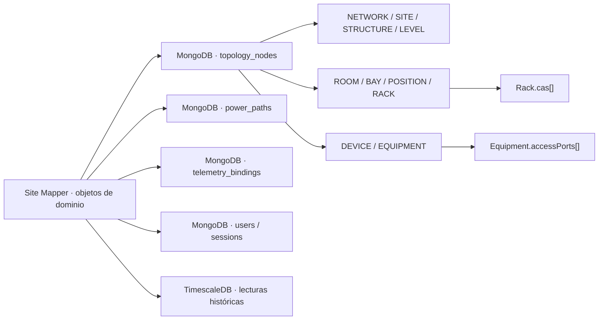
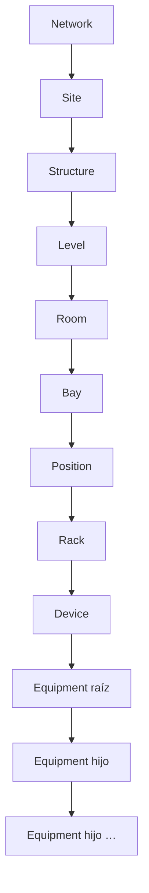
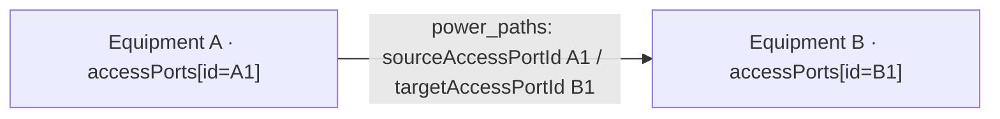
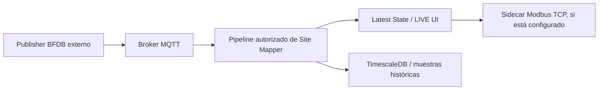

# Modelo de datos explicado para operadores y técnicos · Site Mapper MK1

**Autoridad:** [dominio Topology](../../src/modules/topology/domain/entities.ts), [MongoTopologyRepository](../../src/modules/topology/infrastructure/mongo-topology-repository.ts), [índices MongoDB](../../src/shared/infrastructure/mongodb/bootstrap.ts) y [modelo de persistencia](../architecture/persistence.md).  
**Alcance:** describe el código vigente. **No se propone ni ejecuta separación de colecciones.**

## 1. La diferencia entre un modelo y una colección

**Entidad** es una cosa que la aplicación necesita identificar (Site, Rack, Equipment). **Colección** es una unidad física de persistencia en MongoDB. **No existe ninguna obligación de usar una colección por cada entidad.** Site Mapper agrupa tipos de topología en la colección `topology_nodes` y los diferencia con el campo `kind`.



Si MongoDB Compass muestra **20 documentos en `topology_nodes`**, eso significa 20 objetos de topología **en esa base**, no que todos sean el mismo tipo. Consulta `kind` para saber cuántos son Site, Rack, Device, Equipment, etc.

## 2. Campos básicos de un Topology Node

| Campo | Significado práctico | Ejemplo orientativo |
| --- | --- | --- |
| `id` | Identificador estable de un objeto; no es su nombre | UUID |
| `kind` | Qué clase de objeto representa | `EQUIPMENT`, `SITE`, `CONTAINER_RACK` |
| `name` | Etiqueta legible para operador | `PANEL-01` |
| `parentId` | Padre inmediato de navegación/composición | ID de Equipment o Device padre |
| `lifecycle` | Estado administrativo | `ACTIVE`, `ARCHIVED` |
| `createdAt` / `updatedAt` | Fechas de creación/cambio | Tiempo ISO |
| Campos particulares | Datos propios de un tipo | `polygon`, `cas`, `deviceId`, `children` |

**Ejemplo DIDÁCTICO; no es una muestra copiada de la base:**

```json
{
  "id": "uuid-de-ejemplo",
  "kind": "EQUIPMENT",
  "name": "CB-CAPACITACION-01",
  "parentId": "uuid-panel",
  "parentEquipmentId": "uuid-panel",
  "deviceId": "uuid-device",
  "equipmentType": "CIRCUIT_BREAKER",
  "childMode": "DYNAMIC",
  "children": [],
  "accessPorts": [],
  "lifecycle": "ACTIVE"
}
```

No copias este JSON en la UI. El formulario genera los valores necesarios y el backend comprueba la validez del padre.

## 3. Jerarquía: lugar → activo → parte



| `kind` en Mongo | Palabra de la interfaz | Padre admitido |
| --- | --- | --- |
| `NETWORK` | Network | Raíz |
| `SITE` | Site | Network |
| `STRUCTURE` | Structure | Site |
| `LEVEL` | Level | Structure |
| `ROOM_SUBSTRUCTURE` | Room / Substructure | Level |
| `CONTAINER_CLUSTER_BAY` | Bay / Cluster | Room |
| `POSITION` | Position | Bay / Cluster |
| `CONTAINER_RACK` | Rack / Container | Position |
| `DEVICE` | Device | Rack / Container |
| `EQUIPMENT` | Equipment | Device **o** Equipment |

La barra `/` no añade otro nivel: `ROOM` y `SUBSTRUCTURE` son variantes de `ROOM_SUBSTRUCTURE`; lo mismo ocurre con Bay/Cluster y Rack/Container.

## 4. Device frente a Equipment

- Un **Device** es la identidad del sistema gestionado. Guarda `deviceType`, `rootEquipmentIds[]`, `serialNumber` opcional y contexto de Rack.
- Un **Equipment** es un elemento físico interno con `equipmentType`, `deviceId` (Device dueño), `parentEquipmentId` (padre físico inmediato, cuando aplica), `children[]` y `accessPorts[]`.
- La composición interna es **recursiva**: Chassis → Shelf → Frame → Panel → Circuit Breaker se representa con Equipment anidado. Un Panel `POSITIONAL` puede guardar 24 posiciones en `children[]`; una posición vacía es `null`. No crea equipos ficticios.
- Los seriales activos de `DEVICE` y `EQUIPMENT` tienen **índice de unicidad global** en la misma colección. No reutilizar seriales.
- **No confundir** `parentId` de navegación con `parentEquipmentId` de la composición física. En Equipment, ambos apuntan al contexto de padre inmediato y el servicio mantiene su consistencia.

## 5. Rack CAS: un dato del Rack

`CONTAINER_RACK` incluye `cas[]` y `totalU`. Cada rango de CAS representa una reserva/ocupación:

| Campo de CAS | Qué representa |
| --- | --- |
| `id` | ID de una asignación |
| `startU`, `endU` | Intervalo U del rack |
| `state` | `AVAILABLE`, `RESERVED`, `EQUIPPED` |
| `occupantId` | Identidad del Equipment ocupante (cuando aplica) |
| `mountStartU` / `physicalSizeU` | Montaje físico dentro de la reserva |
| `clearanceTopU` / `clearanceBottomU` | Holguras registradas |

La implementación de CAS actual gestiona reservas/ocupaciones desde Rack y sincroniza la colocación `Equipment.rackPlacement` en una transacción. La intención de dominio de versiones históricas puede describir Rack → Device; **ante esa diferencia documental, prevalece el contrato de los servicios implementados que hayas validado en esta versión**, no un texto antiguo. No cambies CAS directamente en MongoDB.

## 6. Access Port: terminal que pertenece a Equipment

Los Access Ports **no tienen colección propia** en el estado actual. Se guardan en `Equipment.accessPorts[]` y cada uno posee ID global, propietario y características.

| Campo | Para qué sirve |
| --- | --- |
| `id` | Identidad estable del terminal |
| `equipmentId` / `deviceId` | Equipo propietario y Device dueño |
| `name` | Nombre visible: Power output / AP-01-01 |
| `portType` | POWER / NETWORK / CONTROL / DATA / GROUND / CUSTOM |
| `direction` | INPUT / OUTPUT / BIDIRECTIONAL |
| `exposure` | INTERNAL / EXTERNAL |
| `connectorType`, `protocol` | Características físicas/de interfaz opcionales |
| `attributes.feed` | Identidad opcional de vía A / B |
| `lifecycle` | ACTIVE / ARCHIVED |

Que exista el AP no significa que tenga cable. Su estado **CONNECTED** se obtiene de relaciones `power_paths` activas.

## 7. PowerPath: el vínculo eléctrico separado



`power_paths` es colección independiente. Un path conecta **un AP de origen con uno de destino** y declara Feed A/B y lifecycle. MongoDB mantiene índices únicos parciales para `sourceAccessPortId` y `targetAccessPortId` mientras el path está `ACTIVE`. El servicio además valida ocupación antes de crear un vínculo.

**Importante:** índices separados por columna no sustituyen una transacción que proteja simultáneamente roles cruzados de un AP BIDIRECTIONAL ante escritores concurrentes. El operador nunca debe editar la colección manualmente y debe respetar el control 1:1 de la interfaz.

**CONNECTED** = vínculo persistido. **LIVE** = lectura reciente. **Energía presente** = hecho físico que requiere evidencia independiente.

## 8. TelemetryBinding: atribución explícita de la señal

La colección `telemetry_bindings` guarda qué publicador/protocolo, punto bruto, métrica y destino se relacionan. Ejemplo de laboratorio: `EMU-BFDB-01`, `0_1_1`, métrica `VOLTAGE`, destino `CB-01`. Para un breaker se esperan las cuatro métricas V/A/W/kWh.

Se comprueba con `MQTT POINT COMMISSIONING`: `0/4` indica vacío; `4/4 · VERIFIED MAPPING` indica las cuatro asociaciones confirmadas; **ninguno de los dos demuestra recepción LIVE**.

## 9. De MQTT a Latest State e histórico



- **Latest State:** valor más reciente y su calidad/frescura; usado por la interfaz LIVE y otros consumidores.
- **Entity Telemetry Sample:** una medición o serie de mediciones contextualizada al Equipment correcto; su histórico se consulta a través del servicio dedicado de TimescaleDB.
- **Modbus:** salida del laboratorio; no es «prueba de sensores» por sí mismo.
- Los registros históricos **no** deben guardarse dentro de `topology_nodes` ni confundirse con un Access Port.

## 10. Identidad, administración y otras colecciones

| Colección | Responsabilidad |
| --- | --- |
| `users` | Cuenta, rol, estado, hash de contraseña |
| `sessions` | Sesiones seguras, tokens hash y expiración |
| `auth_rate_limits` | Limitación de intentos de autenticación |
| `admin_audit` | Trazabilidad de acciones administrativas |
| `warehouse_templates` | Plantillas reutilizables de inventario |
| `workspace_context` | Último contexto de trabajo cuando está implementado |
| `power_paths` | Cableado registrado entre Access Ports |
| `telemetry_bindings` | Asociación validada de señales a Equipment |
| `topology_nodes` | Todos los tipos físicos del inventario, distinguibles por `kind` |

La captura de MongoDB Compass de `site_mapper_mk1_acceptance_02` es **una base de aceptación**, no prueba de que tenga los mismos datos o volúmenes una instalación productiva.

## 11. Cómo inspeccionar el modelo sin editarlo

**Solo para técnicos autorizados:** abre MongoDB Compass en una base de entrenamiento, selecciona `topology_nodes` y filtra por `kind`. Para conocer tipos presentes:

```javascript
db.topology_nodes.aggregate([
  { $group: { _id: "$kind", total: { $sum: 1 } } },
  { $sort: { _id: 1 } }
])
```

Esta consulta no crea ni borra documentos. Para leer un Equipment específico, consulta por su `id` y revisa `accessPorts`, `children`, `parentEquipmentId`. Para comprender qué alimenta un AP, consulta la UI de **VIEW POWERPATH** en lugar de unir documentos manualmente.

**Prohibido en el manual básico:** `db.dropDatabase()`, `deleteMany()`, alterar `kind` o `parentId` directamente, cambiar seriales por MongoDB, o crear PowerPaths sin validación de dominio.

[Volver al manual maestro](manual-maestro.md) · [Primer acceso](primer-acceso-y-usuarios.md) · [Conexiones](conexiones.md).
