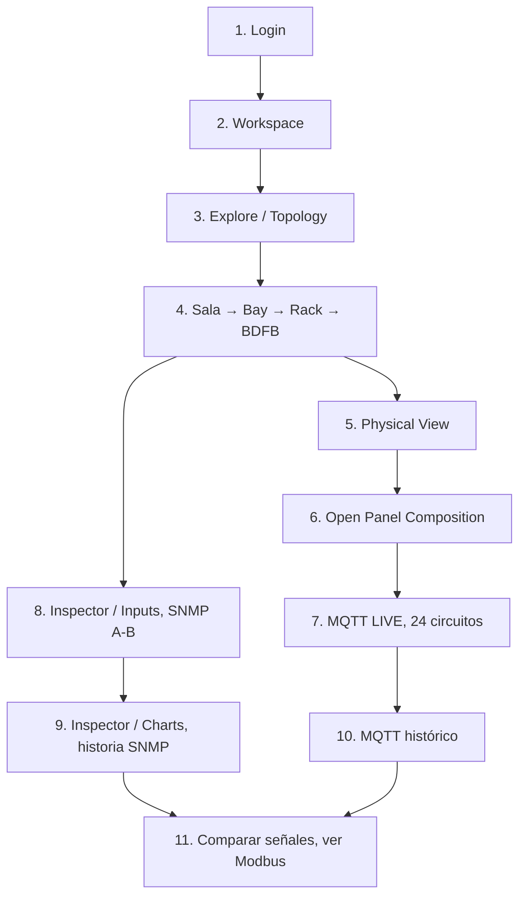
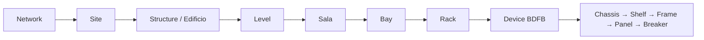
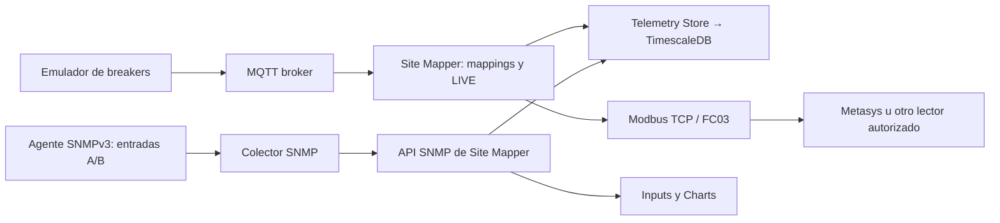

# Site Mapper: de Login a MQTT, SNMP, Timescale y Modbus

**Manual para una persona sin experiencia técnica.** Solo necesitas un navegador, una cuenta entregada por el administrador y acceso a la instalación autorizada. No es necesario saber Docker ni MongoDB para **consultar** el sistema.

> **Precaución:** los shunts SNMP de esta práctica son **simulados**, no mediciones de los equipos reales. Las fuentes MQTT LAB también son sintéticas. No declares cableados ni controladores físicos certificados.

## Mapa del recorrido

## Paso 1. Inicia sesión

1. En tu computadora de laboratorio abre **http://localhost:3000/login**. Si trabajas fuera de esa computadora, solicita la URL a tu administrador.
2. Introduce tu **correo electrónico** y **contraseña**. Pulsa **SIGN IN**.
3. Si aparece **Change password**, establece una contraseña nueva y vuelve a Login. Nunca publiques la contraseña en una captura.
4. Comprueba que llegaste a **Workspace**. Si regresas inesperadamente a Login, **no restablezcas MongoDB**; consulta con el administrador.

No hay registro público desde Login. [Primer acceso y usuarios](primer-acceso-y-usuarios.md).

## Paso 2. Reconoce el Workspace

- **Equipments (Primary)** cuenta dispositivos principales; no 96 breakers ni entradas SNMP.
- **Reporting** muestra dispositivos con telemetría vinculada reciente.
- **No recent data** indica falta de muestra reciente; no significa que el equipo esté eléctricamente apagado.
- **Direct access** permite abrir un BDFB fijado.
- **BDFB Power Overview** agrega potencia de equipos descendientes _MQTT_, no entrada SNMP independiente.

## Paso 3. Encuentra un BDFB

En **EXPLORE** o la barra lateral **TOPOLOGY**, despliega la jerarquía:

El laboratorio probado tiene **BDFB-01** en el rack original (Bay-01), **BDFB-02** en Bay-02 y **BDFB-03** en Bay-03. Si tu instalación tiene otros nombres, busca el equipo por su nombre en lugar de copiar IDs internos.

## Paso 4. Lee BDFB PHYSICAL VIEW

Selecciona el **Device BDFB**, no un breaker. En el panel central verás **CHASSIS**, **SHELF**, dos **FRAME** y cuatro **PANEL**, con **24 posiciones** cada uno.

- BDFB-01 original: solo **3 breakers instalados** y 93 posiciones vacías.
- BDFB-02 y BDFB-03 LAB: **96 breakers instalados por equipo** (cuatro paneles de 24).

En **Selected Panel · Circuit Positions**, `24 INSTALLED / 0 AVAILABLE` confirma **inventario**, no lectura en tiempo real. Nunca crees breakers extra solo para llenar casillas.

## Paso 5. Abre MQTT del panel

1. Pulsa **OPEN PANEL COMPOSITION →** en el panel elegido.
2. En **EQUIPMENT COMPOSITION** localiza **24/24 positions MQTT LIVE** cuando el emulador esté funcionando.
3. Lee la tabla: **POS**, **BREAKER**, **V · V**, **I · A**, **P · W**, **E · kWh** y **STATUS**.
4. Abre la pestaña lateral **Telemetry** para ver los promedios de los breakers descendientes; los espacios sin mediciones se excluyen.

**MQTT LIVE** significa que una fuente reciente fue asociada explícitamente al breaker. Las dos fuentes nuevas usan `LAB-BDFB-02` y `LAB-BDFB-03`, con cuatro grupos `0_1` a `0_4` de 24 circuitos. `STALE`, `UNMAPPED` y `OFFLINE` requieren diagnósticos diferentes.

## Paso 6. Abre SNMP de las entradas DC

Vuelve al **Device BDFB** y elige **INSPECTOR → Inputs**.

- **BDFB-01** validado: muestra `LAB SIMULATED`, dos shunts A/B y `LAB LIVE · SIMULATED`, con corriente y voltaje independientes. Ejemplo histórico visual: A = **228.90 A**, **-53.10 V DC**.
- **BDFB-02 / 03** antes de su incorporación SNMP: `PENDING` y `0/0` porque no tenían inventariadas entradas A/B. Tras ejecutar el nuevo comisionamiento **sintético de laboratorio** y arrancar sus colectores, deberían mostrar dos shunts simulados por BDFB. **No se debe afirmar éxito hasta comprobarlo en la pantalla.**

Las corrientes de los shunts SNMP **no** se obtienen sumando los amperios MQTT de los breakers. Son dos fuentes independientes, con distintas condiciones eléctricas.

## Paso 7. Comprueba las gráficas en TimescaleDB

En **INSPECTOR → Charts**:

1. Selecciona **SNMP · TIMESCALEDB HISTORY → 24H → Current**.
2. Observa las dos series **A (LAB)** y **B (LAB)** cuando existan muestras.
3. Cambia a **Voltage**, **Power** y **Energy**. La potencia se estima como `|V| × I`; la energía se integra solo sobre intervalos válidos, **no proviene de un contador SNMP real**.
4. Desplázate a **MQTT · DESCENDANT EQUIPMENT HISTORY** para ver la historia de los breakers, independiente de SNMP.

Una tarjeta `No samples stored for selected range` en SNMP **no invalida** la historia MQTT. Para la API se usa `window=24h` (minúscula), aunque el botón en pantalla diga **24H**.

## Paso 8. Entiende dónde entra Modbus TCP

Modbus es una **salida de lectura para integradores**; no se configura desde Inputs. El laboratorio comisionó Units **1–3 originales**, y agregó **4 = LAB-BDFB-02**, **5 = LAB-BDFB-03**. Los bloques FC03 de muestra en 4 y 5 se compararon **8/8 con tolerancias numéricas**. Eso no certifica todos los breakers, cableado ni Metasys físico.

## Paso 9. ¿Qué hacer si ves un error?

| Mensaje o señal             | Causa probable                           | Primera acción                            |
| --------------------------- | ---------------------------------------- | ----------------------------------------- |
| Login rechazado             | Credenciales, permisos o sesión          | Consultar al administrador                |
| MQTT LIVE pero SNMP PENDING | Breakers activos; shunts sin preparar    | Revisar Inputs, no alterar MQTT           |
| MQTT STALE                  | No hay muestra reciente                  | Consultar publicador y broker             |
| SNMP LAB LIVE               | Agente simulado enviando datos           | Validar que exista historia SNMP A/B      |
| SNMP 0/0                    | Sin puertos de entrada inventariados     | Solicitar comisionamiento de laboratorio  |
| Charts vacíos               | No hay muestras en ese protocolo/ventana | Cambiar señal o rango; comprobar colector |
| Modbus devuelve cero        | Puede ser cero real **o dato ausente**   | Validar estado y política de dato vencido |

## ¿Cuándo has aprendido lo necesario?

Debes poder **iniciar sesión, localizar tu rack y BDFB, distinguir inventario de medición reciente, abrir los 24 breakers de un panel, reconocer MQTT LIVE, abrir shunts SNMP A/B, encontrar ambos historiales y explicar para qué sirve Modbus** sin tocar configuraciones internas.

**Nunca ejecutar para “arreglar” una pantalla:** `docker compose down -v`, `docker volume rm`, `dropDatabase`, reemplazar identidades de fuentes, copiar OIDs de laboratorio como si fueran la MIB del equipo real o marcar un shunt sintético como físicamente verificado.

**Siguiente lectura:** [Encender y validar el laboratorio en WSL](../operations/laboratorio-industrial-para-principiantes.md) · [Manual de usuario completo](README.md) · [Capturas y evidencias](evidencia-visual.md).
