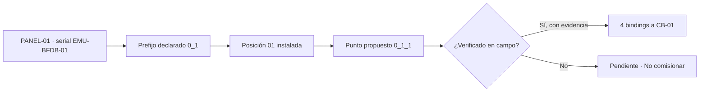
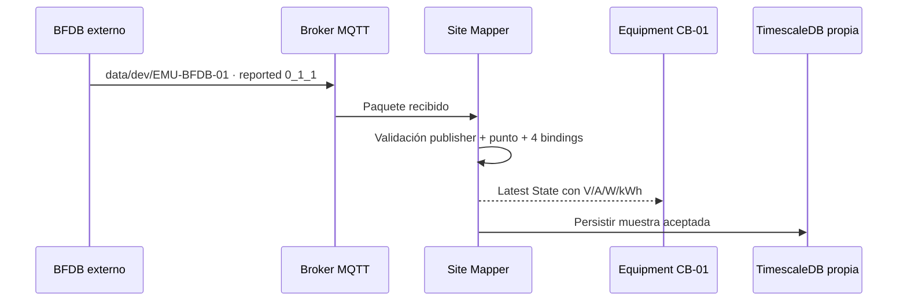

# 5 · Comisionar MQTT: asociar la señal al breaker correcto

**Objetivo:** poder seleccionar un Panel, revisar qué punto propone la plataforma para un breaker y **confirmar explícitamente** los cuatro bindings de ese equipo. No necesitas escribir un UUID ni editar MongoDB.

> Si el emulador o broker no está funcionando, aún puedes revisar el inventario y el estado de commissioning, pero **no** demostrar lecturas LIVE. Nunca inventes puntos de telemetría para completar el panel.

## Antes de pulsar Confirm

Un técnico debe disponer de:

- Un **PANEL** real del inventario con modo `POSITIONAL`, capacidad definida (ejemplo: 24) y un **publisher serial** confirmado, como `EMU-BFDB-01` **solo en el laboratorio**.
- Un `MQTT point prefix` declarado y comprobado (por ejemplo `0_1`).
- Un `CIRCUIT_BREAKER` ya instalado como Equipment en la posición correcta, por ejemplo la posición 01.
- Evidencia de que el publicador y el punto realmente miden **ese breaker**, no otro de la misma sala o panel.
- Permiso de edición de telemetría. Los controles de confirmación no aparecen si tu sesión es de lectura.

### Cómo interpretar el punto sugerido

`0_1_1` es **una propuesta basada en posición**, no una prueba de que el conductor esté cableado allí. Los datos MQTT pueden llegar perfectamente y aun así referirse a otro breaker si la correspondencia es incorrecta.

## Paso a paso en la interfaz

1. Navega al Equipment **Panel** correcto y abre su ficha (no la ficha del CB-01).
2. Busca la sección **MQTT POINT COMMISSIONING**. Debe mostrar **Source**, **prefix**, **capacity** y filas por posición instalada.
3. Localiza la fila `Position 1 · [nombre del breaker]` y verifica el `point` propuesto.
4. Revisa **existingMetrics** en su representación visual: `0/4 metric bindings` significa que no está comisionado; `4/4 metric bindings · VERIFIED MAPPING` indica que los cuatro bindings existen.
5. Si no está comisionado y no hay conflictos, marca la casilla **I verified that [source] / [point] physically measures this breaker** **solo después** de confirmar la correspondencia real.
6. Pulsa **Confirm and commission point**. Espera la respuesta y luego utiliza **Refresh commissioning** si necesitas renovar la vista.
7. Verifica que aparezca **4/4 metric bindings · VERIFIED MAPPING** en **esa misma posición**.
8. Abre la ficha del breaker (Equipment hijo) y comprueba **LIVE TELEMETRY → Own readings**. Si la fuente está publicando y el pipeline acepta sus mensajes, deberían aparecer los valores con hora, origen y punto.

La comisión relaciona individualmente `VOLTAGE`, `CURRENT`, `POWER` y `ENERGY`. **No** crea un PowerPath; los cables se registran en la lección anterior.

## ¿Qué significa cada número?

| Estado visible           | Interpretación                                                                |
| ------------------------ | ----------------------------------------------------------------------------- |
| `0/4 metric bindings`    | Ninguna de las cuatro métricas está vinculada                                 |
| `1/4`…`3/4`              | Asociación incompleta, revisar qué falta                                      |
| `4/4 · VERIFIED MAPPING` | Las cuatro asociaciones están registradas                                     |
| `CONFLICT`               | La fuente/punto/breaker tiene conflicto de pertenencia: no continuar a ciegas |
| `LIVE`                   | Hay una muestra reciente aceptada del Equipment                               |
| `NO DATA` o `UNMAPPED`   | No hay muestra utilizable o no existe vínculo aceptado                        |
| `STALE`                  | Existe información, pero su antigüedad ya no permite llamarla LIVE            |

**4/4 NO implica LIVE.** Es posible tener bindings correctos y un broker apagado, credenciales vencidas o un publisher sin datos.

## El origen de cada variable

La aplicación trabaja con las variables **voltaje (V)**, **corriente (A)**, **potencia (W)** y **energía (kWh)**. Las mediciones son datos observados, no una orden de energizar equipo. El motor Modbus del laboratorio es otra **salida** posible de estas muestras; no hace que el MQTT sea correcto por sí mismo.

## Si aparece CONFLICT

No corrijas un serial de otro Device, Shelf o Frame por comodidad. Revisa con el responsable del commissioning cuál Equipment tiene derecho a publicar bajo ese serial y si ya existe otro binding para el breaker. La interfaz contiene una acción **Retire SOURCE** para fuentes anteriores, pero es destructiva a nivel lógico y requiere validación expresa; **no forma parte del ejercicio de principiantes**.

## ¿Cómo verificarlo sin tocar la base?

Consulta desde la interfaz **LIVE**, luego cambia a **24H** y **7D**. El panel mostrará la hora de la última lectura que corresponde al Equipment. Las rutas HTTP administrativas utilizan valores sensibles a mayúsculas y minúsculas: `window=LIVE`, `window=24h`, `window=7d`, `window=15d` y `window=1M`. El operador de negocio **no necesita escribirlas**.

**Resultado aprobado:** identificar el Panel, fuente, posición, punto y breaker; mostrar 4/4 cuando esté validado y explicar qué falta cuando LIVE no aparece.

[Siguiente: comprobar estado y resolver errores](verificacion.md) · [Contrato MQTT técnico](../telemetry/contract.md).
