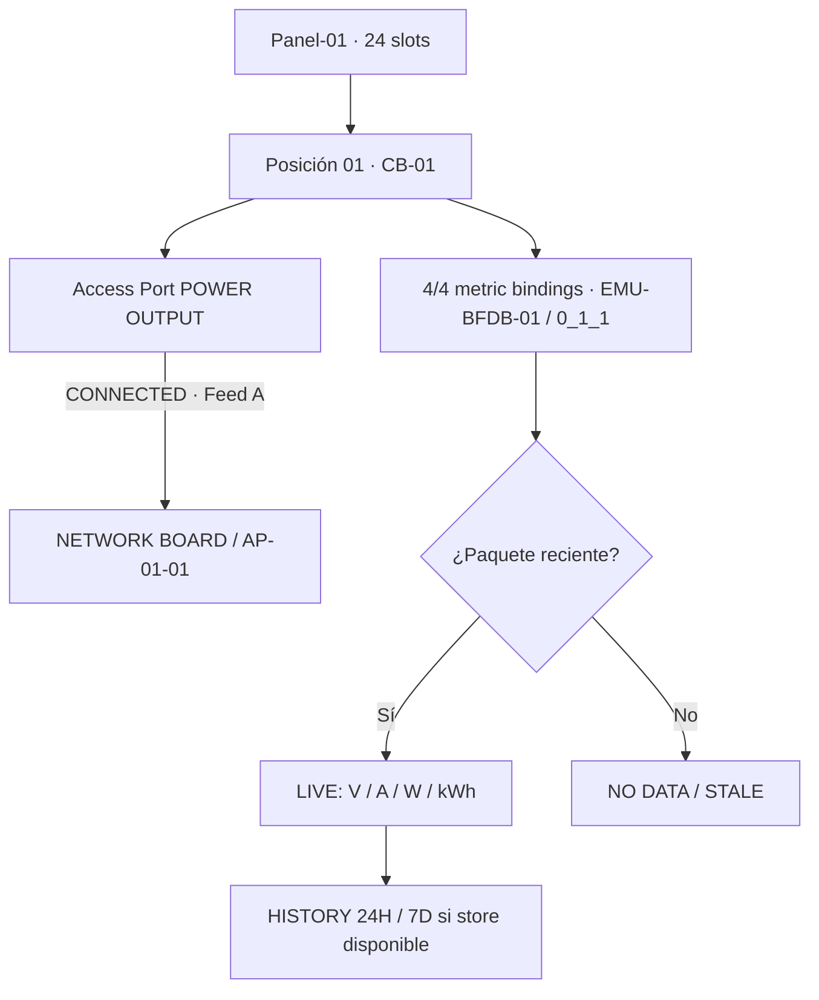

# 6 · Comprobar que todo funciona y entender los estados

**Objetivo:** aprender a evaluar lo que está registrado y lo que realmente está midiendo el sistema. Site Mapper no considera equivalentes inventario, cableado declarado, fuente MQTT, histórico y lectura Modbus.

## Cinco evidencias independientes

| Evidencia            | Dónde la compruebas                                          | Qué demuestra                                            | Qué NO demuestra                                             |
| -------------------- | ------------------------------------------------------------ | -------------------------------------------------------- | ------------------------------------------------------------ |
| **Inventory**        | Árbol global, Rack, Equipment                                | Que el objeto existe y tiene ubicación lógica            | Que esté montado o cableado físicamente                      |
| **Placement**        | Blueprint / Rack Elevation / CAS                             | Que una ubicación/asignación está registrada             | Que la carga tenga energía                                   |
| **PowerPath**        | Terminal **CONNECTED**, **VIEW POWERPATH**, Full Power Trace | Que dos Access Ports fueron enlazados en el inventario   | Que el hardware esté energizado o haya redundancia           |
| **MQTT 4/4**         | Panel → MQTT POINT COMMISSIONING                             | Que cuatro métricas se asignaron a un breaker específico | Que haya un paquete reciente                                 |
| **LIVE + histórico** | Equipment → LIVE TELEMETRY, HISTORY                          | Que llegaron lecturas aceptadas y/o persistidas          | Que el sensor real sea preciso sin calibración/certificación |

## Ejemplo visible de CB-01

La evidencia mostrada en octubre de 2026 cubrió **un breaker en el laboratorio**, no una sala entera ni todos los breakers del Panel.

## Verificación cotidiana (sin consola ni terminal)

1. Abre el Equipment que quieras revisar, no solo el Device padre.
2. Mira **ACCESS PORTS**: si está ocupado, debe indicar **CONNECTED**, extremo opuesto y **VIEW POWERPATH**. Si el destino es incorrecto, **no** crees otra conexión en paralelo.
3. Abre **FULL POWER TRACE** para observar Feed A y B por separado. **VERIFIED** en una ruta no significa redundancia general si la otra ruta está vacía.
4. Revisa **LIVE TELEMETRY → Own readings**. Cada valor debe conservar **unidad**, **fuente** y **fecha/hora de observación/recepción**. No compares datos separados por minutos como si fueran simultáneos.
5. Selecciona **24H** y **7D** para revisar histórico. Un gráfico histórico con muestras antiguas no convierte el estado actual en LIVE.
6. Si no llegan datos, distingue **fuente desconectada**, **binding ausente**, **muestra vencida** o **servicio histórico no disponible**. No modifiques PowerPaths para intentar reparar MQTT.

## Mensajes comunes y acciones seguras

| Pantalla o mensaje                 | Significado práctico                                         | Qué hacer                                                              |
| ---------------------------------- | ------------------------------------------------------------ | ---------------------------------------------------------------------- |
| `SOURCE_ALREADY_CONNECTED`         | El OUTPUT ya alimenta un destino registrado                  | Abrir **VIEW POWERPATH**, verificar destino; no crear una segunda ruta |
| `TARGET_ALREADY_CONNECTED`         | El INPUT ya está ocupado                                     | Abrir la ruta existente y consultar al responsable del inventario      |
| `FEED_MISMATCH`                    | Extremos fijados a vías A/B incompatibles                    | Revisar contrato físico; no cambiar feed por ensayo                    |
| `4/4 · VERIFIED MAPPING`, sin LIVE | Los bindings existen, no hay lectura reciente                | Verificar emisor MQTT, broker y fuente con el administrador            |
| `UNMAPPED`                         | No hay una asociación aceptada para el Equipment             | Revisar el commissioning del Panel si se conoce el circuito            |
| `NO DATA`                          | No hay una muestra utilizable                                | Esperar o comprobar diagnóstico de la fuente                           |
| `STALE`                            | La última muestra está vencida                               | No tratar como energía instantánea; comprobar frescura                 |
| `HISTORY_STORE_UNAVAILABLE`        | No se pudo consultar el almacenamiento histórico             | Notificar al administrador; no borrar base de datos ni bindings        |
| `Last matching packet: —`          | La vista no pudo presentar una lectura que corresponda       | No significa necesariamente que los datos se hayan eliminado           |
| `Power B · No recorded path`       | No hay una segunda vía registrada                            | No declarar redundancia A+B                                            |
| `Placement: ... not mounted`       | Existe contexto de Rack, pero falta registrar montaje físico | Revisar CAS/Rack; no falsear estado “montado”                          |

## Qué debe reportar el operador

Para evitar reportes ambiguos como “no funciona MQTT”, informa **qué pantalla**, **qué Equipment**, **qué hora**, **qué dato esperabas** y **qué estado apareció**. Ejemplo:

> “En Panel-01 / CB-01, fuente EMU-BFDB-01, punto 0_1_1, el commissioning marca 4/4 pero LIVE aparece STALE desde las 10:25. El PowerPath A continúa CONNECTED al NETWORK BOARD. No modifiqué el inventario.”

No envíes en capturas contraseñas, cookies, URIs privadas del broker ni datos de cliente sin autorización.

## Para administradores: comprobación ampliada

El operador estándar no necesita estos endpoints. Si el incidente escala, el administrador puede usar las vistas de diagnóstico y los runbooks:

- [MQTT y Modbus de laboratorio](../operations/mqtt-modbus-lab.md).
- [Conectividad de histórico](../operations/history-connectivity.md).
- [Cardinalidad de los PowerPaths](../operations/power-port-cardinality.md).
- [MVP Readiness](../release/MVP-READINESS.md).

**Resultado aprobado:** explicar por qué pueden coexistir **Power A: Path recorded**, **Power B: No recorded path**, **bindings 4/4**, **LIVE** y **Placement: not mounted** sin que esos estados sean contradictorios.

[Siguiente: práctica completa de reconocimiento](practica-guiada.md).
